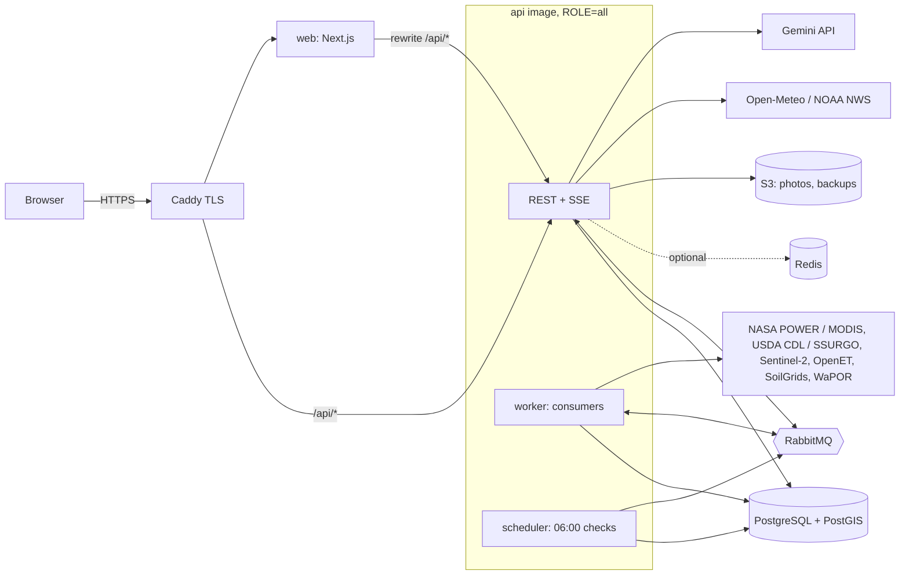

# Terrasight

An AI assistant for agronomists: daily, explained recommendations per field (pest and disease risk, irrigation, sowing windows, alerts) and 5-season crop rotation planning (2026–2030; the headline is the decision for next season), built on 18 seasons of NASA, USDA and ESA open data. The farmer gets a simple shared report.

Built for the NASA Space Apps Challenge 2026, challenge _"Field Shift: Adapting Farms with NASA Data"_. Languages: Ukrainian and English.

- **Morning brief:** every field is re-checked at 06:00 (and on demand, **Analyze fields**); the home page shows what to do first, with the evidence (top factors, confidence, data tier, sources).
- **Rotation planner:** 5-season scenarios from the rotation library and AI-proposed sequences, simulated with FAO-56 / FAO-33 water balance, SCS-CN, ICBM and a Monte Carlo of 150 weather runs × 10 price scenarios. Numbers come from the models, never from the AI.
- **Assistant:** Gemini with function calling over our tools; every number in an answer must match a tool result.
- **Roles:** Owner (the company's owner: users, decisions, report links) and Agronomist (field work; asks the owner).
- **Scouting, owner decisions, zones and work log, work windows**, owner report links without an account.

## Quick start

Requirements: Docker, Node 26 (`.nvmrc`), pnpm 10 (`corepack enable`).

```bash
# Whole stack in containers: PostGIS, RabbitMQ, Redis, migrations, api (:4000), web (:3000)
docker compose -f infra/docker-compose.yml up --build
# open http://localhost:3000 and create a company; optional field-preview boundaries (downloaded once):
docker compose -f infra/docker-compose.yml exec api npm run boundaries:load
```

Without Redis: `docker compose -f infra/docker-compose.yml up --build --scale redis=0` and unset `REDIS_URL`.
Behind a private npm mirror, build the images first with `--secret id=npmrc,src=$HOME/.npmrc` (see the header of `infra/docker-compose.yml`).

Develop outside Docker:

```bash
pnpm install
cp .env.example .env                                  # adjust; add GEMINI_API_KEY etc. to enable more
docker compose -f infra/docker-compose.yml up postgres rabbitmq redis
pnpm --filter @terrasight/api db:migrate
pnpm dev                                              # api :4000, web :3000
```

## Commands

| Command | What it does |
| --- | --- |
| `pnpm dev` / `pnpm build` | Run everything in watch mode / build all packages and apps (Turborepo) |
| `pnpm lint`, `pnpm typecheck`, `pnpm test` | ESLint, `tsc --noEmit`, Vitest (unit) |
| `pnpm test:integration` | Testcontainers suites (needs Docker) |
| `pnpm library:check` | Rebuild-check and validate `data/rotations.json` v2, region test points, pest models, prices |
| `pnpm i18n:check` / `pnpm i18n:build` | UA/EN message keys complete and up to date / regenerate |
| `pnpm golden` | Replay recorded assistant "golden questions" (number check, filters, 5-season horizon) |
| `pnpm --filter @terrasight/api test:contract` | Postman contract tests against a running API (Postman CLI) |
| `pnpm --filter @terrasight/e2e e2e` | Cypress P0 path against `http://localhost:3000` (or `CYPRESS_BASE_URL`) |
| `pnpm --filter @terrasight/api boundaries:load` | Load Natural Earth counties / admin-1 for field previews |
| `node apps/api/scripts/record-fixtures.mjs <workspace-id>` | Record real source responses as offline fixtures |
| `pnpm audit --prod --audit-level high` | Dependency audit (also in CI, non-blocking) |

CI (`.github/workflows/ci.yml`): checks, integration, Postman contract tests, docker build of both images, `pnpm audit`, secret scan. `e2e.yml` runs the Cypress P0 path nightly on the compose stack (and on demand).

## Environment variables

Copy `.env.example` to `.env` for runs outside Docker. In production, secrets live in SSM Parameter Store (`infra/prod/ssm-env.sh`); never commit them.

| Variable | Default | Purpose |
| --- | --- | --- |
| `NODE_ENV` | `development` | `production` turns on secure cookies and JSON logs |
| `ROLE` | `all` | `api`, `worker`, `scheduler` or `all`: which parts run in this process |
| `PORT` | `4000` | API port |
| `LOG_LEVEL` | `info` | pino level; every request line carries `req.id` (also the `X-Request-Id` response header) |
| `DATABASE_URL` | required | PostgreSQL + PostGIS |
| `RABBITMQ_URL` | required | Jobs and progress events |
| `REDIS_URL` | unset | Optional hot cache, rate limits; without it in-process fallbacks run |
| `WEB_ORIGIN` | `http://localhost:3000` | CORS origin of the web app |
| `JWT_SECRET` | required | HS256 key for 15-minute access tokens, at least 32 characters |
| `GEMINI_API_KEY`, `GEMINI_MODEL` | unset, `gemini-3.5-flash-lite` | Assistant and AI-written texts; without a key the assistant says "unavailable" |
| `AI_ROTATIONS`, `AI_RECOMMENDATIONS` | on when a key is set | `0` / `1` to switch AI-proposed rotations and AI-written recommendations |
| `OPEN_METEO_API_KEY` | unset | Commercial Open-Meteo key (the free endpoint is non-commercial) |
| `OPENET_API_KEY`, `EARTHDATA_TOKEN`, `CDSE_CLIENT_ID`, `CDSE_CLIENT_SECRET` | unset | Source credentials; sources report "not configured" without them |
| `EARTHDATA_TOKEN` | unset | Optional. NASA Earthdata bearer token for the GPM IMERG rainfall check (an independent check of POWER rainfall, EP-10); without it the check reports "unavailable" |
| `S3_BUCKET`, `AWS_REGION` | unset, `us-east-1` | Scouting photos (else `UPLOADS_DIR`) and backups |
| `DATA_DIR`, `UPLOADS_DIR`, `FIXTURES_DIR` | `data/`, `uploads/`, `fixtures/` | Library data, local uploads, recorded fixtures |
| `PLAN_FIRST_SEASON` | `2026` | First season of the 5-season horizon |
| `AUTH_RATE_BURST` | `10` | Sign-in/sign-up burst per IP (raised in CI and E2E only) |
| `SENTRY_DSN`, `SENTRY_ENVIRONMENT`, `SENTRY_RELEASE` | unset | Optional API error reporting (`@sentry/node`, loaded only when the DSN is set) |
| `API_URL` | `http://api:4000` | Web build/runtime: where Next.js proxies `/api/*` |
| `NEXT_PUBLIC_BASEMAP_TILES`, `NEXT_PUBLIC_BASEMAP_ATTRIBUTION` | EOX Sentinel-2 cloudless 2016 | Web build-time basemap override (an XYZ template) |
| `NEXT_PUBLIC_SENTRY_DSN` | unset | Web build-time: tiny browser error reporter |

## Architecture



Monorepo (pnpm + Turborepo): `apps/web` (Next.js App Router, MapLibre), `apps/api` (NestJS, Prisma), `apps/e2e` (Cypress), `packages/shared`, `library`, `sources`, `simulator`, `scenario-engine`, `evaluators`, `assistant-core`, `ui`. Data tiers: A Full data (US), B Basic data (EU), C Estimate (global, incl. Ukraine).

## Where things are

| What | Where |
| --- | --- |
| Product definition (scope, users, priorities; source of truth) | [`docs/01-product-definition.md`](docs/01-product-definition.md) |
| RFC (proposed solution, decisions) | [`docs/02-rfc.md`](docs/02-rfc.md) |
| Tech design (architecture, data model, API, testing, deploy) | [`docs/03-tech-design.md`](docs/03-tech-design.md) |
| Epics and stories | [`docs/epics/`](docs/epics/README.md) |
| Design handoff (screens, tokens, UA/EN copy) | [`design/README.md`](design/README.md) |
| Demo host runbook (deploy, rollback, backups, monitoring) | [`docs/runbook-demo-host.md`](docs/runbook-demo-host.md) |
| Demo script | [`docs/demo-script.md`](docs/demo-script.md) |
| Competitor analysis | [`docs/competitor-eos.md`](docs/competitor-eos.md) |
| Data sources and licences | [`THIRD-PARTY-NOTICES.md`](THIRD-PARTY-NOTICES.md) |
| Rotation and pest libraries | `data/rotations.json` (113 rotations), `data/pests.json` (62 entries); rebuild with `python3 tools/build_rotations_v2.py` |

## License

Not decided yet (the team will add one). Third-party data and library terms: [`THIRD-PARTY-NOTICES.md`](THIRD-PARTY-NOTICES.md).
