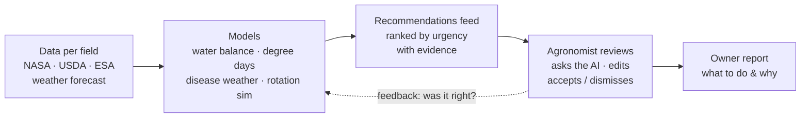

# Terrasight — Product Definition (v2.13)

| | |
| --- | --- |
| **Status** | Draft v2.13 — **supersedes v1** (direction change on 2026-11-14) |
| **Date** | 2026-11-15 |
| **Stage** | 1 of 3 — Product Definition → RFC → Tech Design |
| **Context** | NASA Space Apps Challenge 2026, *Field Shift: Adapting Farms with NASA Data* |
| **What changed from v1** | Terrasight is now an **AI assistant for agronomists**. It gives data-based recommendations across the season (pests, diseases, irrigation, sowing windows, weather alerts) and keeps **rotation planning as a core feature**. The farmer gets a simple shared report instead of a full app. |
| **What changed in v2.1** | One workspace = **one farming company** with many fields, possibly in several regions. All fields are re-checked every morning at 06:00 and on demand (**Analyze fields**), with checks that follow the season. The home page groups fields by urgency. Demo set: the Ukrainian example is replaced by wheat streak mosaic virus in Colorado (§12) |
| **What changed in v2.2** | Competitors & differentiation (EOSDA Crop Monitoring, §7); new requirements: scouting tasks, stable zones, yield range, work log, integrations (§9); non-goals updated: zones are in scope, prescribing rates is not, open imagery only. Full analysis: [`competitor-eos.md`](competitor-eos.md) |
| **What changed in v2.3** | Rotation horizon is **5 seasons (2026–2030)** instead of 10. The headline is the decision for next season; the 5-season comparison is its evidence; the plan is recomputed every autumn (§5, Rotation horizon) |
| **What changed in v2.4** | Design review outcomes (v2.4.1: wording aligned across the whole document): urgency rules (§9), confidence on every home card, partial-failure state of **Analyze fields**, first-run onboarding and empty home, notifications, Fields map, rotation call to action, scouting completion and ownership, "Owner report" naming, honest "Coming soon" for integrations; review decisions in §12 (6–10) |
| **What changed in v2.13** | **Field Shift: climate evidence (2026-11-15):** the product now answers the challenge on the first screen. (1) **Climate shift of the field:** NASA POWER 1981–2025 compared between two periods (1981–2000 and 2006–2025), with the Theil–Sen slope per decade and the Mann–Kendall test; when the trend is not significant the block says **"no clear trend"** plainly. (2) **Rotation ranking under weather year sets** (all years, climate 1981–2000, last 15 years, trend continued to 2030) as a **sensitivity analysis, not a forecast**; the recommendation stays computed on all years. (3) **Hindcast page "How far can you trust this":** the model run on past seasons against USDA NASS county yields and field NDVI, with the real correlation, the real error and the missed years with their reason, plus a **2018–2022 retrospective** of the current and the recommended rotation at today's prices (P1). (4) **Public page without sign-up:** climate for any clicked point, and the rotation for a few ready outlines of real fields, all computed live from real data. This **amends v2.6**: there is still no demo company and no invented values; the only exception is ready outlines of real fields with live data on the public page. (5) **"What NASA data contributed here"** block on recommendations and rotations, built from the data actually used. (6) **Farm stress test:** one number for a repeat of 2022 across all fields, for the current and the recommended plan. (7) **Data:** NASA GPM IMERG is connected as a rainfall check (P1); **SMAP is removed** from the docs and copy because it was never used; USDA NASS county yields are fetched with a key (NASS prices stay values typed in from the 2025 report). (8) A **3-minute demo script** replaces the 8-step one. The 5-season rule (2026–2030) applies to the plan; climate shift and hindcast look back. Scope: EP-10 ([`epics/EP-10-field-shift.md`](epics/EP-10-field-shift.md)), requirements FR-CS-1, FR-CS-2, FR-TR-1, FR-TR-2, FR-NA-1, FR-ST-1, FR-PB-1, FR-GP-1 (§9) |
| **What changed in v2.12** | **One user = one company (2026-11-15):** an agronomist works in only one company, so **invitations are removed** (endpoints, email, `/invite` page, `invitations` table). Users exist only because their company's **Owner creates them** (Team page or onboarding step 2: name, email, role → a one-time setup link valid 7 days, shown once). An email that **already has an account is refused** ("This email is already used by another account", `email-in-use`); nobody is added silently or invited. Creating a second company is refused (`one-company`) and there is no company switcher. Removing a member **deletes their account** (sessions included; their past work stays in the company). **Email verification is removed** (it only guarded invitation acceptance): sign-up creates the account at once (the response stays uniform, so addresses can't be enumerated; the web app then signs in with the same credentials), while **password reset** (forgot / reset by email link) stays and still needs SMTP. Report links (public owner links) are unchanged |
| **What changed in v2.11** | **Recommendations are also written by AI (2026-11-15):** the models still decide risk levels, key numbers and deadlines; the assistant (Gemini, structured output) then **writes the title, action and reason** of each recommendation for the field (EN + natural UK) from those facts, the pest library and the weather summary. Every text passes the number check (each number must be among the provided facts) and the safety filter (risk, not diagnosis; never products or doses); on any failure the **template text** is shown. It may also add up to 2 **"Worth a look"** watch-items for library pests that have **no verified model** (no risk level, no numbers, labelled "Suggested by the assistant · no verified model"; never Urgent), and writes the one-sentence **day summary** of the brief. AI-written items carry a small AI marker. One batched call per field check, cached by facts hash; `AI_RECOMMENDATIONS=0` turns it off |
| **What changed in v2.10** | **Two roles (2026-11-15):** the **Admin** and **Viewer** roles are removed; only **Owner** and **Agronomist** remain. **Owner** = the farming company's owner: creates users (owners or agronomists), manages the company, report links and billing, **answers decisions** (Approve / Not now / Ask…) and sees everything; may also do field work but never sees "Ask the owner". **Agronomist** does the field work and **asks the owner**; cannot manage users, the company or links, and cannot answer decisions. Existing Viewers and Admins become Owners (Viewers were the farm owners reading decisions; Admins keep their management rights). Decisions go to Owners. Onboarding step 2 becomes **Add your agronomist** (create the user, copy the one-time setup link; skippable) |
| **What changed in v2.9** | **Roles revised (2026-11-15):** **Owner = the farming company's owner.** The Owner **creates the company's users** (name, email, role → a one-time "set your password" link valid 7 days, shown once; an existing account is just added) instead of inviting by email; sees everything and **answers decisions** (Approve / Not now / Ask…); never sees "Ask the owner" actions. **Agronomist** does the field work and asks the owner. **Admin** (optional) helps manage users and settings. **Viewer** reads (e.g. a manager) and may answer decisions. Decisions go to Owners and Viewers. The sidebar can be collapsed |
| **What changed in v2.8** | **AI-proposed rotations (2026-11-15):** besides the rotation library, the assistant (Gemini) proposes 3–5 crop sequences for 2026–2030 from the field's own data (crop history, soil, climate, region, irrigation, crops with verified prices) with a short rationale. Every proposal passes rule checks (only modelled crops with verified prices, no forbidden host repeats, irrigation requirements) and is simulated by the same engine (150 weather runs × 10 price scenarios); **all numbers come from the models, never from the AI**. Shown as "Proposed by the assistant" next to library options |
| **What changed in v2.7** | **Owner decisions replace the Owner report (2026-11-15):** **Accept** puts advice into the agronomist's own plan and no longer reaches the owner. A separate, deliberate **Ask the owner** (with an optional note, 8 s Undo) is used only for items that need the owner's approval (money, seed, a rotation change). Each becomes a **decision card with a thread**: advice snapshot → agronomist note → owner **Approve / Not now / Ask…** → agronomist reply (draft from the item). The owner's home is "N decisions need you"; report links open the same view without an account. The monthly report and "Accept and add to the report" are gone. Contract: `packages/shared/src/decisions.ts` |
| **What changed in v2.6** | **No demo and no example data in the product (2026-11-15):** no demo company ("Explore the demo company" removed), no greyed example card on the empty home, no static mock of zones or yield. The field tab "Zones & yield" becomes **Work log** (real events only) until FR-ZN-1 / FR-YF-1 are built on real data (§9). **(v2.13)** FR-ZN-1 and FR-YF-1 are now built on real data; the rule itself stays, with one exception: ready outlines of real fields with live data on the public page; no demo company, no invented values (FR-PB-1) |
| **What changed in v2.5** | (v2.5.2: rotation library v2, 113 rotations in 24 regions and 34 countries (§8); field-brief numbers that can be computed in November (§9); Chase County, NE → `us-central-high-plains` (§12).) (v2.5.1: region = county in the UI, neutral-data wording, a P0 hero example, dates by UI language, competitor sources pending) Competitor research beyond EOS (§7); the **morning brief** home and in-card Accept / Snooze with Undo (§9); field-page brief, scouting map with a bottom sheet, mobile home and dark theme (§9); the **v4 design system** (§9, Design system); neutrality as a product principle (§10); decisions 11–15 (§12) |

---

## 1. Summary

Terrasight is an AI assistant for agronomists. For every field they manage, it watches NASA, USDA and ESA data and turns it into **specific, explained recommendations**, for example:

- "Rootworm risk is high on Pivot 12: corn after corn, and egg hatch is near."
- "Fusarium risk for the wheat on North strip: humid days are forecast during flowering."
- "Irrigate Pivot 14 within 3 days: the soil water is at 45% of what the crop can use."
- "For 2026, consider an alfalfa-based rotation instead of corn ×2."

The agronomist can ask the assistant questions in plain language ("Why is the risk high?", "What changes if I sow a week later?") and get answers grounded in the field's own data. Every number comes from our models and data, never from the AI's imagination. **(v2.13)** "Our data" includes cited public data shown as such, for example county yields in the hindcast.

The agronomist approves what goes into the report. The company's owner or manager sees a simple, shared report: what to do on which fields and why.

---

## 2. Problem

**An agronomist at a farming company is responsible for dozens to hundreds of fields, often spread across regions (e.g. Kansas, Colorado, Nebraska). They can't watch weather, crop stage, pest pressure and soil water for every field every day, so advice comes late or generic.**

- **Too many fields, too little time.** Scouting every field weekly is impossible; problems are found when damage is already visible.
- **The signals exist but are scattered.** Weather (NASA POWER), plant condition (MODIS, Sentinel-2), soil water (models; v2.13: SMAP was never used and is removed), crop history (USDA CDL) and pest models (university extension) live in different tools.
- **Climate shifts the timing.** Pests emerge earlier, heat hits at flowering, droughts last longer. Calendar-based habits miss this.
- **Advice has to be defended.** Owners ask "why?". An agronomist needs the evidence for each recommendation, not just an alert.
- **Long-term decisions are made by habit.** Crop rotation is chosen from memory, though the field's 18-year history says a lot about its risks.

### Challenge fit

| Challenge requirement | How Terrasight meets it |
| --- | --- |
| Help farmers explore crop rotations | Rotation planner: 5-season scenarios per field (2026–2030), headed by the decision for 2026 |
| Compare at least 3 strategies, including the current one | Current rotation detected from history + 2 alternatives |
| Explain why each was suggested | AI explanation grounded in the field's history and model results |
| Show evidence, benefits, gaps and risks | Every recommendation card has evidence, benefits, data gaps and risks |
| Use NASA data | POWER (weather) and MODIS (vegetation) drive the results; GPM IMERG checks rainfall (v2.13; SMAP removed, it was never used). Each conclusion lists the NASA dataset it rests on (FR-NA-1) |

In-season advice (pests, diseases, irrigation, alerts) goes beyond the challenge. It shows that the same data and the same explanation engine serve the agronomist all year, not just once per rotation.

---

## 3. Users

**Primary user: the agronomist / crop advisor.** The company's owner decides: they answer the agronomist's questions and manage the team.

| User | Context | Job to be done | Surface |
| --- | --- | --- | --- |
| **Agronomist / crop advisor** (primary) | Works inside one farming company; dozens to hundreds of fields across regions; plans seasons; answers the owner's questions | "Tell me which of our fields need attention today and why, with evidence I can show the owner." | Desktop workspace + mobile in the field |
| Company owner / manager | Pays and decides; little time | "Tell me what to do on our fields and why, in plain words." | **Decisions** (Approve / Not now / Ask…, simple, mobile-first) as an **Owner**, or the no-account report link |
| Farm staff | Executes work | "What do I need to do this week?" | Shared report |
| External reader (bank, insurer) | Receives a field passport | "Is this field managed with a credible plan?" | Shared PDF / link |
| **Judge / outside reader** (v2.13) | Has no account and little time; wants to check the product on a place they know | "Show me what has changed on this land and whether I can trust the model." | The public page `/explore`, no sign-up (FR-PB-1) |

### Roles

| Role | Permissions |
| --- | --- |
| **Owner** (Власник) | The farming company's owner. Creates users (owners or agronomists), manages the company, report links and billing, can delete the workspace; **answers decisions** (Approve / Not now / Ask…); sees everything. May also do field work, but never sees "Ask the owner" |
| **Agronomist** (Агроном) | Field work: fields, **Analyze fields**, accept / snooze, assistant, scouting, plans, **Ask the owner**, replies in decision threads. Cannot manage users, the company or links, and cannot answer decisions |

Only these two roles exist (v2.10; Admin and Viewer were removed). The Owner creates the other users on the Team page (v2.12: there are no invitations; an email that already has an account cannot be added).

- **One workspace = one farming company** with all its fields, which may lie in different regions (e.g. Kansas, Colorado, Nebraska). Every field belongs to the company (§12, decision 3).
- The agronomist works inside the company's workspace. The owner answers decisions as an **Owner**. Whoever pays for the workspace holds the Owner role; it can be the same person as the agronomist, and a company can have several Owners.
- **One user = one company (v2.12).** A user belongs to exactly one workspace and there is no company switcher. An agronomist who works for several companies has a separate account (and email) for each. The Owner removing a member deletes that account.
- The report for the company's owner or manager is called the **Owner report** in the UI. Older text in this document may say "farmer report"; it means the same thing.
- **Scouting** is done by the agronomist in the hackathon. Assigning a scouting task to farm staff through a link is P2 (§12, decision 6).
- **Platform admin** is an internal Terrasight role.

---

## 4. Core loop

0. **Create the company** (first run, 2 steps): company name, **time zone** (detected; it sets the 06:00 morning check), units (ha °C mm / ac °F in), report language; then **add your agronomist** (name and email; Terrasight creates the account and shows a one-time setup link to copy; optional, can be done later on the Team page). The home page shows an empty state until the first field is added (§9, First run).
1. **Add fields.** Draw or import boundaries; Terrasight reconstructs 18 seasons of history (as in v1).
2. **Morning check and on-demand analysis.** Every morning at **06:00** (workspace time zone), Terrasight re-checks all fields: weather, crop stage, soil water and the risk models that matter **in the current season** (§5, Seasonal checks). The agronomist can also run **Analyze fields** at any time, for all fields or selected ones. Each field shows its progress, and the run ends with a summary: "8 fields checked, 1 new recommendation". The home page shows when the last analysis ran.
3. **Home page.** All the company's fields, grouped by urgency (**Urgent / This week / All good**): what, where, how urgent, why, what evidence, how confident (§9, Home page).
4. **Ask the assistant.** "Why?", "What if I wait a week?", "Compare with last year", "Draft a message for the owner".
5. **Decide and share.** The agronomist accepts, edits or dismisses each recommendation. Accepted ones go to the Owner report.
6. **Scout and learn.** A pest or disease recommendation can become a scouting task (FR-SC-1). The scouting result updates the field's risk, because observed beats modelled (FR-SC-3), and the outcomes tune thresholds per region over time.

---

## 5. Recommendation types

| Type | What it says | Main signals | Hackathon |
| --- | --- | --- | --- |
| **Crop rotation** (core) | What to grow next season (2026) and why, backed by a 5-season comparison (2026–2030) of 3 options; recomputed every autumn | 18-year history (CDL/NDVI), weather (POWER), soil (SSURGO/SoilGrids), prices; Monte Carlo simulation | **P0** |
| **Pest risk** | Risk level + when to scout, for key pests of the crop | Degree days from POWER temperature; rotation history (e.g. corn after corn); crop stage | **P0** (2–3 pests) |
| **Disease risk** | Risk level during sensitive crop stages | Temperature, humidity, rain and leaf-wetness proxies from POWER + forecast; previous crop residue | **P1** (1–2 diseases) |
| **Irrigation timing** | When and how much to irrigate | Daily FAO-56 water balance, crop stage, forecast rain (v2.13: SMAP check removed, never used) | **P1** |
| **Sowing & cover-crop windows** | Best dates to sow or to plant a cover crop | Soil temperature and moisture, frost risk, harvest date of previous crop | **P1** |
| **Weather & stress alerts** | Heat, frost, drought warnings with what to do | Forecast + crop stage sensitivity | **P1** |

### Rotation horizon (v2.3)

The planner compares the current rotation and 2 alternatives over **5 seasons (2026–2030)**. **The agronomist's actual decision is the next season**; the 5-season plan is the evidence for it. Terrasight recomputes the plan every autumn, after the season's harvest data arrives.

Why 5 seasons:

- **Long enough to be fair.** 5 seasons cover a full alfalfa cycle (3 years of alfalfa + 2 years of corn that benefit from it) and at least one full cycle of 2- and 3-crop rotations. With 3 seasons or fewer, perennials always lose, because year 1 carries the establishment cost and the payback comes later. The planner would wrongly favour continuous corn.
- **Short enough to trust.** Prices, climate and tenure change; years 6–10 were mostly guesswork, and many US farmland leases run 1–3 years.
- **Easy to explain:** "a 5-year plan, a decision for next season".

How it is shown:

- The rotation screen's headline is **"Recommended for 2026: <crop>"** (or **"Your choice for 2026"** after the agronomist picks another option, §9). The 5-season comparison sits below it as evidence.
- Margins are $/ha per year, averaged over the 5 seasons. The 5-season cumulative margin is the **sum of the 5 simulated yearly margins**, with no extrapolation. **(v2.13)** "No extrapolation" means margins are never extrapolated: every margin is simulated. The weather year set "trend continued to 2030" shifts only the weather (temperature and rainfall from significant trends) and is labelled a **sensitivity analysis, not a forecast** (FR-CS-2). A rotation whose cycle doesn't divide 5 is simulated for exactly 5 seasons, with no padding.
- The cumulative chart shows **year-by-year points**, so an alfalfa option's year-1 dip and later payback are visible. The shape comes only from the simulation; nothing is hard-coded.
- Soil carbon (ICBM) and erosion are shown as a **trend** (up / down + value), because 5-season changes are small.
- Every screen and every assistant answer says "5 years" / "2026–2030". The assistant never says "10 years". **(v2.13)** The 5-season rule applies to the plan; the climate shift (1981–2025) and the hindcast look back and say so.

### Seasonal checks

What Terrasight checks depends on the season and on each field's crop and stage. Example for the Great Plains (Kansas, Colorado, Nebraska):

| Season | Checks |
| --- | --- |
| Winter (Dec–Feb) | Winter-kill and frost on winter wheat; winter erosion on bare fields; next-year rotation |
| Spring (Mar–May) | Sowing windows for corn, sorghum and soybean (soil temperature and moisture); wheat diseases at heading and flowering; BYD and wheat streak mosaic symptoms to scout; frost after emergence |
| Summer (Jun–Aug) | Rootworm egg hatch and beetles; irrigation timing; heat and drought at flowering; spider mites in hot, dry spells |
| Autumn (Sep–Nov) | **November, for example:** next-year rotation; cover crops after harvest; aphids (BYD) and the volunteer-wheat "green bridge" (wheat streak mosaic) on new winter wheat; frost on winter crops; winter erosion risk on fields left bare |

- Other regions shift these windows by their climate. The checks follow each field's own crop stage and weather, not the calendar.
- Each check belongs to one of the types above; winter erosion is part of "Sowing & cover-crop windows" (cover crop or residue to protect bare soil).
- In the hackathon, only the types marked **Yes** in §9 produce recommendations. The rest of the calendar is design.

### Rules for every recommendation

- It names the field, the action, the timing and the urgency.
- It shows the **evidence**: the data and model behind it, with dates and sources.
- It shows the **confidence** and the data tier (Full / Basic / Estimate).
- It says what is **not known** ("no scouting data yet", "forecast beyond 5 days is uncertain").
- Pest and disease advice says **"scout to confirm"**. Terrasight estimates risk; it does not diagnose.
- **No pesticide products or doses.** Terrasight can say *that* treatment may be needed after scouting, never *which product* or *how much*. Labels and local rules decide that.
- **(v2.13)** Recommendations and rotations carry a **"What NASA data contributed here"** block: for each conclusion, the dataset, the period used and the last data date, built from the data actually used (FR-NA-1).

---

## 6. The AI assistant

| Does | Doesn't |
| --- | --- |
| Explains any recommendation in plain language, with the evidence | Invent numbers: every number comes from a tool call to our models and data |
| Answers questions about a field ("What happened in 2022?", "Why is the risk high?") | Give pesticide products, doses or legal advice |
| Runs what-ifs through our models ("sow a week later", "+2 °C") | Make the decision: the agronomist approves everything that reaches the report |
| Drafts the Owner report and messages, in UA or EN | Pretend to see the field: it says when data is missing or estimated |
| Summarises the day across all fields ("3 fields need attention") | Store or share farm data outside the workspace |
| **(v2.13)** Explains the climate shift of a field and the comparison between weather year sets, through tools; says "no clear trend" when it is not significant | Call the year-set comparison or the climate shift a forecast |

**Grounding rule:** the assistant answers using tools (field history, weather, risk models, rotation simulator). If a number in its answer doesn't match a tool result, the answer is not shown, and the user sees the plain tool result instead.

---

## 7. Goals, competitors, non-goals and success metrics

### Goals

1. From a drawn field to its first recommendations in under 60 s.
2. Every field re-checked each morning and on demand, with results grouped by urgency, each with evidence and confidence.
3. An assistant that answers field questions correctly from data, in UA and EN.
4. A rotation comparison (current + 2 alternatives) that meets the challenge requirements.
5. A report for the owner or manager that the agronomist can share in one click.

### Competitors & differentiation

Full analysis with sources: [`competitor-eos.md`](competitor-eos.md).

**Main competitor:** EOSDA Crop Monitoring (EOS Data Analytics). It is a satellite monitoring platform with:

- 10 vegetation indices;
- a 14-day forecast and a risk map;
- scouting tasks with an offline mobile app;
- variable-rate zone maps and a 14-day yield forecast;
- an activity log and team accounts;
- John Deere integration and an API;
- a free tier, plus paid plans up to 1,000 ha (Essential) and for any area (Professional).

**Its gap:** EOS gives *data* that a person must interpret. Terrasight gives a *decision* with the reason behind it.

| Need | EOS | Terrasight |
| --- | --- | --- |
| What to do today | Indices and maps | Ranked cards: what, where, by when, why |
| Explanation | Analyst interprets | AI assistant; every number grounded in a model result |
| Pests & diseases | Generic risk map | A 62-entry pest and disease library; risk models use crop history, degree days and weather, and run only with cited, verified thresholds (§12) |
| Multi-year planning | — | Rotation planner: 5 seasons (2026–2030), 150 weather runs × 10 price scenarios |
| Cloudy weeks | Optical gaps | FAO-56 water balance (v2.13: SMAP removed, never used) |
| Zones | From current indices | From ≥ 5 seasons of imagery: stable vs year-dependent zones (FR-ZN-1) |
| Scouting | "Go to the problem zone" | Pest-specific checklist; the result updates the field's risk (FR-SC-1, FR-SC-3) |
| Owner loop | Reports | One-tap reply: Done / Not yet / Question |

**Positioning line:** "EOS shows you the field. Terrasight tells you what to do on it — and proves why."

**Other competitors (v2.5 research):**

| Competitor | What it promises | Strength to borrow | Gap we fill |
| --- | --- | --- | --- |
| Climate FieldView | Field health imagery to prioritise scouting; maps side by side | Scouting pins with photos | Imagery without a conclusion; Plus tier ≈ $649/year (price to verify) |
| xarvio FIELD MANAGER (BASF) | Spray Timer: field-specific disease risk and fungicide timing | Green / yellow / red risk status, push alerts | Advice tied to the seller's crop protection; no factor breakdown |
| Cropwise AI (Syngenta) | A "digital agronomist" chat | Natural-language questions over field data | Chat starts empty; strongly tied to the seller's seed catalogue |
| Agworld | Agronomists write recommendations; growers receive and record them | Plan → recommendation → record loop; one-click sending | Manual: no satellite risk models |
| OneSoil | Free monitoring: latest cloud-free image, weather, scouting notes, offline | The easiest start | NDVI without a decision |
| Stripe Radar · Linear (other industries) | Risk insights · triage | Factors behind a score · accept / snooze in one action | — |

Sources for these competitors are not in `docs/` yet: they go into `competitor-eos.md` (or a new `competitors.md`) before any claim is used outside this document.

**Market gaps:** no one gives a daily, ranked to-do list across all fields with reasons; advice mostly comes from input sellers; no one shows which factors drove a risk; field history isn't visible at a glance.

### Non-goals (for now)

- Diagnosis from photos (image recognition of pests or diseases). Scouting photos are attached as evidence, not analysed.
- Pesticide or fertiliser product names, prescriptions and doses. **This also applies to rate maps:** the agronomist enters every rate (FR-ZN-3).
- Prescribing variable rates. Terrasight shows zones (FR-ZN-1) and exports a rate map the agronomist fills in, but never suggests a rate.
- Commercial high-resolution imagery (PlanetScope, 3 m): open data only for v2.
- Farm accounting or replacing farm-management software.
- Automatic field-boundary detection.

### Success metrics

| Metric | Hackathon target | Product target |
| --- | --- | --- |
| Time from boundary to first recommendations | < 60 s | < 30 s |
| Recommendations with evidence + confidence | 100% | 100% |
| "Analyze fields" for all fields (history already built) | < 30 s for a company with 4 fields | < 2 min for 100 fields |
| Morning check finished by 06:30 | — | 99% of days |
| Assistant answers whose numbers match tool results | 100% (enforced) | 100% |
| Climate shift visible after the NASA POWER data arrives (v2.13) | < 10 s | < 10 s |
| Hindcast shown with its real correlation and error, whatever they are (v2.13) | 100% of fields that have yields or NDVI | 100% |
| Agronomists who'd act on a recommendation without re-checking the data | 3 of 5 interviewed | 60% |
| Recommendations accepted (not dismissed) by agronomists | — | > 50% |
| Pest/disease risks confirmed in scouting | — | tracked per region |

**Experiments after the hackathon:** (1) the confidence line on home cards vs none → share of accepted recommendations; (2) the "Recommended for 2026" headline vs the comparison alone → time to **Save to the 2026 plan** and returns to the comparison; (3) the urgency rules → how often agronomists open a This week card before an Urgent one; (4) the hero item vs an equal queue → items closed per day; (5) big numbers vs sentences on the hero → acceptance without opening Details; (6) the mobile confirmation sheet vs instant accept → Undo rate; (7) the dark theme → share of sessions before 07:00.

---

## 8. Data

| Source | Use |
| --- | --- |
| **NASA POWER** | Daily temperature, humidity, rain, radiation since 1981: degree days, disease weather, water balance, climate history |
| **MODIS / Sentinel-2 NDVI** | Crop stage and condition, bare months, volunteer green-up after harvest, crop type outside the US |
| **Sentinel-2 true-colour images** | Field thumbnails on the home page |
| **Sentinel-2 + Landsat NDVI, ≥ 5 seasons** | Stable zones per field, cloudy scenes masked (FR-ZN-1) |
| **NASA GPM (IMERG)** (v2.13) | Monthly precipitation from 2001: an independent check of POWER rainfall in the climate block (P1; needs an Earthdata token). **NASA SMAP is removed** (v2.13): it was named in v2.12 but never used |
| **USDA CDL** | Crop per year, US: rotation history → pest/disease carry-over risk |
| **USDA NASS Quick Stats** (v2.13) | County yields (crop, year, irrigated or not where published) for the hindcast; API key required (`NASS_API_KEY`). Without it the hindcast says "county yields not connected" and uses NDVI only. **NASS prices remain values typed in from the 2025 report** |
| **USDA SSURGO / SoilGrids** | Soil water capacity, texture, slope |
| **OpenET** | Measured water use (US): irrigation detection and model check |
| **Weather forecast**: Open-Meteo (paid plan), NOAA NWS as US fallback | Next 7–10 days for alerts, irrigation and disease windows — **new dependency, not NASA** |
| **Extension pest and disease models** (university degree-day and weather-risk models) | Thresholds and stages, cited per model |
| **Rotation library v2** (`data/rotations.json`) | 113 rotations in 24 regions and 34 countries; a field is mapped to a region by its centroid |
| **Regional prices and costs** | Rotation economics (`data/prices.json`) |
| **Crop flowering windows** (v2.13, `data/crop-flowering.json`) | Window and heat threshold per crop for "hot days at flowering", each with a cited source; `verified: false` until reviewed; without an entry a labelled fallback is used |

**(v2.13)** NASA POWER is a grid of about 55 km: neighbouring fields share the same climate numbers, and every climate block says so.

Data tiers stay as in v1: **A Full data** (US), **B Basic data** (EU), **C Estimate** (global, incl. Ukraine), shown on every field and recommendation.

---

## 9. Scope for the hackathon

**The P0 path (v2.13):** agronomist adds a field → sees how its climate has shifted (NASA POWER, within seconds) → sees its history → runs **Analyze fields** → the home page shows it under Urgent / This week / All good (rotation + pest risks) → asks the assistant "why?" → shares the report.

| Feature | Priority | Hackathon |
| --- | --- | --- |
| Add field + 18-season history | P0 | Yes (exists from v1 work) |
| Climate shift of the field, first block on the field and rotation pages (v2.13, FR-CS-1) | P0 | Yes |
| Rotation ranking by weather year set, a sensitivity analysis (v2.13, FR-CS-2) | P0 | Yes |
| Page "How far can you trust this": hindcast against county yields and NDVI (v2.13, FR-TR-1) | P0 | Yes |
| Rotation retrospective 2018–2022 (v2.13, FR-TR-2) | P1 | Yes |
| "What NASA data contributed here" block (v2.13, FR-NA-1) | P0 | Yes |
| Farm stress test: a repeat of 2022 across all fields (v2.13, FR-ST-1) | P0 | Yes |
| Public page `/explore` without sign-up (v2.13, FR-PB-1) | P0 (climate) / P1 (rotation) | Yes |
| GPM IMERG rainfall check (v2.13, FR-GP-1) | P1 | Yes |
| Rotation comparison: current + 2 alternatives, explained | P0 | Yes |
| Home page: fields grouped by urgency, each card with evidence and confidence | P0 | Yes |
| Morning check at 06:00 + on-demand "Analyze fields" (all or selected), per-field progress, summary, last-run time | P0 | Yes |
| Pest risk for the demo pests: rootworm, BYD with aphids (degree days + rotation) | P0 | Yes |
| AI assistant chat grounded in tools (explain, what-if, field Q&A) | P0 | Yes |
| Report for the owner / manager (shared, read-only, simple) | P1 | Yes |
| Disease risk: wheat streak mosaic virus | P1 | If time |
| Fields page: list + map with a region filter | P1 | Yes |
| Fields in several regions in one workspace | P1 | Yes |
| Irrigation timing | P1 | If time |
| Sowing and cover-crop windows | P1 | Design only |
| Weather and stress alerts | P1 | Design only |
| Agronomist feedback on outcomes | P2 | Design only |
| Seasonal checks beyond the demo types | P2 | Design only |
| UA / EN | P1 | Yes |
| First-run onboarding: company, time zone, units, report language | P0 | Yes |
| Add your agronomist (onboarding step 2 or the Team page) | P1 | Yes |
| Empty home (no fields yet) with the three steps and **Add your first field** (no demo company, v2.6; v2.13: unchanged, the public page is separate) | P1 | Yes |
| **Analyze fields** partial failure: per-field "No data", the run summary says what failed, "Retry" for that field | P0 | Yes |
| Notifications (bell): owner questions, new urgent items, scouting results | P2 | Design only |
| Morning-brief home: hero item with key numbers, queue with Why, in-place Accept / Snooze with Undo, right rail | P0 | Yes |
| Field page brief ("The main thing on this field") | P1 | Yes |
| Mobile home with bottom tabs; Accept confirmed in a bottom sheet | P1 | Yes |
| Dark theme | P2 | Design only |

### New requirements (v2.2)

| ID | Feature | Priority | Hackathon | Acceptance |
| --- | --- | --- | --- | --- |
| FR-SC-1 | **Scouting task.** Any pest or disease recommendation can become a scouting task: a W-route with 5 points, a count out of 20 plants per point, and optional photos. The last point's button is **Finish the check**; **Send** appears only after all 5 points, and the summary shows "Points checked: N / 5" | P0 (demo) | **Build** | The task opens from a home card; a partial check can't be sent; the summary percentage is computed from all 5 points and sent to the agronomist |
| FR-SC-2 | Scouting works offline and syncs when back online. Until it is built, the UI promises only **"Saved automatically"** (the draft is kept in the browser), never "works offline" | P1 | No | Entries made offline appear after reconnect with no duplicates |
| FR-SC-3 | A scouting result updates the field's pest risk (observed beats modelled) and is shown as evidence in the recommendation | P1 | No | The recommendation's "Why" list includes "Scouted on <date>: N%" |
| FR-ZN-1 | **Stable zones.** Split each field into 3 zones (always strong / depends on the year / always weak) from per-season NDVI percentiles, using Sentinel-2 + Landsat for ≥ 5 seasons | P1 | **Built** (v2.13: stable zones are built on real data; v2.6 forbade only a mock) | Zone areas sum to the field area; cloudy scenes are masked |
| FR-ZN-2 | Map layer switch: stable zones ↔ latest NDVI | P1 | No | Switching does not reload the page |
| FR-ZN-3 | Rate-map export (Shapefile first; ISOXML later). The agronomist enters each rate; Terrasight never suggests product rates | P2 | **Built** (v2.13: export as GeoJSON, Shapefile and ISOXML) | The exported file opens in QGIS with 3 polygons and a rate attribute |
| FR-YF-1 | **Yield range** for the planned crop from the simulator: P10 / P50 / P90, with known pest losses included in the P10 | P1 | **Built** (v2.13: yield range is built on real data; v2.6 forbade only a mock) | Numbers match the simulator output for the same field and plan |
| FR-YF-2 | In-season weekly yield update (satellite + 14-day weather) | P2 (later) | No | — |
| FR-LOG-1 | **Work log** per field, merging assistant runs, owner replies, the agronomist's own entries and imported machine records | P1 | **Built** (v2.13: real events only; no longer a design mock) | Entries are shown newest first with their source |
| FR-INT-1 | John Deere Operations Center import (boundaries, planting, harvest). Shown in the UI with a **"Coming soon"** badge, never as connected | P2 (later) | No | — |
| FR-INT-2 | Public read-only API for fields and recommendations. Shown as **"Coming soon"** | P2 (later) | No | — |

### New requirements (v2.13)

| ID | Feature | Priority | Hackathon | Acceptance |
| --- | --- | --- | --- | --- |
| FR-CS-1 | **Climate shift of the field.** NASA POWER daily series 1981–2025 compared between 1981–2000 and 2006–2025: mean growing-season temperature, hot days in the flowering window of the main crop, growing-season precipitation, longest dry spell, growing degree days, last spring and first autumn frost, frost-free days. Theil–Sen slope per decade and two-sided Mann–Kendall test (α = 0.05, with pre-whitening when needed). First block on the field Overview and on the rotation page; states that POWER is a grid of about 55 km | P0 | **Build** | The block appears within seconds of the POWER data arriving, before the satellite history finishes; each metric shows both periods, the signed difference and "clear trend" or "no clear trend" in words; identical inputs give identical output |
| FR-CS-2 | **Rotation ranking by weather year set.** The same options simulated on all years, climate 1981–2000, last 15 years and trend continued to 2030; shown side by side with the label "Sensitivity analysis: how the ranking changes with the weather years used. Not a climate forecast." The recommendation stays on all years; the headline says whether the top option differs between sets | P0 | **Build** | `all years` gives exactly the results of v2.12; a set with fewer than 10 seasons is refused; the page says in one line when the order is the same in all sets; the assistant never calls it a forecast |
| FR-TR-1 | **Hindcast page "How far can you trust this".** The model run on past seasons with real weather; model deviation against the county yield deviation (USDA NASS) and the field NDVI deviation; Pearson r, mean absolute error, years with an error above 20 points and the reason from data only (heat, frost, harvest rain) or "reason unknown"; a plain list of what the model does not include. No parameter is tuned to improve the result | P0 | **Build** | The page shows r and the mean error as computed, including a poor result; the 2022 case is shown first for a field that has it; without a NASS key it says "county yields not connected" and uses NDVI only |
| FR-TR-2 | **Rotation retrospective 2018–2022.** The current and the recommended rotation simulated over the real weather of 2018–2022 | P1 | **Build** | Margins per season and the sum are shown, labelled "at today's prices; a comparison of two simulations, not what the field earned"; agronomy-only mode shows relative yield |
| FR-NA-1 | **"What NASA data contributed here".** For each recommendation and rotation: dataset, period used, last data date and the conclusion it supports; USDA, ESA and Open-Meteo in a second, quieter list | P0 | **Build** | The list is built from the data actually used, never a fixed string; "USDA NASS" appears for prices only with "typed in from the NASS 2025 report" |
| FR-ST-1 | **Farm stress test.** The 2022 weather placed in season 2026 on every field; margin at risk summed over fields for the current plan and for the recommended plan | P0 | **Build** | The home page shows both numbers and the difference for both roles with a link to the fields behind them; fields without 2022 weather or prices are listed as not counted |
| FR-PB-1 | **Public page `/explore`, no sign-up.** Click the map or pick a ready outline: climate shift within seconds. Ready outlines of real fields also show the rotation and the year-set comparison, computed live, without the AI assistant, kept 7 days. Per-IP limits and a daily cap | P0 (climate) / P1 (rotation) | **Build** | Nothing is written to any workspace; every number is from real data and a failed source is shown as failed; a clicked point shows climate only and says why |
| FR-GP-1 | **GPM IMERG rainfall check.** Monthly precipitation from 2001 for the field's cell, compared with POWER | P1 | **Build** | The climate block says whether IMERG agrees with POWER on the direction of the growing-season rainfall change since 2001 and shows both numbers; when IMERG is unavailable the line says so and nothing else depends on it |

**Hackathon cut:** build FR-SC-1 and the real work log; no mocks of FR-ZN-1 / FR-YF-1 (v2.6); leave out everything at P2. **(v2.13)** Stable zones, yield range, the work log and the rate-map export are already built; the cut now adds EP-10 (FR-CS-1 … FR-GP-1).

### Field page (design note)

- Field tabs: **Overview · Work log · Rotation · Owner report** (v2.6; "Zones & yield" returns when built on real data; v2.13: the zones and yield range are built).
- Design canvas screens: **7 · Огляд поля** (`Scout.dc.html`, phone) for the scouting task; **8 · Зони, урожай і журнал робіт** (`Zones.dc.html`) for zones, yield range and the work log.

### Home page (design note)

**Layout (v2.5, "morning brief"):**

- **Header:** the date as a mono kicker ("Saturday, 14 November · 06:00 brief"), "Good morning, Olena." and one sentence about the day ("One thing can't wait. Two more this week. Five fields are fine.").
- **Hero:** the first Urgent item at display size, with **three key numbers**, each with its weight bar. Demo example (November, a P0 type): "Count aphids on Pivot 14 before the frost" with "warmest autumn since <year> · <N> days since emergence · <N> days until frost". The numbers come from the evaluator, never from the mock-up. One primary action, **Accept and add to the report**, plus Snooze and Details.
- **Queue:** "Next, this week" as compact rows. **Why** expands the factors (progressive disclosure); Accept and Snooze are icon buttons.
- **"All fine":** chips with each field's 5-season strip; a plan item is highlighted.
- **Right rail:** today in numbers, weather by county with the next frost, the owner's open question with "Reply — draft ready".
- **Accept / Snooze happen in place:** the item collapses to "Added to the owner report" or "Snoozed until tomorrow 06:00", with **Undo**. Details opens the recommendation page.

The urgency rules below still decide what goes where.

- Fields are grouped by urgency: **Urgent** / **This week** / **All good**.
- Each field card shows: a satellite thumbnail, the field name, its region, **one** action, why (one line) and the deadline. A field with several recommendations shows the most urgent one and **"+N"** (e.g. "+2 risks").
- **Urgency rules** (§12, decision 7):
  - **Urgent**: the deadline is ≤ 7 days away **and** missing it can't be undone (frost, egg hatch, a closing sowing window), or the deadline is ≤ 2 days away for anything.
  - **This week**: any other deadline ≤ 7 days away, and every open scouting task.
  - **All good**: nothing due within 7 days. Planning items, such as the next-year rotation, show here with a **"Plan: <item> · by <date>"** note and move to **This week** 14 days before their deadline.
  - The first Urgent card is marked **"Start here"**; the assistant's one-liner names the same item.
- Every action card shows a **confidence and data-tier line** ("High confidence · Full data"; pest and disease items say "Medium confidence · scout to confirm" until scouted).
- When **Analyze fields** can't refresh a field (a source didn't respond), that field shows **"No data"**, the summary says "7 of 8 fields checked. Pivot 21: NASA POWER didn't respond — showing yesterday's data", and **Retry** re-runs only that field.
- The header shows the last analysis ("Today 06:00 · 8 fields checked, 1 new recommendation") and the **Analyze fields** button. While it runs, a panel above the cards lists every field with its own status (waiting / running / done / no data) and an overall progress bar, plus what is checked this season.
- **No map on the home page.** A company's fields can be hundreds of kilometres apart, so one map would show only scattered dots. A map with a region filter lives on the **Fields** page.

### Field page brief (design note, v2.5)

- The Overview tab opens with **"The main thing on this field"**: one sentence ("Don't plant corn for a third year in 2026"), three numbers that can be computed in November without a degree-day model or replay: **3/5** seasons of corn after corn in 2026–2030 if the plan stays (pest pressure count, RFC §8.5) · **2** years of corn in a row already, 2024 and 2025 (USDA CDL) · **+$123**/ha a year with the alfalfa option (simulator). One primary action, **Compare rotations**.
- For in-season items, dates are shown instead of degree-day sums; degree days stay in the evidence.
- Dates follow the UI language: EN "Jun 25", UA "25.06" ("25 червня" in sentences).

### Scouting on a phone (design note, v2.5)

- The route map is full width. The counter, Previous / Next and Add a photo sit in a **bottom sheet** within thumb reach. The current point is marked in the signal colour, and progress shows "Points checked: N / 5".

### Mobile home and confirmation (design note, v2.5)

- On a phone the home shows the first item, "This week" rows and "All good" as one row, with bottom tabs (Home · Fields · Assistant · Reports).
- **Accept** opens a **bottom sheet** showing exactly what the owner will see, with an optional note; it is confirmed with **Add to the report**.

### Fields page (design note)

- **In the UI, a field's region is its county and state** (e.g. "Finney County, KS"), taken from the field's location. The agronomic region from `rotations.json` (e.g. `us-southern-plains`) is internal and appears only in evidence.
- County chips (All · each county) and a schematic map of the company's states with **one pin per county**: the pin shows the field count and is coloured by the county's most urgent status. Clicking a pin or a chip filters the list.
- The list is grouped by county, with today's weather per county; each row shows the next step and deadline, or the plan note.

### First run (design note)

- Sign up → **Create the company** (2 steps, §4 step 0) → **empty home**: "Let's start with your first field", the three steps (add a field → 18 seasons of history → advice every morning at 06:00), **Add your first field**. No demo company and no example card (v2.6): everything shown is the company's own data. **(v2.13)** The only exception is outside the workspace: ready outlines of real fields with live data on the public page; no demo company, no invented values.

### Rotation screen (design note)

- The headline is **"Recommended for 2026: <crop>"**; once the agronomist picks another option it reads **"Your choice for 2026: <crop>"**.
- One primary action: **Save to the 2026 plan**. Sharing with the owner happens through the Owner report, not from this screen.
- Copy speaks about the field and the farm ("What the field earns over 5 years", "What to check before deciding"), not to the reader as a farmer.

### Notifications (design note, P2)

- The bell opens a list: owner questions (→ Reports), new urgent items after the morning check (→ Home), finished scouting checks (→ the check). "Mark all as read".

### Design system (v4, design note)

- **Concept:** "a morning brief from an experienced colleague" — calm, confident, warm like a field journal.
- **Colour:**
  - neutrals: paper #F5F3EE, surface #FFFFFF, lines #E6E1D6, ink #191714, secondary text #4F4A43;
  - **signal lime #C8F169**, used only as a fill under ink text, never as text;
  - semantic: urgent #B42318, this week #A15C07, fine #23733A, info #1F5FBF.
  - All body text passes WCAG AA.
- **Type:**
  - Onest at 44 / 40 / 36 / 22 / 16 / 14, with negative tracking on headings;
  - **JetBrains Mono** for numbers, dates and source stamps.
- **Layout:** spacing in multiples of 4 / 8. Radii: 12 (buttons), 20 (cards), 28 (hero, sheets), 999 (chips). Depth only on the hero and on sheets. Line icons at 1.7 px; tap targets ≥ 44 px.
- **Components:**
  - buttons: primary ink, outline, underlined text link, 44 px icon button;
  - chips: urgency, the lime "Start here", the mono source stamp;
  - data: the big number with a weight bar, factor rows, the **5-season strip** (the Terrasight signature), the field thumbnail;
  - cards: hero, queue row with expand, done row with Undo;
  - navigation: sidebar (active item with a lime marker), top bar with ⌘K search, bottom tabs on phones, bottom sheet.
- **States:** a skeleton that keeps the card's shape, a source error (what failed, what is shown instead, Retry), success with 8 s Undo, offline (P1) and empty.
- **Motion:** blocks rise in 80–90 ms apart; bars grow in 300 ms; sheets slide in 280 ms. Everything is off under reduced motion.
- **Dark theme:** the same tokens inverted (ink #12110F, surfaces #1A1916, text #F3F0E8; the primary button turns light). It is for pre-dawn work and the tractor cab.

---

## 10. Product principles

- **Evidence first.** No recommendation without the data that triggered it, its date and its source.
- **Risk, not diagnosis.** Pest and disease outputs are risks that tell the agronomist where to scout.
- **The agronomist decides.** The AI drafts and explains; a human approves what reaches the owner.
- **Numbers from models, words from AI.** The language model never produces a number that our tools didn't. **(v2.13)** Numbers come from our models or from cited public data (for example county yields in the hindcast).
- **(v2.13) Show the error.** The hindcast is shown as computed, with its real correlation and error; no parameter is tuned to improve it.
- **Honest about data.** Show the tier, missing sources and forecast uncertainty.
- **Simple for the owner.** The report is short, plain and actionable.
- **Neutral by design.** No product names and no seller ties; the UI says so ("No product ads · open public data: NASA, USDA, ESA and others"). Every source is listed in §8 and named on the evidence it feeds.
- **One focus per screen.** One hero item and one primary action; details on demand.

---

## 11. Risks

| Risk | Impact | Mitigation |
| --- | --- | --- |
| AI states a wrong number or invents a fact | Loss of trust, bad advice | Tool-grounded answers; number check against tool results; template fallback |
| Pest/disease models are too generic for a field | False alarms | Show as risk + "scout to confirm"; cite the model; tune with agronomist feedback |
| Liability for crop-protection advice | Legal and safety | No products or doses; "follow the label and local rules" |
| Forecast API is down during the demo | No alerts | Cache the last forecast; demo fixtures labelled cached |
| Scope creep: 6 recommendation types in 48 h | Unfinished demo | P0 = rotation + 2 pests + assistant; the rest in design |
| Morning check slow or failing for many fields | Stale home page | Last-analysis time always shown; per-field status; "Analyze fields" can re-run any field |
| The demo shows only US (tier A) data | The value outside the US isn't shown | Tiers B and C stay supported and labelled; the demo UI runs in UA and EN; a tier C field can be added later as a separate example |
| LLM cost and latency | Slow chat | Short tool results, caching, streaming answers |
| The climate trend is not significant for a field (v2.13) | The first block looks empty | Say "no clear trend" and grey the slope; never colour or arrow alone |
| The hindcast error is large (v2.13) | The model looks weak | Show it as it is, with missed years and reasons; no tuning; the page lists what the model does not include |
| The public page can be abused (v2.13) | Cost, outage, scraping | Per-IP limits and a daily cap; no AI assistant on public runs; POWER cached per grid cell; results kept 7 days; reverse-proxy rate limit |
| NASA POWER is a coarse grid of about 55 km (v2.13) | Neighbouring fields look identical; local effects are missed | Every climate block states it |
| Flowering windows and heat thresholds are unverified until reviewed (v2.13) | "Hot days at flowering" may be off | `verified: false` with cited sources, "not yet reviewed" shown in the block; labelled fallback for unknown crops |
| GPM IMERG depends on an Earthdata token (v2.13) | The rainfall check is missing | The line says so; no other result depends on it |

---

## 12. Open questions — resolved

All resolved on 2026-11-14. Decisions 1 and 3 were revised in v2.1.

| # | Question | Decision |
| --- | --- | --- |
| 1 | Which pests and diseases for the demo? | Library: [`data/pests.json`](../data/pests.json): 62 pests, diseases and parasitic plants, each with risk drivers, data signals, scouting and prevention advice in EN/UA. **Demo set (v2.1):** western corn rootworm on **Pivot 12** (corn) and barley yellow dwarf with its aphid vectors in a warm autumn on **Pivot 14** (winter wheat); disease: **wheat streak mosaic virus** on a dryland winter-wheat field in north-eastern Colorado (region `us-central-high-plains` since library v2) (volunteer-wheat green bridge, early sowing, warm autumn). The Ukrainian sunflower example (broomrape, sclerotinia) is dropped from the demo; both stay in the library. Every model threshold marked `verify: true` must be checked against a cited extension source before it is used; the source is shown in the UI |
| 2 | Which LLM, and can field data be sent to it? | **Google Gemini API with function calling.** The assistant calls our tools (field history, risk models, rotation simulator, weather). Only derived field data is sent, no personal data. Every number in an answer must match a tool result; otherwise the tool result is shown instead |
| 3 | Workspace model | **One workspace = one farming company** with many fields, possibly in several regions (e.g. Kansas, Colorado, Nebraska). The agronomist works inside the company; the owner answers decisions as an Owner |
| 4 | Weather forecast source | **Open-Meteo** (paid plan, required for commercial use); **NOAA NWS** as the US fallback |
| 5 | Does the farmer confirm items in the report? | **Optional one-tap answer per item:** "Done" / "Not yet" / "I have a question". Nothing is forced. Answers go back to the agronomist and feed the outcome loop (§4, step 6) |

### Design review decisions (v2.4)

| # | Question | Decision |
| --- | --- | --- |
| 6 | Who scouts, and who gets the result? | **The agronomist** scouts in the hackathon; the result goes to the agronomist who owns the recommendation and updates the field's risk (FR-SC-3). Assigning a check to farm staff by link is P2 |
| 7 | What makes an item urgent? | The rules in §9 (Home page): ≤ 7 days and irreversible, or ≤ 2 days for anything; planning items stay under All good until 14 days before their deadline. Validate with 3–5 agronomists |
| 8 | Show confidence on home cards? | **Yes, always** — it is a product principle (Evidence first). Its effect on acceptance is measured after the hackathon (experiment 1) |
| 9 | Rotation headline? | **Yes**: "Recommended for 2026 / Your choice for 2026" above the comparison, one primary action (experiment 2) |
| 10 | How many risks on a home card? | **One** (the most urgent) **+ "+N"**; revisit once real fields show how many risks are typical |

### Design decisions (v2.5)

| # | Question | Decision |
| --- | --- | --- |
| 11 | Home layout | **Morning brief**: one hero item, a short queue, a context rail. An equal-weight grid made it unclear what comes first |
| 12 | Accept on the home page or only on the recommendation page? | **In place**, with Undo, on desktop; on a phone through a confirmation sheet that shows what the owner will see. Details stays one click away |
| 13 | Degree days or dates in headlines? | **Dates** in headlines (EN "≈ Jun 25", UA "≈ 25.06"); degree days in the evidence |
| 14 | Dark theme in the hackathon? | **Design only** (P2); the tokens are defined so it can be added without a redesign |
| 15 | Copy competitors' automatic boundary detection (OneSoil)? | **No** for v2 (non-goal); boundaries are drawn or imported |

**Nebraska demo field (closed in v2.5.2):** Chase County, NE maps to `us-central-high-plains` (library v2), which also covers the north-eastern Colorado wheat field. The Kansas pivots stay in `us-southern-plains`.

Note on scope: rootworm and BYD with aphids cover the P0 "Pest risk"; wheat streak mosaic virus is the demo's one **disease** (P1 "Disease risk").

### Open questions for v2.13

Taken from the epic ([`EP-10-field-shift.md`](epics/EP-10-field-shift.md)); all **open** until the owner answers. Decisions D1–D4 were taken on 2026-11-15 and the team's defaults T1–T16 stand unless the owner changes them.

| # | Question | Status |
| --- | --- | --- |
| 1 | Flowering windows and heat thresholds (`data/crop-flowering.json`): review the cited values before they are marked verified | Open |
| 2 | `NASS_API_KEY`: add it to `.env` (free key from quickstats.nass.usda.gov/api) | Open |
| 3 | GPM IMERG needs a working NASA Earthdata token (`EARTHDATA_TOKEN`): is the one in `.env` still valid? | Open |
| 4 | Ready outlines for the public page: export the three recorded fields (second Kansas pivot, Chase County NE, Logan County CO) or use the Garden City pivot only? | Open |
| 5 | Is α = 0.05 acceptable, or should the block also mark "weak evidence" at 0.10? | Open |

### Why the Ukrainian example was replaced (v2.1)

| | Keep the Ukrainian sunflower field | **Replace with wheat streak mosaic in Colorado** ✅ |
| --- | --- | --- |
| Workspace model | Sits outside the company: needs a second workspace or an exception | Fits: one company, fields in Kansas and Colorado |
| Season of the demo (November) | Broomrape and sclerotinia show at sunflower flowering (summer): replay only | Autumn infection on new winter wheat: live in November |
| Data | Tier C: NDVI can't tell sunflower from other row crops, so the risk is often "unknown" | Tier A: CDL history + NDVI green-up after wheat harvest |
| Story | Shows UA farmers and the "Estimate" tier | Shows a field in a second state and the season-dependent checks |

Cost: the demo no longer shows a tier C field. The interface stays in UA and EN, and a Ukrainian field can come back later as a separate "Estimate" example.

---

## Next

- **EP-10 Field Shift (v2.13):** [`epics/EP-10-field-shift.md`](epics/EP-10-field-shift.md) (17 stories, 80 points). **Code starts after the owner approves this version and the epic** and answers the open questions above (§12). Then the RFC and Tech Design sections named in the epic are updated.
- **RFC v2.1** (`02-rfc.md`):
  - D11: one workspace = one company; remove farms, farm viewers and per-farm report links.
  - D7: morning check at 06:00 in the workspace time zone, on-demand "Analyze fields" with per-field progress and a summary, season-dependent checks.
  - D8: demo set with wheat streak mosaic virus; a green-bridge evaluator (NDVI green-up between wheat harvest and sowing).
  - D12: the report is for the company owner or manager.
- **RFC, from v2.2:** the scouting task and how a result overrides the modelled risk (D7, D12); offline sync (P1); stable zones from Sentinel-2 + Landsat (new data source); a pest-loss term in the simulator for the P10 yield (D4); photo storage.
- **RFC, from v2.4:** company onboarding with the workspace time zone (drives the 06:00 job); per-field status of an analysis run (`ok` / `stale` / `failed`) with a single-field retry; the urgency rules as a pure function with tests; notifications (P2).
- **Competitors:** add sources for the v2.5 competitors and verify the FieldView price.
- **Design:** done on the canvas (17 screens, v4 design system), including the morning brief, mobile home, dark theme, interface states, first run and the Fields map.
