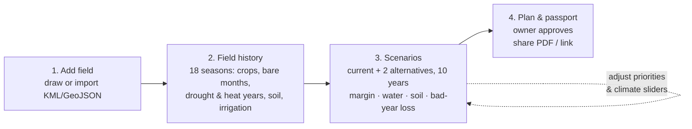
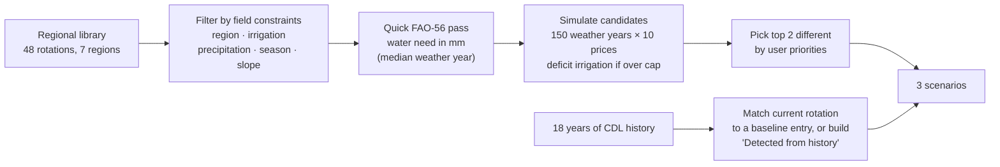

# Terrasight — Product Definition

| | |
| --- | --- |
| **Status** | Draft |
| **Date** | 2026-11-14 |
| **Stage** | 1 of 3 — Product Definition → RFC → Tech Design |
| **Context** | NASA Space Apps Challenge 2026, *Field Shift: Adapting Farms with NASA Data* |

---

## 1. Summary

Terrasight is a web app that helps agronomists and farmers choose a crop rotation for the next 10 years. It bases the choice on 18 seasons of satellite and ground data about **their specific field**.

The user draws a field on a map. Terrasight collects public NASA, USDA and ESA data and reconstructs the field's history. It then models the current rotation and two alternatives against hundreds of weather and price scenarios. For each one it explains why it was suggested, what evidence supports it, and what it gains and risks.

---

## 2. Problem

**Farmers choose a multi-year crop rotation from memory and advice. Meanwhile the evidence about their own field sits unused in a dozen public datasets.**

The decision is which crops to grow, in what order, on one field, over the next several seasons. It locks in water use, income, soil health and drought exposure for years.

Why it is hard today:

- **Climate is moving faster than experience.** A rotation that worked in the 2000s may fail in a 2022-style drought. Garden City, KS got 5.03 in of rain in 2022, against a ~19.6 in normal: the driest year since 1893.
- **The data exists but is unusable.** Crop history (USDA CDL), weather (NASA POWER), vegetation (MODIS NDVI), soil (SSURGO, SoilGrids) and water use (OpenET) live in different portals, formats and map projections.
- **Existing tools answer a different question.** Farm-management software records what happened. Agronomy models need an expert to run them. Nothing compares rotations for one field and explains the trade-offs.
- **Water is the binding constraint** in irrigated regions, and the most profitable option is often the thirstiest.

### Challenge fit

| Challenge requirement | How Terrasight meets it |
| --- | --- |
| Help farmers explore crop rotations | 10-year rotation scenarios per field |
| Compare at least 3 strategies, including the current one | Current rotation detected from history, plus 2 alternatives |
| Explain why each was suggested | Rationale tied to the field's own history |
| Show evidence, benefits, gaps and risks | Per-scenario evidence, data-quality tier, losses in bad years |
| Use NASA data | POWER, MODIS, SMAP, GPM as core inputs |

---

## 3. Users and jobs to be done

**The primary user is the agronomist or farm advisor who prepares the decision. The farmer approves it and checks it from the field.**

| User | Context | Job to be done | Main surface |
| --- | --- | --- | --- |
| Agronomist / farm advisor | Advises 5–50 farms, prepares seasonal plans | "Show me, with evidence, which rotation fits this field and why, so I can defend it to the farmer." | Desktop |
| Farm owner / manager | Decides and pays; has little time | "Tell me what I gain and risk if I change my rotation, in money and water." | Mobile + desktop |
| Farm staff | Views plans, adds fields | "Show me the agreed plan for this field." | Mobile |
| External reader (bank, insurer) | Receives a field passport | "Show me that this field is managed with a credible plan." | Shared PDF / link |

### Roles in a farm workspace

| Role | Permissions |
| --- | --- |
| Owner | Everything, including billing, deleting the workspace and approving plans |
| Admin | Manage members and fields, approve plans |
| Editor | Add fields, run and save scenarios, propose plans |
| Viewer | Read fields, scenarios and passports |

- One person can belong to several workspaces, for example an agronomist with many clients.
- **Platform admin** is a separate role inside the Terrasight team (support, data sources, abuse). Customers never see it.
- Not target users for now: commodity traders, policymakers, and researchers who need raw model output.

---

## 4. Core user journey

1. **Add field.** Draw the boundary on a satellite map or import KML/GeoJSON. A field name is suggested automatically and can be edited. Data from 6–7 sources is gathered in about 15–30 s, with live progress per source. If a source fails, the app says what is missing.
2. **Field history (18 seasons).** Shows the actual crop each year, months the soil was bare, drought and heat years, soil properties, and whether the field is irrigated. The model is checked against satellite-measured evapotranspiration.
3. **Scenarios (10 years).** Compares the current rotation with 2 alternatives on margin, irrigation, erosion, soil carbon and yield loss in a bad year. The user sets priorities (water, margin, soil, drought) and climate shifts (+°C, −% rain, water cap), and the scenarios re-rank.
4. **Plan and field passport.** The chosen scenario is saved as a plan and an Owner or Admin approves it. A field passport (PDF or link) can be shared with a bank or insurer.

### Example outcome (pivot-irrigated field near Garden City, KS)

| Scenario | Rotation | Margin, $/ha/yr | Irrigation, mm/yr | Yield loss if 2022 repeats |
| --- | --- | --- | --- | --- |
| A — "As now" | corn ×2 → wheat → sorghum | 280 | 290 | −28% |
| B — "Alfalfa-based" | alfalfa ×3 → corn → wheat | 403 | 406 | −15% |
| C — "Less water" | wheat → sorghum → fallow | 95 | 133 | −10% |

What the user should take away:

- B earns about $123/ha/yr more than A, halves erosion and is more resilient. It needs about 115 mm more water.
- B is the best option in only 6 of 10 price scenarios.
- C is the safest in a drought, but the least profitable.

Terrasight shows these trade-offs. It does not pick one "right answer". *These numbers are illustrative; in the product the simulator computes them.*

---

## 5. Goals, non-goals and success metrics

### Goals

1. Go from a drawn field boundary to a reconstructed field history in under 60 seconds, with no manual data entry.
2. Compare the current rotation with 2 alternatives on margin, water, soil and bad-year risk over 10 years.
3. Explain every scenario: why it was suggested, what evidence supports it, its benefits, gaps and risks.
4. Be honest about uncertainty: show the data-quality tier and price robustness, and never give a single "right answer" without caveats.
5. Work beyond the US, with lower but clearly labelled accuracy (EU, Ukraine, global).

### Non-goals

- Weather forecasting or in-season advice (irrigation scheduling, spraying).
- Precision-ag maps within a field (management zones, variable rate).
- Farm accounting, inventory, or replacing farm-management software.
- Automatic field-boundary detection. It comes later and is marked "Coming soon" for now.
- Making the decision for the farmer: Terrasight recommends, the human decides.

### Success metrics

| Metric | Hackathon target | Product target |
| --- | --- | --- |
| Time from boundary to history | < 60 s | < 30 s |
| Data sources live per US field | ≥ 4 of 6 | 6 of 6 |
| Modelled vs satellite ET (OpenET) error | Shown in the UI | < 20% on validation fields |
| New fields that reach a saved plan | — | 40% |
| Agronomists who would show it to a client | 3 of 5 interviewed | 70% |
| Judges understand the trade-off in the demo | Within 2 min | — |

---

## 6. Data coverage

Accuracy depends on the country, and the UI always shows the tier.

| Tier | Label | Regions | Crop history | Soil | Water use |
| --- | --- | --- | --- | --- | --- |
| A | Full data | US | USDA CDL (yearly, 30 m) | SSURGO | OpenET |
| B | Basic data | EU | LPIS declarations | SoilGrids | MODIS ET |
| C | Estimate | Global, incl. Ukraine | Inferred from NDVI seasonal pattern | SoilGrids | Modelled only |

Weather (NASA POWER, since 1981) and vegetation (MODIS NDVI, since 2000) are global for every tier.

**Why 18 seasons:** USDA CDL covers the whole US only from 2008, so 2008–2025 gives 18 years of crop history. Weather scenarios can use the full 40+ years of NASA POWER.

---

## 7. Economics (product rules)

- **Measure:** gross margin per hectare, which is revenue minus variable costs (seed, fertiliser, irrigation, fuel and machinery operations).
- **Excluded:** rent, depreciation and subsidies. They are the same for every scenario and differ a lot between countries.
- **Decision signal:** the *difference* versus the current rotation and its *robustness to prices*. Robustness means how many of 10 price scenarios (±20%) a rotation stays best in, and at what price it stops paying off.
- **Prices:** regional defaults (USDA NASS/AMS/ERS for the US, Eurostat/FADN for the EU, State Statistics Service of Ukraine and FAOSTAT elsewhere). The user can override them with their own.

---

## 8. Scope

**The hackathon MVP is one complete path for one field: history, three explained scenarios and a saved plan.** Everything else is designed and can be cut.

| Feature | Priority | Hackathon | Notes |
| --- | --- | --- | --- |
| Add field: draw on map, import KML/GeoJSON | P0 | Yes | Name auto-suggested, editable |
| Data gathering with live progress and per-source status | P0 | Yes | Partial data allowed, gaps labelled |
| Field history: 18 seasons of crops, bare months, stress years, soil, irrigation | P0 | Yes | Full in the US, estimated elsewhere |
| 3 scenarios over 10 years: margin, water, erosion, soil carbon, bad-year loss | P0 | Yes | Current + 2 alternatives |
| Per-scenario explanation: why, evidence, benefits, gaps, risks | P0 | Yes | Challenge requirement |
| Priorities (water / margin / soil / drought) and climate sliders | P1 | Yes | Re-ranks scenarios |
| Price robustness (10 price scenarios, break-even) | P1 | Yes | |
| Save plan + field passport (PDF / link) | P1 | Yes | |
| Accounts, farm workspaces, multiple fields | P1 | Basic | Email + password |
| UA / EN interface | P1 | Yes | |
| Roles and invitations | P2 | Design only | |
| Custom prices and costs per farm | P2 | Design only | Regional defaults first |
| Mobile layout | P2 | Design only | |
| Notifications (toasts, bell) | P2 | Toasts only | |
| Platform admin panel | P3 | No | |
| Automatic field-boundary detection | P3 | No | "Coming soon" |
| Custom rotation builder | P3 | No | |

---

## 9. Product principles

- **The field's own history is the argument.** Every claim points back to a season, a year or a measurement on this field.
- **Trade-offs, not verdicts.** Show what each rotation gains and costs, because the best on margin is rarely the best on water.
- **Honest about data.** Show the tier (Full / Basic / Estimate) and what is missing. Never fill gaps silently with synthetic data.
- **Differences over absolutes.** Compare against today's rotation, so regional price and cost errors cancel out.
- **Plain language first.** An agronomist can open the methodology; a farmer should not need to.

---

## 10. Risks

| Risk | Impact | Mitigation |
| --- | --- | --- |
| A public API is down during the demo | Empty history | Per-source cache of real responses; partial results labelled |
| Model numbers look precise but are rough | Loss of trust | Ranges, data tier, validation against OpenET |
| Prices drive the ranking more than agronomy does | Misleading advice | Price robustness and break-even price shown |
| Low accuracy outside the US | Weak story for Ukraine | Tier labels; a US field as the main demo |
| Too much scope for 48 hours | Unfinished demo | P0 path first; P2+ stays in design |

---

## 11. Open questions — resolved

All four questions were resolved on 2026-11-14.

| # | Question | Decision |
| --- | --- | --- |
| 1 | Demo focus: US field or Ukrainian field? | **US field first, Ukraine second** |
| 2 | One recommended rotation, or three presented neutrally? | **Three side by side, ranked, with a "Best fit for your priorities" badge** |
| 3 | Where do the alternative rotations come from? | **Hybrid: a curated regional library, filtered by the field's constraints, then simulated** |
| 4 | Is irrigation water a hard limit or just a cost? | **Both: always a cost, plus an optional cap that is simulated with deficit irrigation** |

### 11.1 Demo focus

- [x] The main demo uses the pivot-irrigated field near Garden City, Kansas. It has the best data (tier A), and the real 2022 record drought gives the story.
- [x] A Ukrainian field follows as a second example. It carries the "Estimate" tier label, to show that the system works globally.

### 11.2 Recommend vs neutral

- [x] Three scenarios are shown side by side and ranked by the user's priorities: water, margin, soil and drought.
- [x] The top one is marked **"Best fit for your priorities"**. It is never called "the right answer".
- [x] Every scenario shows its trade-offs and risks, whatever its rank.

### 11.3 Where the alternatives come from

- [x] **Curated regional library:** `data/rotations.json` holds 48 rotations across 7 regions. Each one has a rationale and risks in EN and UA. The crops `silage_corn` and `triticale` are defined but unused, and stay in the library for future rotations.
- [x] **Filter by field constraints:** region, irrigation (rotations marked `required` are dropped on dryland fields), minimum precipitation, season length and slope. The water cap does not filter (see §11.4).
- [x] **Simulate** every remaining candidate: 150 weather years × 10 price scenarios.
- [x] **Pick the top 2 *different* candidates** by the user's priorities: the best on the top priority, plus the best that differs from it on another axis. Together with the current rotation, that makes 3 scenarios.
- [x] **Current rotation:** detected from 18 years of CDL history and matched to a library rotation marked `baseline: true`.
- [x] **Rejected:** free-form generation. It produces invalid sequences and is hard to explain.

### 11.4 Irrigation water

- [x] By default, water is a **cost**: a pumping cost per mm, included in the gross margin.
- [x] The user can also set an optional **water cap** in mm/year.
- [x] Rotations whose water need exceeds the cap are **not** filtered out. They are simulated with deficit irrigation (yield response factor Ky, FAO-33), get an **"exceeds cap"** badge, and show the extra yield and margin loss caused by the cap.
- [x] The only water-related filter: rotations with `irrigation: "required"` are dropped on dryland fields.

### 11.5 Decisions carried into the RFC

| Topic | Decision |
| --- | --- |
| Water need in mm | Before the full simulation, estimate each candidate's water need with a quick FAO-56 pass on the field's median weather year. The library's `low` / `medium` / `high` field stays only as a display label. |
| Slope | Add an optional `maxSlopePct` to rotations where erosion matters: fallow-heavy, row-crop-only and sunflower-heavy ones. Rotations without it always pass the slope filter. |
| Fewer than 2 candidates pass | Relax filters in this order: water cap → precipitation → slope. Mark scenarios that needed a relaxed filter with a warning. If fewer than 2 still pass, show what there is and explain why. |
| History matches no baseline | Build an ad-hoc current rotation straight from the last 4–6 years of detected crops and label it **"Detected from history"**. The user can correct it. |
| Drought as a priority | Drought is the 4th priority, next to water, margin and soil (§4, §8). |

---

## Next

- **RFC** (`02-rfc.md`): the proposed solution and its alternatives (data pipeline, simulation approach, sync vs async gathering, scenario generation), with trade-offs and decisions.
- **Tech Design** (`03-tech-design.md`): architecture, data model (PostgreSQL/PostGIS), API, modules, caching, testing and deployment.