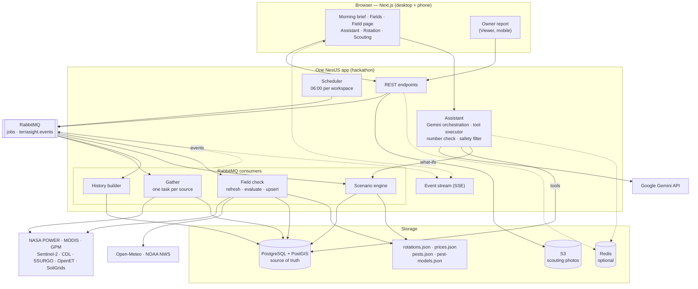
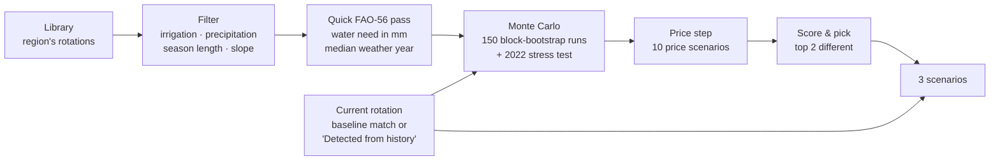
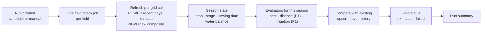
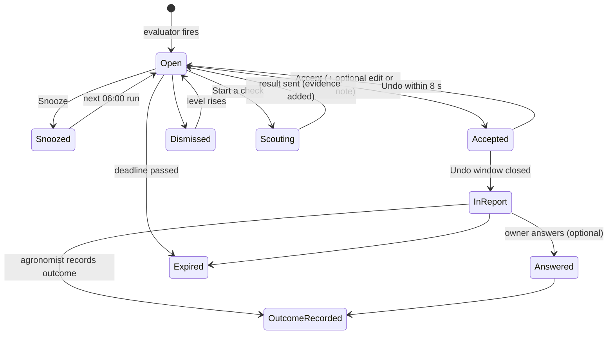
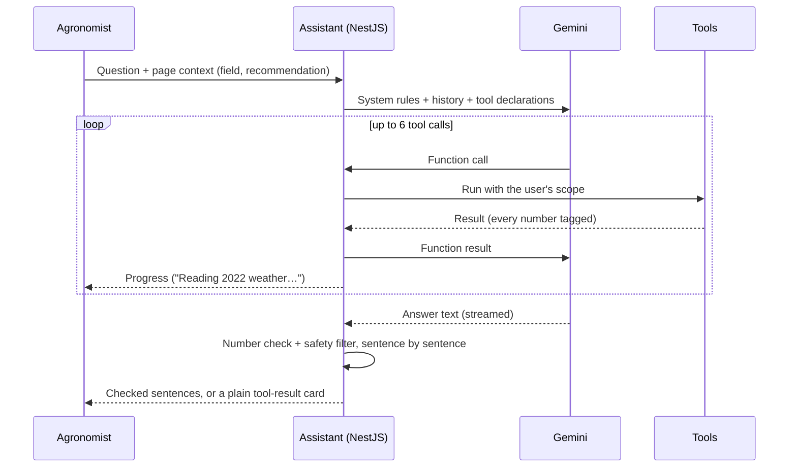
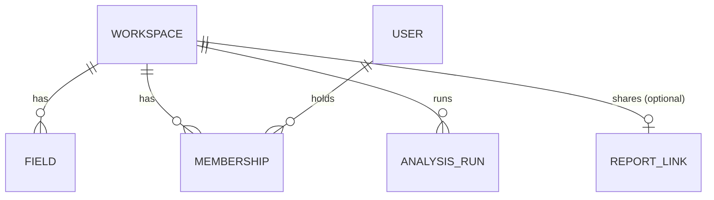

# Terrasight — RFC (v2.2)

| | |
| --- | --- |
| **Status** | Draft v2.2 — in review. D1–D5 were accepted in v1 and are carried over (D4 with the 5-season horizon); D6 is revised; D7–D12 are new |
| **Date** | 2026-11-14 |
| **Stage** | 2 of 3 — Product Definition → **RFC** → Tech Design |
| **Builds on** | [`01-product-definition.md`](01-product-definition.md) v2.5, especially §5 (recommendation types), §6 (AI assistant), §9 (scope and design notes) and §12 (decisions 1–15) |
| **Data** | [`../data/rotations.json`](../data/rotations.json) v2: 113 rotations, 24 regions, 34 countries (rebuilt and validated by [`../tools/build_rotations_v2.py`](../tools/build_rotations_v2.py)) · [`../data/pests.json`](../data/pests.json): 62 pests, diseases and parasitic plants |
| **Supersedes** | RFC v1 (accepted 2026-11-14): rotation planning only |
| **What changed in v2.1** | Product definition v2.1–v2.5: one workspace = one company, no farms (D11); morning check at 06:00 in the workspace time zone and on-demand **Analyze fields** with per-field status (D7); urgency rules, in-place Accept / Snooze with Undo (D7); scouting tasks (D7, D12); demo set with wheat streak mosaic virus and a `green_bridge` evaluator (D8); owner reply drafts without sending the owner's text to Gemini (D9); Owner report (D12). Log in §21 |
| **What changed in v2.2** | Open questions 1–5 resolved (§20); replay mode moved to P2 and rootworm shown as a 2026 rotation risk (§10.6, §11.4); demo company in Kansas, Nebraska and Colorado (§2, §5.4, §14.2); 8 s Undo countdown on the done row (§10.4); 90-day retention (§12.7). **Rotation library v2:** region match rules (§6.3), double cropping (§7.8), southern hemisphere (§7.7), FAOSTAT price fallback (§16); Nebraska question closed (§2, §11.4). Log in §21 |
| **Next** | [`03-tech-design.md`](03-tech-design.md) (draft v1) and the backlog in [`epics/`](epics/README.md) |

---

## 1. Summary

Terrasight v2 is an AI assistant for agronomists working inside a farming company. This RFC sets out how it turns field data into a morning brief of explained recommendations, how the assistant answers questions without inventing numbers, how scouting results come back, and how accepted advice reaches the company's owner. Rotation planning from v1 stays the core feature, so its decisions are carried over.

| # | Decision | Approach | Status |
| --- | --- | --- | --- |
| D1 | How data is gathered | An async job per field with one task per source, and live progress over SSE with a polling fallback | Carried over |
| D2 | Caching, messaging and where state lives | PostgreSQL is the source of truth. RabbitMQ carries jobs and events. Redis is optional. Recorded fixtures keep the demo safe | Carried over, + v2 rows (§5.5) |
| D3 | Crop history and irrigation | CDL / LPIS / NDVI classifier with confidence; irrigation confirmed by the user | Carried over, + current-season record (§6.4) |
| D4 | Simulation | TypeScript simulator; 150 block-bootstrap weather runs over **5 seasons (2026–2030)** + "If 2022 repeats"; 10 price scenarios | Carried over; **horizon changed from 10 to 5 seasons** (§7.7, §21) |
| D5 | Rotation scenario selection | Library → filter → water need → simulate → pick 2 different alternatives | Carried over, + pest pressure shown as a rotation risk (§8.5) |
| D6 | Explanations | Templates are the base and the fallback for every card. The LLM answers in the chat and rephrases templates, always under the number check | **Revised** |
| D7 | Recommendation engine | A morning check at 06:00 (workspace time zone) and on-demand **Analyze fields** run pure evaluators per field. Recommendations have a lifecycle with in-place Accept / Snooze and Undo. A pure urgency function sorts them into Urgent / This week / All good. Scouting tasks feed results back | **New** |
| D8 | Pest and disease risk models | `pests.json` describes; a new `pest-models.json` holds a small tree of standard evaluators per pest. A model runs only when every threshold is verified and cited | **New** |
| D9 | AI assistant | Gemini function calling over our read-only tools, scoped on the server; every sentence is number-checked before it is shown; a safety filter blocks products and doses; the owner's free text is never sent | **New** |
| D10 | Weather forecast | Open-Meteo (paid) per grid cell, NOAA NWS as US fallback, then the last cached forecast with its age | **New** |
| D11 | Workspace and access | One workspace = one farming company with its fields, in any number of counties and states. The owner or manager is a Viewer. Onboarding creates the company; a demo company can be explored | **New** |
| D12 | Owner report and outcome loop | Items the agronomist accepts go to the Owner report; optional one-tap answers from the owner; scouting results and outcomes come back to the field | **New** |

Architecture, data model, API and deployment details belong in the Tech Design. This RFC only fixes the choices those details depend on.

---

## 2. Context and constraints

- **Time:** a 48-hour hackathon. The P0 path must work end to end: the agronomist adds a field → sees its history → runs **Analyze fields** → the morning brief shows it under Urgent / This week / All good (rotation + pest risks) → asks the assistant "why?" → accepts an item into the Owner report. Building FR-SC-1 (scouting task) is also P0.
- **Existing assets:** a Next.js proof of concept with live NASA POWER, MODIS, CDL and SSURGO calls, and a tested rotation simulator in TypeScript.
- **Stack:** Next.js + NestJS, PostgreSQL + PostGIS, Prisma, RabbitMQ, Redis, AWS. New in v2: **Google Gemini API** and **Open-Meteo**.
- **Product rules that shape the design:**
  - From boundary to first recommendations in under 60 s; **Analyze fields** for the demo company in under 30 s (§7).
  - Every recommendation names field, action, timing and urgency, and shows evidence, confidence, data tier and what is not known (§5).
  - Risk, not diagnosis: "scout to confirm". No pesticide products or doses (§5, §10).
  - Numbers from models, words from AI (§6 grounding rule). Only derived field data goes to the LLM (decision 2).
  - The agronomist approves everything that reaches the owner (§10).
  - One focus per screen: one hero item, one primary action (§10).
  - Partial data is allowed, but gaps are labelled and never filled silently.
- **Demo company:** fields in **Kansas** (`us-southern-plains`), **Nebraska** (Chase County) and **north-eastern Colorado** (both `us-central-high-plains`), as on the design canvas. Rootworm on **Pivot 12** (corn), barley yellow dwarf with aphids on **Pivot 14** (winter wheat), wheat streak mosaic on a **dryland winter-wheat field in north-eastern Colorado** (decision 1; this field must be added to the canvas, §18). All tier A.
- **Seasonality:** the demo happens in November. BYD/aphids and the wheat streak mosaic green bridge are autumn risks, so they are live. Rootworm is shown as a **rotation risk for 2026** (corn after corn, `host_repeat` only, §8.5 and §11.4), which needs no degree days and no archived forecasts. Egg-hatch timing comes back next spring. There is **no replay mode** in the hackathon (§10.6 is P2).

---

## 3. Solution at a glance



How the main flows work:

1. **First run.** The agronomist creates the company: name, time zone (detected), units, report language, and optionally invites the owner as a Viewer (D11). Or they open the demo company.
2. **New field.** Gather (D1) → history (D3) → rotation scenarios (D5) → first field check (D7). The first recommendations appear in under 60 s.
3. **Every morning at 06:00** in the workspace time zone, the scheduler starts an analysis run for all the company's fields. The agronomist can start the same run at any time with **Analyze fields**, for all or selected fields. Each field reports its own status; the run ends with a summary.
4. **Morning brief.** The urgency function sorts open items into Urgent / This week / All good; the first Urgent item is the hero. The agronomist accepts (into the Owner report), snoozes or opens details, with Undo; asks the assistant; or turns a pest item into a scouting task.
5. **Owner report and scouting.** The owner reads accepted items and may answer each in one tap. Scouting results come back to the field as evidence (D12).

**Deployment** is unchanged from v1: one NestJS app runs the API, the scheduler and the consumers, behind an ALB or on a container host, not API Gateway + Lambda, because SSE needs long-lived connections.

---

## 4. D1 — Data gathering: sync or async?

| Option | Pros | Cons |
| --- | --- | --- |
| A. One synchronous HTTP request | Simplest; no queue | 15–30 s requests hit proxy and Lambda timeouts; no per-source progress; one slow source blocks everything |
| B. Async job + polling | Survives timeouts; resumable | Progress is laggy; more requests |
| **C. Async job + SSE progress, polling as fallback** ✅ | Live per-source progress (Goal 1); one-way, so simpler than WebSockets | Needs a message broker (RabbitMQ) and a long-lived HTTP host |
| D. Async job + WebSockets | Two-way | Two-way isn't needed; harder behind load balancers |

**Accepted: C.** Each field gets one gather job with one child task per source. Every task has its own timeout (about 20 s) and up to 2 retries. When a task fails, the job still completes, and the source is marked `failed` with a reason the UI shows ("SSURGO did not respond, soil data missing"). If SSE can't connect, the browser polls the job status.

Per-source status values: `queued` → `running` → `done` | `partial` | `failed` | `cached`.

---

## 5. D2 — Caching, messaging and state

### 5.1 Roles

Each concern has exactly one owner:

| Concern | Technology |
| --- | --- |
| Jobs and retries (gather, history, scenarios) | RabbitMQ |
| Progress events to the browser | RabbitMQ (`terrasight.events` topic) → API → SSE |
| Raw source responses (long-lived) | PostgreSQL source cache |
| Source of truth for job and task status | PostgreSQL |
| One active gather job per field | PostgreSQL partial unique index |
| Refresh tokens (revocable) | PostgreSQL |
| Access tokens | Short-lived JWT (15 min) in an httpOnly cookie, verified by signature; no server state |
| Hot cache: computed history and scenario results by `field + inputs hash` | Redis, TTL 6 h |
| Rate limiting for external APIs (per source, shared by all consumers) | Redis (token bucket) |
| Cache of refresh-token revocation checks | Redis (optional) |

### 5.2 Redis is fully optional

Redis is never the source of truth. If Redis is empty or down, the app still works. It reads from PostgreSQL and re-runs the simulation; it's only slower.

| Redis role | When Redis is empty or down |
| --- | --- |
| Hot cache | Cache miss: load the history from PostgreSQL and re-run the simulation |
| Rate limiting | Each consumer falls back to a conservative in-process limit per source |
| Revocation-check cache | Check the refresh token in PostgreSQL directly |

No user is signed out when Redis is lost: access tokens are verified by signature, and refresh tokens live in PostgreSQL.

### 5.3 Progress events

- Consumers publish events to the `terrasight.events` topic exchange with routing keys like `field.<fieldId>.gather.<source>`.
- Each API instance binds its own temporary queue and forwards matching events to the open SSE connections.
- Events are hints, not state. When the browser (re)connects, the API first sends the current status from PostgreSQL, then streams new events. A lost event costs nothing.

### 5.4 Caches and demo resilience

Public APIs are the biggest demo risk (product definition §11).

| Layer | What it stores | Key | Lifetime |
| --- | --- | --- | --- |
| **Source cache** (PostgreSQL) | The raw response of each source call | `source + geometry hash + parameters` | Long: historical data doesn't change. Current-year data is refreshed after 7 days |
| **Hot cache** (Redis) | Computed history and scenario results | `field id + inputs hash` | TTL 6 h; rebuildable from PostgreSQL |
| **Demo fixtures** (files in the repo) | Recorded real responses for the demo company's fields in Kansas, Nebraska and Colorado | Same key as the source cache | Permanent; loaded at seed time |

Rules:

- A cached response is shown as `cached` with its date. It is never shown as live.
- Fixtures contain **real recorded responses**, not synthetic data, which keeps the "never fill gaps silently" rule.
- During the demo the app runs in normal mode. Fixtures only help when a live call fails.

### 5.5 Additions in v2

The v1 roles stay. v2 adds these:

| Concern | Technology |
| --- | --- |
| Morning schedule | A scheduler inside the NestJS app creates an analysis run at 06:00 in each workspace's time zone and publishes one `field.check` job per field. The last run per workspace is stored in PostgreSQL, so runs missed during a restart are caught up |
| Analysis runs (trigger, fields, per-field status, summary) | PostgreSQL; progress as events on `workspace.<id>.analysis` |
| One active check per field | PostgreSQL partial unique index, as for gather jobs |
| Forecasts and recent weather | PostgreSQL source cache, keyed by `provider + grid cell + issue time` |
| Recommendations, level history, snoozes, owner answers, scouting tasks and counts, outcomes | PostgreSQL |
| Scouting photos | Private S3 bucket through signed URLs; metadata in PostgreSQL |
| Assistant conversations and tool calls | PostgreSQL (audit and evaluation) |
| Assistant rate limits (per user, per workspace) | Redis token bucket, with the same in-process fallback as the source limits |
| Brief updates to the browser | `terrasight.events` with routing keys like `workspace.<id>.brief` → API → SSE |

Demo fixtures now also cover recorded forecasts for the demo fields.

---

## 6. D3 — Crop history and irrigation detection

### 6.1 Crops per season

| Tier | Source per year | Method | Confidence |
| --- | --- | --- | --- |
| A — US | USDA CDL, 30 m | Majority crop class inside the polygon; share of the second class kept for mixed fields | High when the majority class covers ≥ 70% of the field |
| B — EU | LPIS declarations | Crop declared for the parcel that overlaps the polygon most | High where LPIS is public; otherwise fall back to tier C |
| C — Global, incl. Ukraine | MODIS NDVI seasonal profile | Rule-based classifier on the shape of the season (below) | Shown as "Estimate" |

**Tier C classifier (hackathon version).** It works on the 16-day NDVI series for each season and identifies **crop groups**, not single crops:

| Pattern | Group | Mapped to |
| --- | --- | --- |
| Green-up in autumn, peak in April–May, harvest in July | Winter cereal / rapeseed | `winter_wheat` as the default |
| Peak in July–August | Summer row crop | `corn`, `sunflower` or `soybean`, chosen by the regional baseline rotations |
| No peak above a threshold | Fallow | `fallow` |
| High NDVI most of the year, several dips | Perennial forage | `alfalfa` |

Two more outputs come from the same data:

- **Bare months:** months with NDVI below the bare-soil threshold.
- **Stress years:** seasons where NDVI peak, precipitation (POWER) or heat days fall below or above their 18-year percentiles.

**Rejected for now:** a trained ML classifier on Sentinel-2. It's more accurate but needs training data and doesn't fit 48 hours.

### 6.2 Irrigated or dryland

Irrigation is detected automatically, then confirmed by the user on the history screen.

| Region | Signal | Rule |
| --- | --- | --- |
| US | OpenET annual ET vs precipitation (POWER) + soil water storage (SSURGO) | ET clearly above precipitation + storage in most years → irrigated |
| Elsewhere | MODIS NDVI through dry summers | NDVI stays high through summers with low precipitation → irrigated |
| Any | Low confidence | Ask the user directly before building scenarios |

Pivot-shape detection is P3.

### 6.3 The field's region and its current rotation

**Region (library v2).** The field's region comes from the `match` rules in `rotations.json`:

1. The field's centroid is reverse-geocoded to its ISO 3166-2 code (e.g. `US-NE`, `UA-63`, `BR-MT`).
2. Regions are tried **in file order**. A rule matches when its `admin` list contains the ISO 3166-2 code or the ISO 3166-1 country code, and the centroid lies inside the rule's optional `lat` / `lon` bounds. The first matching rule wins.
3. With no match, the planner shows **"No rotation library for this region yet"**. History, in-season advice and the assistant still work; only rotation scenarios are missing.
4. Regions marked `verify: true` (17 of 24) are rules of thumb: their scenarios carry the note "Library not yet reviewed for this region" until a regional agronomist has reviewed them.

`tools/build_rotations_v2.py` checks the rules against known points (Garden City, KS → `us-southern-plains`; Chase County, NE → `us-central-high-plains`; and others).

**Current rotation:**

1. Take the detected crops from the last 4–6 years. Where the region uses double cropping, a season holds a `main` and a `second` crop.
2. Compare that sequence, with cyclic shifts, against every `baseline: true` rotation of the region. A double-crop season matches only when both crops match.
3. If one matches at least 75% of the years, use it.
4. Otherwise build an ad-hoc rotation from the detected years and label it **"Detected from history"**. The user can correct it.

### 6.4 Current-season record (new in v2)

Pest models need **this season's** crop and sowing date. History sources don't give them in time: CDL for a year is published only after the season, and NDVI shows a crop only once it has grown.

Each field gets a season record: crop, sowing date, irrigated or dryland, tillage. Every value keeps its source:

| Priority | Source | Shown as |
| --- | --- | --- |
| 1 | Entered or confirmed by the agronomist | Confirmed |
| 2 | The saved plan for this year ("Save to the 2026 plan") | From plan |
| 3 | NDVI: crop group, and sowing estimated from the green-up date | Estimate |
| 4 | Typical sowing date for the crop in the region | Estimate (regional) |
| — | Nothing available | Unknown: the model runs only the parts that don't need the value, and the card says what is missing |

The agronomist can also **correct the crop history** for past years, for example when CDL mixes classes on a small field or, in tier C, when NDVI gives only a crop group ("summer row crop"). Corrections are stored as overrides and used by every history-based model, for example rootworm's corn-after-corn check (§11.4).

---

## 7. D4 — Simulation engine

### 7.1 Where it runs

| Option | Pros | Cons |
| --- | --- | --- |
| **A. Extend the PoC's TypeScript simulator inside the NestJS app** ✅ | Already tested; one language; no extra service | Fewer scientific libraries than Python |
| B. Python service (FastAPI + NumPy) | Rich science ecosystem | New service, new deploy, and the PoC simulator would need rewriting |
| C. In the browser | Instant sliders | Large bundle; heavy for mobile; logic exposed and harder to test |

**Accepted: A.** The models (FAO-56 daily water balance, FAO-33 Ky, SCS-CN, relative RUSLE, ICBM) are arithmetic loops that run fast in Node.

### 7.2 Scale check

| Item | Count |
| --- | --- |
| Candidate rotations after filtering | up to 14 (largest region) + the current rotation |
| Monte Carlo weather runs | 150, plus 5 stress-test runs (2022 placed in each year in turn) |
| Years per run | 5 (2026–2030) |
| Days per year | 365 |
| **Daily water-balance steps** | **15 × 155 × 5 × 365 ≈ 4.2 M** |

That is about half the load of the v1 10-season plan: a couple of seconds of single-threaded Node, well inside the time budget. It can be split across worker threads if needed.

### 7.3 Weather runs

- **150 Monte Carlo runs.** Each run is a 5-season sequence (2026–2030) built from real NASA POWER years 1981–2025.
- **Block bootstrap.** Sequences are built from blocks of **2–3 consecutive real years**, not single years, so multi-year droughts such as 2011–2012 appear inside the runs.
- **Fixed random seed**, so the same inputs always give the same results.
- **Named stress test, "If 2022 repeats":** the real 2022 weather is placed in each year 1–5 in turn, and the worst of those 5 runs is reported. The result is shown separately, not mixed into the 150 runs.
- **Climate sliders** (+°C, −% rain) apply deltas to the resampled daily series.

### 7.4 Price scenarios

- **10 scenarios, fixed seed.** Scenario 0 is the unchanged base prices.
- **Per-crop multipliers within ±20%:**
  - Corn, sorghum and wheat share a common **grain-market factor**, plus their own noise.
  - Hay, cotton, oilseeds and pulses move **more independently**.
- **Applied after the weather step.** Prices don't change agronomy, so yields and water per run are computed once and then priced 10 times. 10 price scenarios therefore cost almost nothing.
- **Price robustness:** in how many of the 10 price scenarios a rotation has the highest mean margin, plus the break-even price at which it stops beating the current rotation.

### 7.5 What re-runs when the user changes something

| User change | Re-runs | Expected time |
| --- | --- | --- |
| Priority weights | Ranking only (§8.2) | < 50 ms, so it can run in the browser |
| Price overrides | Price step + ranking | < 200 ms |
| Water cap | Deficit-irrigation simulation for affected candidates | 1–3 s |
| Climate sliders (+°C, −% rain) | Full simulation | 2–5 s |

Results are kept in the Redis hot cache by `field + inputs hash` (TTL 6 h), so moving a slider back is instant.

### 7.6 Water cap

As accepted in RFC v1:

- The water cap **never filters**. Rotations over the cap are **simulated with deficit irrigation**: irrigation is limited to the cap, and the yield loss follows FAO-33, `1 − Ya/Ym = Ky × (1 − ETa/ETc)`.
- The result carries an **"exceeds cap"** badge and the extra yield and margin loss against the uncapped run. Rotations far over the cap fall down the ranking on their own.
- Rotations with `irrigation: "required"` are dropped only on dryland fields.

### 7.7 Planning horizon: 5 seasons (changed 2026-11-14)

The planner simulates **5 seasons, 2026–2030**, instead of 10. The agronomist's decision is the next season; the 5 seasons are the evidence for it (product definition §5, Rotation horizon; rationale in §21).

| Rule | Detail |
| --- | --- |
| Exactly 5 seasons | A rotation whose cycle doesn't divide 5 is simulated for exactly 5 seasons, with no padding and no extrapolation |
| Starting point | The current rotation continues from its detected position in the cycle. Alternatives start at year 1 of their cycle in 2026, so establishment costs (e.g. alfalfa) are counted |
| Cumulative margin | The sum of the 5 simulated yearly margins. Shown as year-by-year cumulative points (2026–2030), so a year-1 dip and later payback are visible. No hard-coded shape |
| Margin metric | $/ha per year, mean over the 5 seasons and all runs |
| Soil carbon (ICBM) and erosion | Shown as a trend (up / down + value), because 5-season changes are small |
| Headline | "Recommended for 2026: <crop>" (the first season of the best-fit scenario), or "Your choice for 2026: <crop>" after the agronomist picks another option; one primary action, "Save to the 2026 plan" (decision 9) |
| Re-planning | The plan is recomputed every autumn, after the season's harvest data arrives (§10.2) |
| Southern hemisphere | For regions with `hemisphere: "S"` the 5 seasons are 2025/26–2029/30, **labelled by harvest year** (2026 = 2025/26). "Recommended for 2026" means the season harvested in 2026. Weather blocks for the bootstrap (§7.3) are cut at the season boundary (1 July), not at 1 January, so one season's weather is never split across two blocks |

### 7.8 Double cropping (library v2)

A season in the library can hold two crops: `{"main": crop, "second": crop}`, e.g. soybean then safrinha corn in Brazil, wheat then soybean in Argentina or the US Delta, rice then wheat in India. 17 of the 113 rotations use it.

| Part | Rule |
| --- | --- |
| Water balance | Both crops run in the same season, **one after the other, each on its own calendar** (sowing, stages, harvest); the soil water at the first crop's harvest carries over to the second |
| Margin | The season's margin is the sum of both crops' margins |
| Pest pressure (§8.5) | Host crops count in either slot |
| Crop history (§6.3) | A double-crop season matches only when both crops match |
| `second: "fallow"` | The off-season stays bare (e.g. `br-ce-soy-fallow`) |

Crop calendars per region and the order of the two crops in the daily loop are a Tech Design task.

---

## 8. D5 — Scenario selection

### 8.1 Pipeline



Filters, with the library fields they use:

| Filter | Library field | Field data | Rule |
| --- | --- | --- | --- |
| Region | `region` | Centroid → ISO 3166-2 → first matching `match` rule (§6.3) | Same region only; no region → "No rotation library for this region yet" |
| Irrigation | `irrigation` | Irrigated or dryland (§6.2, confirmed by the user) | Drop `required` on dryland fields |
| Precipitation | `minPrecipMm` | Median annual precipitation (POWER) | Field median ≥ minimum |
| Season length | `minSeasonDays` | Median frost-free days (POWER) | Field median ≥ minimum |
| Slope | `maxSlopePct` (new, optional) | Mean slope from a DEM | Field slope ≤ maximum; rotations without the field always pass |

### 8.2 Scoring

For each candidate, the engine computes the metrics as **differences from the current rotation**:

| Metric | Measure | Unit | Better when |
| --- | --- | --- | --- |
| Margin | Mean gross margin over the 5 seasons and all runs | $/ha/yr | Higher |
| Water | Mean irrigation over all runs | mm/yr | Lower |
| Soil | Soil-carbon change + relative erosion index over the 5 seasons (shown as a trend) | Index | Higher carbon, lower erosion |
| Drought | **Mean margin in the worst 10% of the 5-season weather runs (CVaR-10)** | $/ha/yr | Higher |

The drought metric is in money, not yield, because yields of different crops can't be compared and margins can.

Each metric is scaled to 0–1 across the candidates. The score is the sum of the scaled metrics, each weighted by the user's priority. Weights default to equal.

### 8.3 Picking 2 *different* alternatives

1. **Alternative 1:** the candidate with the best score.
2. **Alternative 2:** among the rest, the best candidate that differs from alternative 1. "Differs" means both:
   - it is better than alternative 1 on at least one metric that alternative 1 is not best at, and
   - its crop sequence shares less than 60% of crop-years with alternative 1.
3. The "Best fit for your priorities" badge goes to whichever of the 3 scenarios (current rotation included) has the highest score.

### 8.4 Fewer than 2 candidates

Filters are relaxed in this order: **precipitation → slope**. The water cap is not part of the order, because it never filters (§7.6).

Each scenario that needed a relaxed filter carries a warning. If fewer than 2 still pass, the UI shows what there is and explains why.

### 8.5 Pest pressure as a rotation risk (new in v2, not scored)

For each of the 3 scenarios, the engine counts the years in which a verified rotation-based pest model would fire: host repeats and too-short host intervals (`host_repeat` and `host_interval` kinds, §11.2). For example: "Corn after corn in 3 of 5 seasons: rootworm risk".

- The count is shown under **Risks** in the scenario explanation and used in the rotation recommendation text ("consider an alfalfa-based rotation instead of corn ×2").
- It is **not part of the score**. The score still uses the 4 metrics in §8.2, so the rotation ranking doesn't change.

---

## 9. D6 — Explanations (revised)

**What changed:** v1 used templates only, with no LLM in the hackathon. In v2 the assistant is P0 and the product definition allows an LLM under the grounding rule (product definition §6).

| Option | Pros | Cons |
| --- | --- | --- |
| A. Templates only (v1) | Deterministic; free; every number traceable | No chat, so the P0 assistant is missing |
| B. The LLM writes every card | Fluent text everywhere | The brief, the report and the passport stop working when the LLM is down; hundreds of cards a day cost money; output differs from run to run |
| **C. Templates are the base for every card; the LLM works in the chat and rephrases templates on request** ✅ | Cards are deterministic and always available; the LLM adds value where language matters | Two kinds of text, so both must pass the same checks |

**Accepted: C.**

- Brief cards, the field brief, rotation scenarios, the Owner report and the passport all render from templates, without the LLM. If Gemini is down, only the chat and rephrasing stop.
- The LLM is used in the chat (D9) and for "Rephrase" and owner-reply drafts. Its output passes the same number check and safety filter as chat answers (§12.4, §12.5).
- The agronomist can edit any text before it is accepted. Human edits are not number-checked, because the agronomist is responsible for them, but the item is marked "edited by the agronomist".
- **Dates, not degree days, in headlines** (decision 13). Degree days stay in the evidence. Dates follow the UI language (EN "Jun 25", UA "25.06").

**Template for a risk card** (pest, disease, irrigation, weather):

| Part | Source |
| --- | --- |
| **Headline** | The action, field and date: "Count aphids on Pivot 14 before the frost" |
| **Key numbers** | Up to 3 values from the evaluator's drivers, each with its weight (the hero shows them with weight bars) |
| **Action and timing** | The `scout` text from `pests.json` and the evaluator's window |
| **Why** | The drivers that fired, with their values; a scouting result when there is one ("Scouted on <date>: N%") |
| **Evidence** | Each data point with source, date range and value; links to the season in the history view |
| **Not known** | The evaluator's unknowns: estimated sowing date, unconfirmed history, forecast beyond day 5 |
| **Model** | Model name and its cited source (§11.3) |
| **Confidence and tier line** | "High confidence · Full data"; pest and disease items say "Medium confidence · scout to confirm" until scouted (§10.3) |
| **Footer** | "Scout to confirm. Terrasight estimates risk; it does not diagnose." |

**Template for the rotation recommendation:** the headline is **"Recommended for 2026: <crop>"**, or **"Your choice for 2026: <crop>"** after the agronomist picks another option (decision 9). Below it, the 5 parts from v1 still apply, over the 5 seasons 2026–2030:

| Part | Source |
| --- | --- |
| **Why suggested** | The library `rationale`, plus the reason it was picked ("best on water among 9 candidates") |
| **Evidence** | Facts from this field, e.g. 2022 rainfall, NDVI peak and the modelled loss for that season |
| **Benefits** | Metrics where it beats the current rotation, with numbers |
| **Gaps** | Data tier, failed sources, relaxed filters, unconfirmed irrigation |
| **Risks** | The library `risks`, "exceeds cap", CVaR-10 margin, "If 2022 repeats", price robustness, and pest pressure (§8.5) |

**Field brief** ("The main thing on this field"): the field's most urgent open item, or the rotation recommendation when nothing is due, in one sentence with up to 3 key numbers and one primary action.

---

## 10. D7 — Recommendation engine

### 10.1 When recommendations are computed

| Option | Pros | Cons |
| --- | --- | --- |
| A. On demand, when the agronomist opens the brief | No background work | Slow with hundreds of fields; no "what changed since yesterday" |
| **B. A scheduled morning check for all fields, results stored, plus on-demand Analyze fields** ✅ | The brief is ready at 06:00; risk changes have a history; one code path for both triggers | Some work is done for fields nobody opens (cheap, see §10.2) |
| C. Event-driven, as each data source updates | Freshest | Many partial runs; hard to reason about for 48 hours of work |

**Accepted: B.**

### 10.2 Analysis runs

An **analysis run** is one check of a set of fields. It has two triggers and one pipeline:

| Trigger | Fields | When |
| --- | --- | --- |
| `schedule` | All active fields of the workspace | **06:00 in the workspace time zone** (set at onboarding, §14.2) |
| `manual` | All or selected fields | The agronomist clicks **Analyze fields** |



- **Per-field status:** `waiting` → `running` → `ok` | `stale` | `failed`. `stale` means a source didn't respond and the field shows the last good data, with its date ("No data" in the UI, plus "showing yesterday's data" in the summary). `failed` means no usable data at all.
- **Summary**, stored with the run: fields checked, new recommendations, and what failed: "7 of 8 fields checked. Pivot 21: NASA POWER didn't respond — showing yesterday's data". The brief header shows the last run's time and summary.
- **Retry** re-runs only that field, as a new single-field manual run.
- **Progress:** each field's status is an event on `workspace.<id>.analysis`; the brief shows a panel with every field's status and an overall bar (product definition §9).
- **One active run per workspace for `schedule`, one active check per field.** A manual run that includes a field already being checked waits for that check instead of starting another.
- **Season-dependent checks:** each evaluator declares the crop stages it applies to. A field check runs only the evaluators whose stage window matches the field's season state, so November runs autumn checks (product definition §5, Seasonal checks).
- **Per grid cell, not per field.** Weather and forecasts are fetched once per grid cell and shared by every field in it.
- **The recent-days gap.** NASA POWER daily data arrives a few days late. The days between the last POWER day and today come from Open-Meteo's recent observed data, labelled as such in the evidence.
- **Rotation recommendations are not daily.** They are created after the history build and **recomputed every autumn** after the season's harvest data arrives, when prices change, or when the agronomist asks.

### 10.3 Evaluators

Evaluators are **pure functions** in a TypeScript package: `evaluate(model, inputs, asOf) → RiskResult`.

- Inputs are a snapshot: daily weather (history + recent days + forecast), crop history, the season record (§6.4), the water balance, NDVI. No I/O inside. The same inputs and `asOf` always give the same result.
- They are tested with recorded fixtures from the demo fields.

| Output | Meaning |
| --- | --- |
| `level` | `none` · `low` · `moderate` · `high` · `unknown` (key input missing; never shown as "low") |
| `deadline` | The date by which to act or scout |
| `irreversible` | Whether missing the deadline can't be undone (frost, egg hatch, a closing sowing window). Declared per model in `pest-models.json` or per recommendation type, never guessed |
| `keyNumbers[]` | Up to 3 driver values with weights, for the hero and the field brief |
| `drivers` | Which drivers from `pests.json` fired, with their values |
| `evidence[]` | Source, date range, value, unit, for each input that mattered |
| `unknowns[]` | What was estimated or missing |
| `confidence` | `high` · `medium` · `low` |
| `tier` | A / B / C of the field |

**Confidence rule:**

1. Start from the data tier: A high, B medium, C low.
2. Drop one step for each estimated key input: sowing date estimated, crop history not confirmed, the window lying beyond forecast day 5.
3. **Pest and disease items are capped at `medium` until the field is scouted** for that pest (product definition §9). A scouting result lifts the cap (§10.7).
4. A model never raises confidence on its own.

### 10.4 Recommendation lifecycle



- **Accept adds the item to the Owner report** (decision 12). On desktop it happens in place; on a phone a bottom sheet first shows exactly what the owner will see, with an optional note. The item is committed to the report only when the **8 s Undo** window closes, so Undo never has to pull an item back from the owner. On desktop the item collapses to a done row ("Added to the owner report") with an **Undo button and a visible 8 s countdown**, as on the design's States board; the same applies to Snooze.
- **Snooze** hides the item until the next 06:00 run, then it returns as Open if it still fires.
- **One live recommendation per `(field, type, subject, season)`**, for example `(Pivot 12, pest, western_corn_rootworm, 2026)`. Runs update it in place and keep a history of its levels, so there are no duplicates.
- **Items in the report never change by themselves.** If the level changes after acceptance, the agronomist sees "changed since accepted" and decides whether to update the report.
- **Edits:** the agronomist can edit the text before accepting; the item is marked "edited by the agronomist" (D6).

### 10.5 Urgency and the morning brief

The grouping is a **pure function** `classifyUrgency(item, now, workspaceTimeZone) → urgent | this_week | all_good`, with table-driven tests. It implements decision 7:

| Group | Rule |
| --- | --- |
| **Urgent** | `deadline − now ≤ 7 days` **and** `irreversible`, **or** `deadline − now ≤ 2 days` for anything |
| **This week** | Any other `deadline − now ≤ 7 days`, **and every open scouting task** |
| **All good** | Nothing due within 7 days. Planning items (e.g. the next-year rotation) show here with "Plan: <item> · by <date>" and move to **This week** 14 days before their deadline |

- **Order inside a group:** deadline (earliest first), then level, then confidence.
- **Hero:** the first Urgent item, marked "Start here". The assistant's one-line summary of the day names the same item. With no Urgent item, the hero is the first This week item.
- **One item per field card,** the most urgent, with "+N" for the rest (decision 10).
- Snoozed and accepted items leave the groups; expired items disappear.
- Days are counted in the workspace time zone, so "today" is the same for every field of the company.

### 10.6 Running "as of" a past date (P2, not in the hackathon)

Moved to P2 in v2.2: the hackathon has no replay mode, no replay banner and no archived forecasts. Evaluators still take an `asOf` date (it costs nothing and keeps them testable), but the product always runs them with today's date. When replay is built:

- In replay mode, all data after `asOf` is hidden. The forecast comes from archived forecasts issued on that date (Open-Meteo historical forecast data). If none exists, observed weather is used and labelled "observed weather used as forecast".
- **Use:** show a field as of a past date, with a banner on every screen ("Replay: as of …"), e.g. rootworm egg hatch outside the season.
- **Backtesting:** run the models over past seasons and compare with what happened, for example the 2022 drought. This also supports threshold verification (§11.3).
- Replay results are never added to a real Owner report.

### 10.7 Scouting tasks (FR-SC-1 P0, FR-SC-2 and FR-SC-3 P1)

- **From a recommendation:** any pest or disease item can start a check. The task belongs to the agronomist who started it (decision 6) and appears under This week until sent.
- **Route:** a W-shaped route of **5 points** generated inside the field polygon (PostGIS), avoiding the field edge. At each point the agronomist counts affected plants **out of 20**, with optional photos.
- **Completion:** the last point's button is **Finish the check**; **Send** appears only after all 5 points have a count. The summary shows "Points checked: N / 5" and the result as the share of affected plants over all 100 plants.
- **Draft:** kept in the browser and labelled **"Saved automatically"** only. The UI never says "works offline" until FR-SC-2 is built.
- **Photos:** uploaded to a private S3 bucket through signed URLs; metadata (point, time, size) in PostgreSQL.
- **FR-SC-2 (P1), offline:** a service worker queues entries; every entry carries a client-generated id, so a replay after reconnecting can't create duplicates.
- **FR-SC-3 (P1), observed beats modelled:** a sent result is added to the item's Why ("Scouted on <date>: N%") and lifts the confidence cap. It changes the risk **level** only through a per-pest action threshold in `pest-models.json`, which must be verified and cited like any other threshold (§11.3). Without one, the result is shown as evidence and the level stays modelled.

---

## 11. D8 — Pest and disease risk models

### 11.1 The library and the models are separate files

| File | Holds | Status |
| --- | --- | --- |
| `data/pests.json` | What each pest is: crops, regions, season, damage, drivers, signals, "risk when", scouting and prevention text, EN/UA. 62 entries | Exists; validated (crop, region, driver and signal ids all resolve) |
| `data/pest-models.json` | A machine-readable risk model per pest: a tree of evaluators with parameters, thresholds, units, citations, verification state, `irreversible`, the crop-stage window, and an optional scouting action threshold | **New; Tech Design task.** Demo set first |

Why separate: in `pests.json`, `model.type` is free text (41 different values across 62 entries), and the only number is `baseTempC`. Every threshold needs its own citation and verification state. Keeping them out of the descriptive library means a text fix never looks like a model change, and the reverse.

### 11.2 A small, closed set of evaluator kinds

| Kind | What it computes | Inputs | Demo use |
| --- | --- | --- | --- |
| `host_repeat` | Host crop on this field in the previous N seasons (e.g. corn after corn) | Crop history, season record | Rootworm |
| `host_interval` | Years since a host crop last grew, against a safe interval | Crop history | Library (e.g. broomrape, sclerotinia) |
| `degree_days` | Degree days from a biofix (a date or an event such as emergence), with a base and optional upper temperature; stage thresholds | Daily temperature (history + recent days + forecast), biofix | Rootworm egg hatch (soil); aphid activity after emergence (air) |
| `weather_window` | Days (or hours) that meet conditions (temperature range, humidity, rain) inside a crop-stage window | Weather + forecast, crop stage | P1 diseases |
| `climate_anomaly` | This season against the field's own 1981+ distribution, as a percentile | POWER climatology | Warm autumn for BYD and wheat streak mosaic |
| `water_stress` | Days below a soil-water fraction in the FAO-56 balance | Water balance | P1 (e.g. charcoal rot, spider mites) |
| **`green_bridge`** (new in v2.1) | Green vegetation on and around the field between the previous wheat harvest and the new sowing: volunteer wheat that carries the wheat curl mite and the virus | Sentinel-2 NDVI (10 m) after harvest, crop history, sowing date | Wheat streak mosaic |
| **`sowing_before`** (new in v2.3) | Sown before a cited date, e.g. K-State's Best Pest Management Planting Date (formerly the Hessian fly-free date) | Season record (sowing date) | BYD with aphids |

- **v2.3 (2026-11-14), after checking the extension sources:** K-State, UNL and CSU publish no warm-autumn percentile, no aphid degree-day threshold and no NDVI value. The demo models therefore use the rules the sources do state: BYD = `sowing_before(BPMP date)` with the first forecast freeze as the deadline; wheat streak mosaic = `green_bridge` meaning volunteer still green in the 14 days before sowing (K-State MF3383, UNL), ½-mile neighbourhood named as not checked. A warm autumn is part of the explanation, not a threshold. The NDVI cut-off is an internal calibration (`source.type: "calibration"`), not an agronomic threshold.
- **Combinators:** `all`, `any`, `max` and `gate`. For example, `gate(host_repeat, degree_days)` means heat only matters when corn follows corn. A pest model is a small tree of these nodes.
- Pests whose drivers don't fit any kind yet (regional reports, adjacency, migration) stay **library only** until a kind is added.

Shape of a model, with thresholds left empty until they are verified:

```json
{
  "pest": "western_corn_rootworm",
  "enabled": false,
  "irreversible": true,
  "stageWindow": { "crop": "corn", "from": "emergence", "to": "silking" },
  "tree": {
    "gate": [
      { "kind": "host_repeat", "host": ["corn", "silage_corn"], "seasons": { "ref": "repeatSeasons" } },
      { "kind": "degree_days", "temp": "soil", "baseC": { "ref": "baseC" },
        "biofix": "jan1", "stages": { "hatchStart": { "ref": "hatchStartDD" }, "hatchEnd": { "ref": "hatchEndDD" } } }
    ]
  },
  "thresholds": {
    "baseC":        { "value": 11,   "unit": "°C",   "source": null, "verified": false },
    "hatchStartDD": { "value": null, "unit": "°C·d", "source": null, "verified": false },
    "hatchEndDD":   { "value": null, "unit": "°C·d", "source": null, "verified": false },
    "repeatSeasons":{ "value": 1,    "unit": "seasons", "source": null, "verified": false }
  },
  "scoutAction": { "value": null, "unit": "% plants", "source": null, "verified": false }
}
```

### 11.3 Verification gate

As decided in product definition §12 (decision 1):

- Every threshold carries a value, a unit, a **source** (title, publisher, URL, date accessed, the region it applies to), `verified`, `verifiedBy` and `verifiedAt`.
- **A model runs only when all its thresholds are verified.** Otherwise the pest is library only and no risk level is produced.
- The citation is shown on every risk card.
- A CI check fails if a model is `enabled` while any of its thresholds is unverified.
- **Per-region values:** a threshold can have regional overrides. The evaluator uses the field's agronomic region and falls back to the default only when the source says it applies there.
- **Hackathon:** the team verifies the **3 demo models only** (rootworm, BYD with aphids, wheat streak mosaic) against university extension publications: **K-State, University of Nebraska–Lincoln, Colorado State University**. `verifiedBy` names the team member; a local agronomist reviews them if one is available, recorded as a second reviewer.

### 11.4 Demo set

| Pest / disease | Field | Crop | Model tree | Inputs | Weak spots |
| --- | --- | --- | --- | --- | --- |
| Western corn rootworm | **Pivot 12**, Kansas | Corn | **Hackathon:** `host_repeat(corn, silage_corn)` only, as a **rotation risk for 2026**: "Don't plant corn for a third year in 2026". A planning item, so it sits under All good with a "Plan" note until 14 days before its deadline (§10.5). **Spring (later):** `gate(host_repeat, degree_days(soil, base 11 °C → hatch window))`, `irreversible` | CDL history (corn in 2024 and 2025); the saved or recommended 2026 crop | Only `repeatSeasons` needs a verified source for the hackathon. Egg-hatch thresholds and the soil-temperature proxy (POWER `TS` is surface temperature) are verified before spring |
| Barley yellow dwarf + aphid vectors (bird cherry-oat aphid, greenbug) | **Pivot 14**, Kansas | Winter wheat | `all(climate_anomaly(warm autumn), degree_days(air, base 3 °C, from emergence))`, raised by early sowing; deadline = forecast frost | POWER air temperature, forecast, sowing date | Needs the emergence date (season record, §6.4). Aphid flights are not observed, so the card asks to count aphids |
| Wheat streak mosaic virus | Dryland wheat field, north-eastern Colorado (`us-central-high-plains`) | Winter wheat | `all(green_bridge(after previous wheat harvest), climate_anomaly(warm autumn))`, raised by early sowing | Sentinel-2 NDVI after harvest, CDL history, sowing date, POWER temperature | Small volunteer patches may be below what 10 m NDVI shows, and volunteers on a neighbour's land may be outside the image window used: the card says so and asks to scout. Once the crop is up, the action is scouting and next year's prevention |

**Planning deadline** for the rootworm item and the rotation recommendation: the agronomist sets it; the default is the typical sowing date of the next crop in the field's agronomic region.

Rootworm and BYD with aphids cover the P0 "Pest risk"; wheat streak mosaic covers the P1 "Disease risk". Broomrape and sclerotinia stay in the library.

### 11.5 Safety rules in models and text

- Outputs are risk levels and scouting windows, never "infestation detected".
- Every pest and disease card ends with "Scout to confirm" and the `scout` text from `pests.json`.
- The `prevent` text may be shown (destroy volunteers before sowing, avoid early sowing, discuss resistant varieties with the seed supplier). Product names and doses never are; the assistant's output filter enforces the same rule (§12.5).

---

## 12. D9 — AI assistant

### 12.1 Architecture

The provider is decided: Google Gemini API with function calling (decision 2). The open choice was how the model gets its facts.

| Option | Pros | Cons |
| --- | --- | --- |
| **A. Function calling: Gemini calls our read-only tools; our server runs them** ✅ | Every number comes from our models; access rules stay on our server; what-ifs reuse the real simulator | Several round trips per answer |
| B. Retrieval: put field data in the prompt and let the model reason | One call | The model computes and compares numbers on its own, which breaks the grounding rule |
| C. The model writes queries or code | Flexible | Unsafe; untestable; breaks the grounding rule |

**Accepted: A.**

### 12.2 One turn



### 12.3 Tools

All tools are **read-only**. Drafts are just text; the agronomist accepts them into the report through the UI.

| Tool | Returns |
| --- | --- |
| `list_fields(filter)` | Field aliases, county, crop, tier, open items with urgency |
| `get_brief()` | The morning brief: groups, hero, last run summary (for "Summarise the day") |
| `get_field_summary(field)` | Area, county, tier, irrigation, season record |
| `get_field_history(field, years)` | Crop per year, bare months, stress years, NDVI peaks |
| `get_weather(field, from, to, variables)` | Sums, means and extremes, with percentiles against 1981+ |
| `get_forecast(field, days)` | Daily forecast with provider and issue time |
| `list_recommendations(filter)` | Items with urgency, deadline, status |
| `explain_recommendation(id)` | Drivers, key numbers, evidence, model and citation, unknowns, scouting results |
| `run_risk_model(field, pest, overrides)` | A what-if risk result, e.g. sowing a week later or +2 °C. Not saved |
| `run_rotation_scenarios(field, overrides)` | D5 results for changed climate, prices, water cap or priorities; cached by inputs hash |
| `compare(a, b)` | Differences between two results (seasons, scenarios, what-ifs), so the model never subtracts on its own |
| `get_pest_info(pest)` | The `pests.json` entry in the user's language |

The tool executor takes the workspace and permissions from the session, **never from the model's arguments**. A field id the user can't see returns "not found".

### 12.4 Number check

- Every tool result in the turn is flattened into a set of allowed values. A value is allowed in the exact form, at the precision the UI shows, and in the unit conversions the UI supports (mm ↔ in, ha ↔ ac, °C ↔ °F). Dates are allowed in both UI date formats.
- Each sentence of the answer is parsed for numbers: digits, decimals, percentages, dates, and number words from 0 to 20 in EN and UA. The system prompt asks for digits for every quantity.
- **Allowed without a tool:** numbers the user wrote in the question, and list numbering.
- **No arithmetic by the model.** Differences, sums and percentages come from `compare`.
- **Streaming by sentence.** A sentence is shown only after it passes. On the first failure, that sentence and the rest of the answer are replaced by a plain card built from the turn's tool results, with the note "Showing the data directly". Every fallback is logged.

### 12.5 Safety and scope

- **System rules:** risk, not diagnosis; "scout to confirm"; no products, doses or legal advice; say when data is estimated or missing; answer in the user's UI language; numbers only from tools; the rotation horizon is always "5 years" / "2026–2030", never "10 years".
- **Output filter**, after the number check: a sentence with a dose pattern (an amount with a per-area or per-volume unit such as l/ha, kg/ha, ml/ha, oz/ac) or with an active-ingredient or product name is replaced with "Choice of treatment and dose: follow the product label and local rules." The ingredient list is a Tech Design task.
- Questions about products, prices of chemicals, legal matters or unrelated topics get short refusal templates in EN and UA.

### 12.6 What is sent to Gemini

| Sent | Not sent |
| --- | --- |
| Field aliases (F1, F2…), mapped back to real names in the UI | User, company, field and owner names; emails |
| Agronomic region, data tier, crop history, season record | Polygon coordinates, county names |
| Weather, soil and NDVI summaries; model results; scouting counts | **The owner's free-text questions and notes** from the Owner report, and scouting photos |
| The conversation in this session | Other workspaces' data |

**Owner reply drafts ("Reply — draft ready").** The owner's question is free text and may contain personal data, so it is not sent (decision 2: derived field data only). The draft is built from the report item the question is attached to:

1. A template reply from that item: what was recommended, why (top drivers and key numbers), the deadline and what happens next.
2. Optionally, Gemini rephrases that template only, under the number check.
3. The agronomist reads the owner's question next to the draft, edits it and sends it.

Sending a scrubbed version of the question to Gemini would give better drafts, but needs a change to decision 2 (open question 4).

The hackathon uses the **paid Gemini API tier**, which is acceptable for the hackathon. Its data-use terms and DPA are reviewed before production.

### 12.7 Limits, tests and fallbacks

- At most 6 tool calls per turn and a 30 s turn timeout. Rate limits per user and per workspace use the Redis token bucket, with the in-process fallback (D2).
- The model id is pinned in config. A fast, cheap Gemini model handles chat.
- **Golden questions:** a fixed set of EN and UA questions on the demo fields runs before each release. It measures the number-check pass rate, checks that product and dose questions are refused, and that the horizon is always 5 years.
- If Gemini is down or over quota, the chat shows "Assistant unavailable". The brief, cards, drafts from templates and the report keep working (D6).
- **Retention:** conversations and tool calls are stored per workspace for audit and evaluation for **90 days**, then deleted by a daily job. The agronomist can delete a conversation earlier. Golden-question logs contain no customer data and are kept separately.

---

## 13. D10 — Weather forecast

| Option | Pros | Cons |
| --- | --- | --- |
| **Open-Meteo, paid plan** ✅ primary | Global; one API for forecast, recent observed days and archived forecasts; includes soil temperature and reference ET | Paid for commercial use; one more external dependency |
| **NOAA NWS** ✅ US fallback | Free; official | US only; fewer variables (no soil temperature) |
| Raw NOAA GFS files | Free, global | GRIB processing is too much work for 48 hours |

**Accepted: Open-Meteo, with NWS as the US fallback.**

- **Per grid cell:** coordinates rounded to 0.1°; one request serves every field in the cell. Refreshed by each analysis run; stored in the PostgreSQL source cache with the issue time.
- **Horizon:** days 1–7 are used by evaluators; days 8–10 are shown only and marked uncertain. Confidence drops for windows beyond day 5 (§10.3).
- **Next frost** per county (brief right rail) comes from the same forecast.
- **Fallback chain:** Open-Meteo → NWS (US only) → the last cached forecast, shown with its age → nothing. With no forecast, the future part of a window is `unknown`, the field's status is `stale`, and the card says "Forecast unavailable since …".
- NWS asks clients for a User-Agent; Terrasight sends a generic application name, with no personal contact details.
- Open-Meteo's attribution is shown wherever forecast data appears; this also keeps the "open public data" line honest (product definition §10).
- Archived forecasts are not used in the hackathon; they belong to the replay mode (§10.6, P2).

---

## 14. D11 — Workspace and access

### 14.1 Model

As decided in product definition §12 (decision 3): **one workspace = one farming company** with all its fields, which may lie in several counties and states. There are no farms inside a workspace.



| Role | Can |
| --- | --- |
| Owner | Everything, including billing and deleting the workspace |
| Admin | Members, fields, prices, sharing |
| Agronomist (Editor) | Fields, recommendations (accept, snooze, edit, dismiss), scouting, assistant, plans, **Analyze fields** |
| Viewer | Read-only: the Owner report and passports; one-tap answers. Usually the company owner or manager, and farm staff |

- Whoever pays holds the Owner role; the company owner who only reads the report is a Viewer. One person can be both.
- One user = one company (PD v2.12): a user belongs to exactly one workspace; an agronomist who works for several companies has a separate account for each. There are no invitations.
- **Report link (optional):** a secret, revocable link to the Owner report, with an optional expiry, for staff without an account. It shows what a Viewer sees; answers through it are recorded as "via report link".
- Every query is filtered by workspace. The assistant's tool executor applies the same filter (§12.3).
- **County** is derived from the field's centroid (US Census county boundaries) and shown in the UI; the agronomic region from `rotations.json` is used by the models (product definition §9, Fields page).

### 14.2 Onboarding and the demo company

- **Create the company** (2 steps): name, **time zone** (detected from the browser, editable; it schedules the 06:00 run), units (ha °C mm / ac °F in), report language; then optionally invite the owner or manager as a Viewer (also possible later on Reports).
- **Empty home** until the first field: the three steps, **Add your first field** and **Explore the demo company**.
- **Demo company:** a seeded template workspace (fields in Kansas, Nebraska and Colorado, recorded fixtures). **Explore** gives the user their own copy, marked "Demo", so they can accept, snooze and scout without affecting anyone else. Copies share the source cache, so they are cheap; the user can delete theirs.

---

## 15. D12 — Owner report and outcome loop

### 15.1 Owner report

- One report per workspace, made of items the agronomist accepted (§10.4), grouped by field and urgency. Named **Owner report** in the UI.
- Each item: action, deadline, a one-line reason, "Scout to confirm" where relevant, and a short evidence summary in plain words, from the template (D6), the agronomist's edit, or an accepted rephrasing; plus the agronomist's optional note.
- Mobile first; in the workspace's report language.

### 15.2 Owner answers

As decided in product definition §12 (decision 5), each item has an **optional** one-tap answer: **Done** / **Not yet** / **I have a question** (with a short optional text).

- Nothing is forced, and no reminders are sent to the owner.
- The latest answer is shown; earlier answers are kept.
- An open question appears in the brief's right rail with a reply draft (§12.6) and, later, in notifications (P2).

### 15.3 Scouting results and outcomes

- A sent scouting check (§10.7) is attached to its recommendation as evidence and appears in the work log.
- For pest and disease items, the agronomist records the outcome: **Confirmed** / **Not found** / **Not checked**. A sent check with a verified action threshold can pre-fill it.
- An owner's "Done" means the work was done; it is not an outcome.
- Each outcome is stored with the recommendation's input snapshot and the versions of `pests.json`, `pest-models.json` and the evaluators, so every outcome is tied to the exact model.
- Hackathon: outcomes are stored and shown. Tuning thresholds per region from outcomes is P2.

### 15.4 Notifications (P2, design only)

An in-app bell: owner questions, new Urgent items after the morning run, finished scouting checks; "Mark all as read". No email or push in v2.

---

## 16. Smaller decisions

| Topic | Decision | Alternatives considered |
| --- | --- | --- |
| Default prices and costs | A versioned `data/prices.json` per region (NASS/ERS for the US, Eurostat/FADN for the EU, Ukrstat/FAOSTAT for Ukraine). It must cover **every crop used in the 24 regions** of library v2. Where regional prices aren't available, the region falls back to **FAOSTAT producer prices**, labelled "Estimate". **The file doesn't exist yet; it's a Tech Design task** | Live price APIs: too fragile for the demo |
| Slope data | A free global DEM sampled over the polygon; mean slope stored with the field | SSURGO slope classes: US only |
| Model check | Modelled ET compared with OpenET (US) for the history years, with the error shown | MODIS ET outside the US |
| Field passport | Server-rendered PDF from a print view, plus a read-only share link | Client-side PDF: inconsistent output |
| Library changes | `maxSlopePct` added to fallow-heavy, row-crop-only and sunflower-heavy rotations. `silage_corn` and `triticale` stay | — |
| Hosting | API behind an ALB or on a container host | API Gateway + Lambda: no long-lived SSE connections |
| Process layout | One NestJS app runs the API, scheduler and consumers for the hackathon | Separate worker service from day one |
| Auth | 15-min JWT in an httpOnly cookie; revocable refresh tokens in PostgreSQL | Server sessions in Redis |
| Versions on results | Every recommendation stores the versions of the library files and the evaluator package it used | Store only the result: outcomes couldn't be tied to a model |
| Hourly weather | Daily data for everything in the hackathon; hourly Open-Meteo data only where a P1 disease model needs hours | Hourly everywhere: more data for no P0 gain |
| LLM interface | A thin internal interface for chat with function calling, implemented for Gemini only | Several providers now: no demo gain |
| Units | Evidence stored in SI, shown in the workspace's units | Store as displayed: breaks the number check |
| Time zone (new) | One IANA time zone per workspace; schedule, "today", deadlines and urgency use it | Per field: fields of one company would have different "todays" in one brief |
| Dates (new) | Formatted by UI language (EN "Jun 25", UA "25.06"); stored as ISO dates | One format: wrong for one of the two languages |
| Field thumbnails (new) | A recent cloud-free Sentinel-2 true-colour image per field, cached and refreshed with NDVI composites | Live tiles on the home page: slow with many fields |
| Stable zones (new) | FR-ZN-1 is a static mock in the hackathon; the zone method (Sentinel-2 + Landsat, ≥ 5 seasons) is designed in the Tech Design | Build now: not in the hackathon cut |

---

## 17. Risks

| Risk | Impact | Mitigation |
| --- | --- | --- |
| Pest thresholds wrong, or applied in the wrong region | False alarms or missed risks | Verification gate with citations (§11.3); per-region values; "scout to confirm"; backtesting when replay is built (P2) |
| An item is put in the wrong urgency group | The agronomist misses the real priority | Pure, tested urgency function; `irreversible` declared per model, never guessed; validate the rules with 3–5 agronomists (decision 7) |
| Volunteer wheat missed by 10 m NDVI | Wheat streak mosaic risk too low | The card names the limit and asks to scout; confidence capped at medium |
| Rootworm is out of season at the demo | Weak pest story on stage | Shown as a 2026 rotation risk (corn after corn), which is the decision the agronomist faces in November; BYD and wheat streak mosaic run live |
| The number check is too strict | Many fallback cards; the assistant looks weak | `compare` tool for derived numbers; display-precision matching; golden questions tuned before the demo |
| The assistant names a product or a dose | Liability and safety | System rules + output filter + golden tests (§12.5) |
| Owner reply drafts feel generic | Agronomists ignore them | Drafts built from the linked item's evidence; the agronomist edits; scrubbed questions as a later option (open question 4) |
| Accept is undone after the owner saw the item | Confusing report | Items reach the report only after the 8 s Undo window (§10.4) |
| This season's crop or sowing date is unknown | Pest models can't run | Season record with a clear source order; `unknown` instead of `low` (§6.4) |
| Soil temperature proxy for rootworm | Hatch window off by days | Open-Meteo soil temperature for the current season; the proxy is checked during verification |
| A source fails during the morning run | Stale brief | Per-field `stale` status with the data date; summary says what failed; single-field Retry (§10.2) |
| Gemini cost, latency or outage | Slow or no chat | Fast model; compact tool results; cached what-ifs; streaming by sentence; the brief and report don't depend on it |
| Forecast provider down | No forecast-based windows | NWS fallback in the US; last cached forecast with its age; fixtures for the demo |
| Irrigation detected wrongly | Wrong filters and water results | User confirmation; low confidence → asked directly |
| Resampled weather understates future extremes | Drought risk too low | Block bootstrap; climate sliders; "If 2022 repeats" |
| Redis or RabbitMQ down | Slower, or delayed jobs | Redis holds no source-of-truth data; job state lives in PostgreSQL and is re-published |
| Scope: 6 recommendation types + scouting in 48 hours | Unfinished demo | P0 = rotation + 2 pests + assistant + brief + scouting; zones and yield are static mocks; the rest stays in design |

---

## 18. Impact on other documents

| Document | Status | What it needs |
| --- | --- | --- |
| `01-product-definition.md` | v2.5.1 | Nothing from this RFC; open question 4 may change decision 2 |
| Design (`design/`, 17 screens, v4 design system) | **Done** | The dryland winter-wheat field in north-eastern Colorado (**Logan County**) and the **8 s Undo countdown** on the done row are on the canvas. Handoff in [`../design/README.md`](../design/README.md): tokens, UI copy UA/EN, screens |
| `02b-design-spec.md` | Obsolete | Replaced by `design/README.md` and `design/tokens.css` |
| `03-tech-design.md` | Draft v1 | Modules: scheduler and analysis runs, field check consumer, evaluators package with `green_bridge`, `pest-models.json` loader and CI gate, urgency function, recommendation lifecycle, scouting (route generation, photos), assistant, forecast sources, onboarding and demo copies, Owner report. Tables: workspaces with time zone, analysis runs and field statuses, season records, recommendations with level history and snoozes, scouting tasks and points, answers, outcomes, conversations. Tests: evaluator fixtures, urgency table, number check, golden questions, scope filter |
| `CLAUDE.md` | Updated | Stage lines |

---

## 19. Open questions

None. The Nebraska question is closed by library v2 (§20).

---

## 20. Resolved questions

### From RFC v1 (accepted 2026-11-14)

| # | Question | Decision |
| --- | --- | --- |
| Q1 | Relaxation order, given the cap no longer filters | Precipitation → slope only (§8.4) |
| Q2 | What "150 weather years" means | 150 Monte Carlo runs of 5-season sequences (10 in v1; changed 2026-11-14, §21), block bootstrap of 2–3 real years, fixed seed, plus "If 2022 repeats" (§7.3) |
| Q3 | Price scenarios | Per-crop multipliers within ±20%, shared grain factor, 10 scenarios, fixed seed, scenario 0 = base (§7.4) |
| Q4 | Irrigated or dryland | Detected, confirmed by the user; low confidence → asked; pivot shape P3 (§6.2) |
| Q5 | LLM in explanations | **Superseded by D6 v2:** templates stay the base; the LLM works in the chat and rephrases, under the number check (§9) |
| Q6 | SSE on AWS | SSE with polling fallback; ALB or container host (§3, §4) |
| Q7 | Sessions and Redis | Redis fully optional; JWT + refresh tokens in PostgreSQL (§5) |

### From RFC v2.2 open questions (resolved 2026-11-14)

| # | Question | Resolution |
| --- | --- | --- |
| 1 | Nebraska demo field | Library v2 adds `us-central-high-plains` (W and central Nebraska, NE Colorado, NW Kansas). Chase County, NE and the NE Colorado wheat field match it; the Kansas pivots stay in `us-southern-plains` (§2, §6.3) |

### From RFC v2.1 open questions (resolved 2026-11-14)

| # | Question | Resolution |
| --- | --- | --- |
| 1 | Threshold sign-off | The team verifies the 3 demo models from K-State, UNL and Colorado State extension publications; demo set only; a local agronomist reviews if available (§11.3) |
| 2 | Gemini terms | Paid tier acceptable for the hackathon; data-use terms and DPA reviewed before production (§12.6) |
| 3 | Retention | 90 days, then deleted; the agronomist can delete earlier; golden-question logs hold no customer data and are kept separately (§12.7) |
| 4 | Owner questions to Gemini | No; revisit with real drafts (§12.6) |
| 5 | Replay | Dropped from the hackathon; rootworm shown as a 2026 rotation risk; replay is P2 (§10.6, §11.4) |

### From RFC v2 open questions

| # | Question | Resolution |
| --- | --- | --- |
| 1 | Plan approval | No Owner approval: the agronomist saves the plan ("Save to the 2026 plan") and shares it through the Owner report (product definition §9, decision 9) |
| 3 | Notifications | In-app bell, P2, design only; no email or push (§15.4) |
| 4 | Farmer access | Replaced by the company model: the owner is a Viewer; an optional report link for staff (§14.1) |
| 5 | Replay dates | Superseded in v2.2: no replay in the hackathon |

### From the product definition (decisions 1–15)

| # | Decision | Where |
| --- | --- | --- |
| 1 | Demo set: rootworm (Pivot 12), BYD + aphids (Pivot 14), wheat streak mosaic (Colorado); verified, cited thresholds | §11 |
| 2 | Gemini with function calling; derived field data only; number check | §12 |
| 3 | One workspace = one company; owner is a Viewer | §14 |
| 4 | Open-Meteo paid; NWS US fallback | §13 |
| 5 | Optional "Done / Not yet / I have a question" | §15.2 |
| 6 | The agronomist scouts; the result goes to them | §10.7 |
| 7 | Urgency rules | §10.5 |
| 8 | Confidence on every card | §9, §10.3 |
| 9 | "Recommended / Your choice for 2026" | §9 |
| 10 | One item per card + "+N" | §10.5 |
| 11 | Morning brief with a hero | §10.5 |
| 12 | Accept in place with Undo; sheet on phones | §10.4 |
| 13 | Dates in headlines | §9 |
| 14 | Dark theme design only | — |
| 15 | No automatic boundary detection | — |

---

## 21. Decision log

| Date | Decision | Rationale | Sections changed |
| --- | --- | --- | --- |
| 2026-11-14 | **Rotation horizon is 5 seasons (2026–2030), not 10.** The headline is the decision for next season; the plan is recomputed every autumn | **Long enough to be fair:** 5 seasons cover a full alfalfa cycle (3 years alfalfa + 2 years corn) and at least one full cycle of 2- and 3-crop rotations; with 3 or fewer, perennials always lose to continuous corn because year 1 carries the establishment cost. **Short enough to trust:** prices, climate and tenure change; years 6–10 were mostly guesswork, and many US leases run 1–3 years. **Easy to explain:** "a 5-year plan, a decision for next season" | §1 (D4), §7.2, §7.3, §7.7, §8.2, §8.5, §9, §10.2, §12.5, §20 (Q2) |
| 2026-11-14 | **One workspace = one company; farms, farm viewers and per-farm links removed** | Product definition v2.1, decision 3 | §1, §3, §14 |
| 2026-11-14 | **Analysis runs: 06:00 in the workspace time zone + manual Analyze fields, per-field status and single-field Retry** | Product definition v2.1 and v2.4: one "today" per company; failures shown per field instead of failing the brief | §5.5, §10.2, §16 |
| 2026-11-14 | **Urgency as a pure function; `irreversible` declared per model** | Decision 7; testable and explainable; nothing guessed | §10.3, §10.5 |
| 2026-11-14 | **Accept = add to the Owner report, committed after an 8 s Undo; Snooze until the next 06:00 run** | Decision 12; Undo must never pull an item back from the owner | §10.4, §15.1 |
| 2026-11-14 | **Pest and disease confidence capped at medium until scouted; scouting can change the level only through a verified action threshold** | Product definition §9 and FR-SC-3; observed beats modelled, but only with a cited threshold | §10.3, §10.7 |
| 2026-11-14 | **Demo set: wheat streak mosaic replaces broomrape and sclerotinia; new `green_bridge` evaluator** | Decision 1 (v2.1): fits the company, live in November, tier A data | §11.2, §11.4 |
| 2026-11-14 | **Owner reply drafts built from the linked item; the owner's free text is not sent to Gemini** | Decision 2: derived field data only | §12.6, §19 (Q4) |
| 2026-11-14 | **Replay mode moved to P2; rootworm shown as a 2026 rotation risk (`host_repeat` only)** | In November the agronomist's rootworm decision is the 2026 crop, which needs no degree days or archived forecasts; less to build and verify. Egg-hatch timing returns in spring | §2, §10.6, §11.4, §13, §17, §19 |
| 2026-11-14 | **Demo company in Kansas, Nebraska and Colorado; wheat streak mosaic stays on a dryland wheat field in north-eastern Colorado, to be added to the canvas** | Matches the design canvas; keeps decision 1 and an existing library region (`us-southern-plains`) | §2, §5.4, §14.2, §18 |
| 2026-11-14 | **Desktop done row shows the 8 s Undo countdown** | Matches the design's States board | §10.4 |
| 2026-11-14 | **Thresholds verified by the team from K-State, UNL and Colorado State extension; 90-day retention; paid Gemini tier for the hackathon** | Answers to RFC v2.1 open questions 1–3 | §11.3, §12.6, §12.7, §20 |
| 2026-11-14 | **Rotation library v2: 24 regions, 34 countries, region match rules, double cropping, southern hemisphere** | One library for the demo company's three states and for users elsewhere; closes the Nebraska question. New regions are rules of thumb (`verify: true`) until a regional agronomist reviews them | Header, §2, §6.3, §7.7, §7.8, §8.1, §11.4, §16, §19 |
