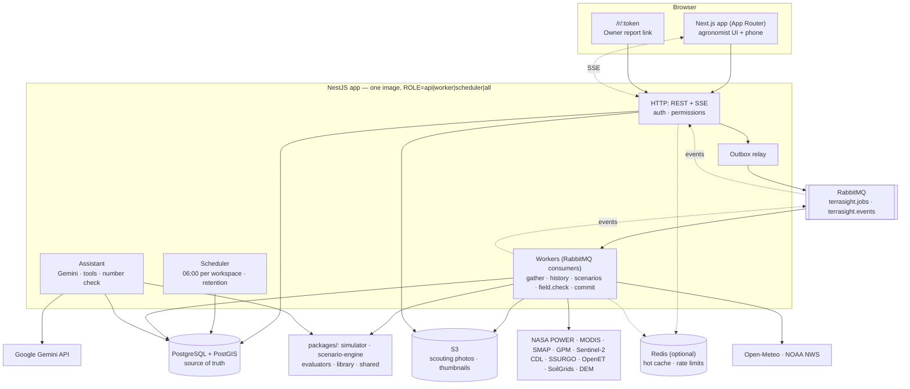
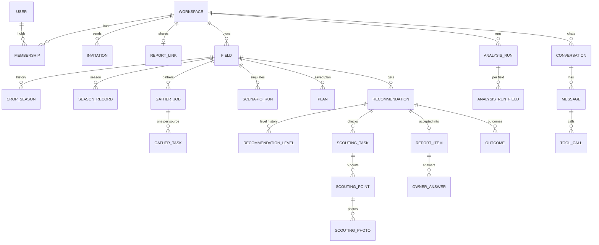
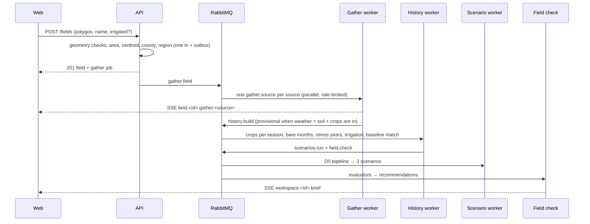

# Terrasight — Tech Design (v1.1)

| | |
| --- | --- |
| **Status** | **Agreed** v1.1 (2026-11-14). Build follows the epics in `epics/` |
| **Date** | 2026-11-14 |
| **Stage** | 3 of 3 — Product Definition → RFC → **Tech Design** |
| **Builds on** | [`01-product-definition.md`](01-product-definition.md) v2.5.2 (scope, priorities), [`02-rfc.md`](02-rfc.md) v2.2 (behaviour, decisions D1–D12), [`../design/README.md`](../design/README.md) (screens, routes, components, tokens) |
| **Data** | [`../data/rotations.json`](../data/rotations.json) v2 · [`../data/pests.json`](../data/pests.json) · `data/pest-models.json` and `data/prices.json` (new, §6) |
| **Backlog** | [`epics/`](epics/README.md): one file per epic, stories with acceptance criteria |
| **Open questions from the RFC** | None (RFC §19). This document's own questions are resolved (§20) |
| **What changed in v1.1** | Open questions 1–4 resolved (§20); hackathon simplifications (§1.1); Undo for Snooze (§10.3); a known test point per library region and an ISO-code alias map (§6.3–§6.4); laptop fallback (§17); framework versions pinned at kickoff (§3). Log in §21 |

---

## 1. Scope

This document fixes **how** the RFC's decisions are built: repository, runtime, modules, data model, messaging, APIs, frontend, testing and deployment.

| In the hackathon build (P0 path) | Later (P1/P2, designed here only where it shapes the data model) |
| --- | --- |
| Onboarding, workspace, roles, demo company copy | Notifications (bell) |
| Add field, gather, 18-season history, season record | Offline scouting (service worker) |
| Analysis runs: 06:00 schedule + Analyze fields, per-field status | Replay "as of" a past date |
| Evaluators for the 3 demo models; urgency; recommendation lifecycle | Dark theme (tokens exist) |
| Morning brief with Accept / Snooze + 8 s Undo; field brief | Stable zones and yield range (static mock in the hackathon) |
| AI assistant (Gemini, tools, number check, safety filter) | Work log, John Deere import, public API |
| Rotation planner (5 seasons, Monte Carlo, Save to the 2026 plan) | Disease, irrigation, sowing, weather-alert evaluators beyond the demo set |
| Scouting task (W-route, counts, photos, Send) | Threshold tuning from outcomes |
| Owner report, one-tap answers, report link, reply draft | |

### 1.1 Hackathon simplifications

The production design in this document stays as written. For the 48-hour build only:

| Area | Production design | Hackathon build | Backlog |
| --- | --- | --- | --- |
| Infrastructure | Terraform (§17) | EC2 set up by hand + docker compose | L-18 |
| Observability | pino logs + OpenTelemetry traces and metrics (§17) | pino logs only | L-19 |
| Visual tests | Storybook + screenshot diff against design PNGs (§16) | Storybook without screenshot diff | L-20 |
| API contract tests | Postman collection for every endpoint (§16) | P0 endpoints only | L-21 |
| Integration tests | Testcontainers for all pipelines (§16) | Only the analysis pipeline, the commit / Undo race and the partial unique indexes | L-22 |

---

## 2. Architecture



- **One NestJS image, several roles** (RFC §3). `ROLE=all` runs everything in one process for local work and the hackathon demo; `api`, `worker` and `scheduler` can be scaled separately later without code changes.
- **PostgreSQL is the source of truth** (RFC D2). RabbitMQ carries jobs and events; Redis holds only rebuildable data and can be absent.
- **Pure domain packages** (simulator, scenario engine, evaluators, urgency, number check) have no I/O and run in workers, in the assistant's what-if tools and in tests the same way.

---

## 3. Repository

pnpm workspaces + Turborepo, TypeScript everywhere (strict). Node.js, frameworks and infrastructure images use the **current stable versions pinned at kickoff** (exact versions in `package.json`, lockfile and `docker-compose.yml`).

```
apps/
  web/                 Next.js (App Router), React, Tailwind (tokens from design/tokens.css), next-intl, MapLibre GL
  api/                 NestJS: HTTP, SSE, workers, scheduler (ROLE env)
packages/
  shared/              zod schemas + types shared by web and api (DTOs, enums, events), units, date formatting
  library/             loaders + validators for rotations.json, pests.json, pest-models.json, prices.json; region matching
  sources/             source adapters (POWER, MODIS, Sentinel-2, CDL, SSURGO, OpenET, SMAP, GPM, SoilGrids, DEM, Open-Meteo, NWS)
  simulator/           FAO-56 water balance, FAO-33 Ky, SCS-CN, relative RUSLE, ICBM (ported from the PoC)
  scenario-engine/     D5 pipeline: filter → FAO-56 quick pass → Monte Carlo → price step → score → pick
  evaluators/          evaluator kinds, pest-model trees, confidence rule, urgency function, key numbers
  assistant-core/      tool schemas, number check, sentence splitter, safety filter (no Gemini SDK here)
  ui/                  design-system components (Button, Chip, HeroItem, QueueRow, BigNumber, SeasonStrip, …)
data/                  rotations.json, pests.json, pest-models.json, prices.json, admin boundaries (build artefacts in .gitignore)
design/                design handoff (read-only for engineers)
fixtures/              recorded real source responses for the demo fields (RFC §5.4)
prisma/                schema.prisma, migrations, seed (demo template workspace)
tools/                 build_rotations_v2.py, validate-library, record-fixtures, golden-questions runner
infra/                 docker-compose.yml (local, demo host, laptop fallback), Caddyfile; Terraform later (§1.1, §17)
```

Shared rules: ESLint + Prettier, `tsc --noEmit` in CI, Conventional Commits, one PR per story where possible.

---

## 4. Backend modules (NestJS)

| Module | Responsibility | RFC |
| --- | --- | --- |
| `auth` | Sign up / sign in (email + password), JWT access cookie, refresh rotation, CSRF | §16 |
| `workspaces` | Create the company (onboarding), settings (time zone, units, report language), demo copy | §14 |
| `members` | Memberships, roles, invitations (Viewer invite), permission guard | §14.1 |
| `library` | Loads and validates library files at boot; exposes versions; region matching | §6.3, §11.1 |
| `geo` | Reverse geocoding (ISO 3166-2, US county) from local PostGIS boundary tables | §6.3, §14.1 |
| `fields` | CRUD, PostGIS geometry, area, centroid, county, region, aliases for the LLM | D1 |
| `sources` | Source adapters, source cache, rate limits, fixtures fallback | D1, D2 |
| `gather` | Gather jobs and per-source tasks, progress events | D1 |
| `history` | Crop history (CDL / NDVI), bare months, stress years, irrigation detection, baseline match, overrides | D3 |
| `seasons` | Season records with value sources | §6.4 |
| `scenarios` | Scenario runs (D5) by inputs hash, plans ("Save to the 2026 plan") | D4, D5 |
| `forecast` | Open-Meteo / NWS per grid cell, fallback chain | D10 |
| `analysis` | Analysis runs, `field.check` consumer, per-field status, summary, retry | §10.2 |
| `recommendations` | Upsert from evaluator results, lifecycle, accept / snooze / undo / commit, urgency, brief | §10.3–§10.5 |
| `scouting` | Tasks, W-route, points, photos, send | §10.7 |
| `reports` | Owner report items, report links, owner answers, outcomes | D12 |
| `assistant` | Conversations, Gemini orchestration, tool executor, number check, safety, streaming | D9 |
| `events` | SSE endpoints, RabbitMQ topic subscription per API instance | §5.3 |
| `files` | S3 presigned uploads, thumbnails | §10.7 |
| `jobs` | Outbox relay, retention jobs (conversations 90 days), source cache expiry | §12.7 |

Module boundaries: a module only touches its own tables; cross-module reads go through exported services. Pure logic lives in `packages/`.

---

## 5. Data model

PostgreSQL + PostGIS (versions pinned at kickoff). Prisma for schema and most queries; raw SQL (via `$queryRaw`) for PostGIS functions. **Storage rules:** SI units (mm, ha, °C, kg, $), ISO dates, timestamps in UTC; the workspace time zone converts "today" and deadlines (RFC §16).



### 5.1 Tables

| Table | Key columns | Notes |
| --- | --- | --- |
| `users` | id, email (unique, citext), password_hash (argon2id), name, ui_language, created_at | |
| `refresh_tokens` | id, user_id, family_id, token_hash, expires_at, revoked_at, replaced_by | Rotation with family revocation |
| `workspaces` | id, name, slug, time_zone (IANA), units (`metric`/`imperial`), report_language (`uk`/`en`), currency, is_demo, demo_template_id, created_at | One workspace = one company |
| `memberships` | workspace_id, user_id, role (`owner`/`admin`/`agronomist`/`viewer`) | PK (workspace_id, user_id) |
| `invitations` | id, workspace_id, email, role, token_hash, expires_at, accepted_at | Viewer invite at onboarding |
| `report_links` | id, workspace_id, token_hash, language, expires_at, revoked_at | Optional link for staff without an account |
| `fields` | id, workspace_id, name, alias_no (int, per workspace), geom (`MultiPolygon, 4326`), centroid, area_ha, admin_code (ISO 3166-2), country, county_name, region_id (library) or null, tier, irrigation (`irrigated`/`dryland`/`unknown`), irrigation_source, slope_pct, thumbnail_key, created_by, archived_at | GIST index on geom |
| `crop_seasons` | field_id, season (harvest year), main_crop, second_crop, confidence, source (`cdl`/`lpis`/`ndvi`/`user`), is_override | PK (field_id, season) |
| `season_records` | field_id, season, crop, crop_source, sowing_date, sowing_source, emergence_date, irrigated, tillage, updated_by | Source order RFC §6.4 |
| `field_history` | field_id, built_at, inputs_hash, bare_months jsonb, stress_years jsonb, ndvi_peaks jsonb, irrigation_detection jsonb, baseline_match jsonb | Latest per field; provisional flag while sources finish |
| `source_cache` | key (sha256 of source + geometry/cell + params), source, params jsonb, payload jsonb (or s3_key if > 1 MB), fetched_at, expires_at, origin (`live`/`fixture`) | Long-lived; current year refreshed after 7 days |
| `gather_jobs` | id, field_id, status, started_at, finished_at | Partial unique index: one active per field |
| `gather_tasks` | job_id, source, status (`queued`/`running`/`done`/`partial`/`failed`/`cached`), attempts, error, finished_at | |
| `analysis_runs` | id, workspace_id, trigger (`schedule`/`manual`), requested_by, as_of (date), status, started_at, finished_at, summary jsonb | Partial unique: one active `schedule` run per workspace |
| `analysis_run_fields` | run_id, field_id, status (`waiting`/`running`/`ok`/`stale`/`failed`), data_date, error, new_recommendations | Partial unique on field: one active check per field |
| `scenario_runs` | id, field_id, inputs_hash, library_versions jsonb, result jsonb, duration_ms, created_at | Unique (field_id, inputs_hash) |
| `plans` | field_id, season, crop, rotation_id, scenario_run_id, saved_by, saved_at | "Save to the 2026 plan" |
| `recommendations` | id, workspace_id, field_id, type (`rotation`/`pest`/`disease`/`irrigation`/…), subject, season, status, level, confidence, tier, deadline, irreversible, planning (bool), key_numbers jsonb, drivers jsonb, evidence jsonb, unknowns jsonb, model_ref, versions jsonb, input_snapshot_id, text_override jsonb, edited_by, snoozed_at, snoozed_until, accepted_at, accepted_by, committed_at, dismissed_at, updated_at | Partial unique (field_id, type, subject, season) where status is live |
| `recommendation_levels` | recommendation_id, run_id, level, confidence, at | Level history |
| `input_snapshots` | id, hash, payload jsonb | Inputs of an evaluation, for outcomes and audit |
| `scouting_tasks` | id, recommendation_id, field_id, created_by, route geom (`MultiPoint`), status (`open`/`sent`), result_pct, sent_at, client_id (idempotency) | |
| `scouting_points` | task_id, idx (1–5), geom, affected (0–20), plants (20), checked_at | |
| `scouting_photos` | id, task_id, point_idx, s3_key, content_type, bytes, taken_at | |
| `report_items` | id, workspace_id, recommendation_id, text jsonb (uk/en snapshot), note, committed_at, superseded_by | Snapshot: the report never changes by itself |
| `owner_answers` | id, report_item_id, answer (`done`/`not_yet`/`question`), text, via (`user`/`link`), user_id, created_at | Latest shown, all kept |
| `outcomes` | id, recommendation_id, outcome (`confirmed`/`not_found`/`not_checked`), note, count, recorded_by, versions jsonb, input_snapshot_id | |
| `conversations` | id, workspace_id, user_id, title, created_at, expires_at (created + 90 days) | Retention job deletes expired rows |
| `messages` | id, conversation_id, role, text, checked (bool), fallback (bool), created_at | |
| `tool_calls` | id, message_id, tool, args jsonb, result jsonb, duration_ms | |
| `outbox` | id, topic, routing_key, payload jsonb, created_at, published_at | Transactional outbox (§7) |
| `audit_log` | id, workspace_id, user_id, action, target, at | Accept, commit, publish, role changes |
| `admin_areas`, `us_counties` | code, name, country, geom | Loaded at deploy from Natural Earth admin-1 and Natural Earth admin-2 US counties (§6.4) |

### 5.2 Key constraints

- One live recommendation per `(field_id, type, subject, season)` (RFC §10.4) — partial unique index on live statuses.
- One active gather job, one active field check per field; one active scheduled run per workspace — partial unique indexes (RFC §5.5).
- Every query in a workspace-scoped module filters by `workspace_id`; a Prisma middleware rejects queries on scoped tables without it.
- Report items are written once; a changed recommendation creates a new item that supersedes the old one only when the agronomist republishes.

---

## 6. Library files and reference data

| File | Schema / loader | Validation | Status |
| --- | --- | --- | --- |
| `data/rotations.json` v2 | `packages/library/rotations.ts` | `tools/build_rotations_v2.py --check` in CI, plus a zod schema at boot | Exists |
| `data/pests.json` | `packages/library/pests.ts` | zod schema; crop and region ids resolve | Exists |
| `data/pest-models.json` | `packages/library/pest-models.ts` | JSON Schema (§6.1); **CI fails if an `enabled` model has an unverified threshold** (RFC §11.3) | New — 3 demo models |
| `data/prices.json` | `packages/library/prices.ts` | Every crop used by a region has a price or the FAOSTAT fallback (RFC §16) | New |

Each file's content hash is its **version**, stored with every recommendation and scenario run (RFC §16).

### 6.1 `pest-models.json`

```json
{
  "version": 1,
  "models": [
    {
      "pest": "western_corn_rootworm",
      "enabled": false,
      "phase": "hackathon",
      "irreversible": false,
      "planning": true,
      "stageWindow": null,
      "tree": { "kind": "host_repeat", "host": ["corn", "silage_corn"], "seasons": { "ref": "repeatSeasons" } },
      "thresholds": {
        "repeatSeasons": {
          "value": 1, "unit": "seasons", "verified": false,
          "source": { "title": null, "publisher": null, "url": null, "accessed": null, "appliesTo": ["us-southern-plains", "us-central-high-plains"] },
          "verifiedBy": null, "verifiedAt": null, "reviewedBy": null
        }
      },
      "keyNumbers": ["hostSeasonsInRow", "hostSeasonsInPlan"],
      "scoutAction": null
    }
  ]
}
```

- The example is shown with `verified: false`; the CI gate keeps `enabled: false` until the team fills in the K-State / UNL / CSU source (RFC §11.3).
- Kinds: `host_repeat`, `host_interval`, `degree_days`, `weather_window`, `climate_anomaly`, `water_stress`, `green_bridge`, `sowing_before` (v1.2); combinators `all`, `any`, `max`, `gate` (RFC §11.2).
- Hackathon set: rootworm (`host_repeat` as a planning item), BYD with aphids (`sowing_before` the K-State BPMP date, deadline = first forecast freeze), wheat streak mosaic (`green_bridge`: volunteer green in the 14 days before sowing) (RFC §11.2 v2.3, §11.4).

### 6.2 `prices.json`

```json
{
  "version": 1,
  "currency": "USD",
  "regions": {
    "us-southern-plains": {
      "source": "USDA NASS / ERS", "asOf": "2025-12",
      "crops": { "corn": { "price": { "value": null, "unit": "$/t" }, "variableCost": { "value": null, "unit": "$/ha" }, "yieldRef": { "value": null, "unit": "t/ha" } } }
    }
  },
  "fallback": { "source": "FAOSTAT producer prices", "label": "Estimate", "byCountry": {} }
}
```

**Filled by the team before EP-06 starts** (S-06.05) for `us-southern-plains` and `us-central-high-plains`: prices from **USDA NASS prices received (2025 average)**, variable costs from **K-State crop budgets**; `source` and `asOf` recorded **per crop**. Nothing is hard-coded in code.

### 6.3 Region matching

`packages/library/region.ts` implements RFC §6.3 exactly as the Python validator does (`tools/build_rotations_v2.py`): ISO 3166-2 code or ISO 3166-1 country code in `admin`, optional `lat` / `lon` bounds, first match in file order. **Known test points:** [`data/region-test-points.json`](../data/region-test-points.json) holds at least one point per library region (24 regions, 27 points, plus one point with no region). Both checks read it:

- `tools/build_rotations_v2.py --check` matches each point with its stated ISO 3166-2 code and fails if a region has no point;
- `apps/api/scripts/check-region-points.mjs` (`pnpm --filter @terrasight/api boundaries:check`) derives each point's code from the loaded Natural Earth boundaries in PostGIS (§6.4) and must reach the same region. It lives in the API because it needs the database; `packages/library` stays free of I/O.

**ISO code aliases:** where Natural Earth uses an outdated ISO 3166-2 code for a library country, `packages/library/admin-aliases.ts` maps old → current code before matching; `rotations.json` is never edited for this. Likely candidates to check when the boundaries are loaded: China's numeric codes replaced in 2017 (`CN-13` → `CN-HE`, `CN-37` → `CN-SD`, `CN-41` → `CN-HA`). `boundaries:check` fails on any point whose derived code doesn't match a rule, which shows where an alias is needed.

### 6.4 Reverse geocoding

No external geocoding API for placing a field. At deploy, `pnpm --filter @terrasight/api boundaries:load` loads **Natural Earth admin-1** (has `iso_3166_2` codes) and **Natural Earth admin-2 US counties** into `admin_areas` and `us_counties` (census.gov blocks scripted TIGER downloads). Place search on the Add field map (typing a town name) goes through a rate-limited Nominatim proxy (`GET /api/geocode`); coordinates typed as `lat, lon` need no call. A field's centroid is matched with `ST_Contains`; the US county name feeds the UI region ("Logan County, CO", PD §9) and the ISO code feeds region matching.

---

## 7. Messaging

RabbitMQ (version pinned at kickoff). Exchanges:

| Exchange | Type | Use |
| --- | --- | --- |
| `terrasight.jobs` | direct | Work queues |
| `terrasight.retry` | direct | Delayed retries through TTL queues |
| `terrasight.dlx` | fanout | Dead letters → `dead` queue (alerted) |
| `terrasight.events` | topic | Progress and state events → API → SSE |

| Queue | Message | Consumer | Prefetch | Retries |
| --- | --- | --- | --- | --- |
| `gather.field` | `{fieldId, jobId}` | fans out one `gather.source` per source | 4 | 2 |
| `gather.source` | `{jobId, source}` | source adapter; per-request timeout 20 s, per-source task timeout 60–300 s (`SOURCE_TIMEOUT_MS`) | 8 | 2 (5 s, 30 s) |
| `history.build` | `{fieldId, provisional}` | history builder | 2 | 2 |
| `scenarios.run` | `{fieldId, inputsHash}` | scenario engine (worker threads) | 1 per CPU | 1 |
| `field.check` | `{runId, fieldId, asOf}` | analysis pipeline | 4 | 2 |
| `recommendation.commit` | `{recommendationId, acceptedAt}` | commits to the Owner report after 8 s (§10.3) | 16 | 3 |
| `retry.5s`, `retry.30s`, `commit.8s` | — | TTL queues dead-lettering back to `terrasight.jobs` | — | — |

**Event routing keys:** `field.<id>.gather.<source>`, `field.<id>.history`, `workspace.<id>.analysis`, `workspace.<id>.brief`, `conversation.<id>.answer`.

**Rules:**

- **Transactional outbox.** A request writes its rows and an `outbox` row in one transaction; the relay publishes and marks `published_at`. No job is lost when RabbitMQ is briefly down (RFC §17).
- **Idempotent consumers.** Every message carries an id; consumers check state in PostgreSQL before acting (e.g. a commit message for an undone item does nothing).
- **Events are hints.** On (re)connect the API sends the current state from PostgreSQL, then streams events (RFC §5.3).

---

## 8. Pipelines

### 8.1 New field: gather → history → scenarios → first check



Budget: first recommendations in < 60 s (PD §7). History is built provisionally as soon as weather, soil and crop history arrive, and rebuilt when the remaining sources finish.

### 8.2 Analysis runs (RFC §10.2)

- **Scheduler:** every minute, the scheduler process (one instance, protected by a PostgreSQL advisory lock) finds workspaces whose local time has passed 06:00 with no `schedule` run for today, creates the run and its field rows in one transaction, and enqueues one `field.check` per field.
- **Manual:** `POST /analysis-runs {fieldIds?}`; fields already being checked are attached to their running check instead of starting another.
- **`field.check`:** refresh by grid cell (POWER recent days, Open-Meteo recent observed days and forecast, NDVI if a new composite exists, SMAP) → season state → evaluators whose `stageWindow` matches → upsert recommendations → status `ok` / `stale` (a source failed; last good data and its date are kept) / `failed`.
- **Summary:** when the last field finishes, the run's summary is computed ("7 of 8 fields checked. Pivot 21: NASA POWER didn't respond — showing yesterday's data") and sent as `workspace.<id>.analysis`.
- **Retry:** a new single-field manual run.
- **Budget:** "Analyze fields" for the demo company < 30 s with history already built (PD §7).

### 8.3 Grid-cell sharing

Weather requests are keyed by provider cell: POWER's native grid; Open-Meteo / NWS at coordinates rounded to 0.1° (RFC §13). Fields in one cell share one cached response.

---

## 9. Simulator and scenario engine

### 9.1 Packages

```ts
// packages/simulator
simulateSeason(input: SeasonInput, weather: DailyWeather[]): SeasonResult   // FAO-56, Ky, SCS-CN, RUSLE index, ICBM
// packages/scenario-engine
runScenarios(field: FieldContext, lib: Library, prices: Prices, opts: ScenarioOptions): ScenarioResult
```

- **Horizon:** exactly 5 seasons (2026–2030; southern hemisphere 2025/26–2029/30 labelled by harvest year) — RFC §7.7.
- **Starting point:** the current rotation continues from its detected position; alternatives start at year 1 (RFC §7.7).
- **Double cropping:** `main` then `second` in one season, each on its own calendar; soil water carries over; margins add (RFC §7.8).
- **Weather runs:** 150 block-bootstrap runs of 2–3 consecutive POWER years (1981–2025), blocks cut at 1 January (north) or 1 July (south); plus "If 2022 repeats" with 2022 placed in each year 1–5, worst reported (RFC §7.3).
- **Prices:** 10 scenarios, fixed seed, scenario 0 = base, shared grain factor (RFC §7.4), applied after the weather step.
- **Determinism:** a seeded PRNG (PCG32) with seed = hash(field id, inputs hash); same inputs → same output.
- **Scale:** 15 × 155 × 5 × 365 ≈ 4.2 M daily steps (RFC §7.2); runs in a Piscina worker-thread pool; budget < 5 s per field on the demo host.
- **Cache:** results by `field + inputs hash` in `scenario_runs` (durable) and Redis (6 h); priority weights re-rank in the browser (< 50 ms, RFC §7.5).
- **From scratch:** there is no PoC (confirmed 2026-11-14); `packages/simulator` is written and tested from the FAO-56 / FAO-33 / SCS-CN / RUSLE / ICBM references.

### 9.2 Field brief numbers (PD §9, design 08)

Computed without degree days: corn-after-corn seasons in the saved/recommended plan (pest pressure count, RFC §8.5), corn years in a row from CDL, margin difference of the alfalfa option (scenario result).

---

## 10. Evaluators, urgency and lifecycle

### 10.1 Evaluators (`packages/evaluators`)

```ts
evaluate(model: PestModel, inputs: EvalInputs, asOf: Date): RiskResult
// RiskResult: level, deadline, irreversible, planning, keyNumbers[], drivers[], evidence[], unknowns[], confidence, tier
```

- Pure; inputs are a snapshot (weather series, forecast, crop history, season record, water balance, NDVI). The snapshot is hashed and stored in `input_snapshots`.
- **Confidence rule** (RFC §10.3): from tier; −1 step per estimated key input; pest and disease capped at `medium` until scouted.
- `unknown` is never shown as `low`.
- `asOf` exists but the product always passes today (replay is P2, RFC §10.6).

### 10.2 Urgency

```ts
classifyUrgency(item: { deadline: Date; irreversible: boolean; planning: boolean; openScoutingTask: boolean },
                now: Date, tz: string): 'urgent' | 'this_week' | 'all_good'
```

- Urgent: ≤ 7 days and irreversible, or ≤ 2 days. This week: any other ≤ 7 days, and every open scouting task. All good: the rest; planning items move to This week 14 days before their deadline (RFC §10.5).
- Days counted in the workspace time zone. Table-driven tests cover every boundary (6, 7, 8 days; 2/3 days; DST changes).
- The brief query returns groups, the hero (first Urgent, else first This week) and "+N" per field.

### 10.3 Lifecycle (RFC §10.4)

| Action | API | Effect |
| --- | --- | --- |
| Accept | `POST /recommendations/:id/accept {note?, text?}` | `status=accepted`, `accepted_at=now`; outbox → `commit.8s` |
| Undo | `POST /recommendations/:id/undo` | Works for **accepted or snoozed** items within 8 s of the action (`accepted_at` or `snoozed_at`); an accepted item must not be committed yet. Back to `open`, `snoozed_until` cleared |
| Commit | `recommendation.commit` consumer | If still accepted and 8 s have passed: write `report_items` snapshot, `committed_at`; event to the brief and Reports |
| Snooze | `POST /recommendations/:id/snooze` | `snoozed_at = now`, `snoozed_until` = next 06:00 in the workspace time zone; the 06:00 run reopens it if it still fires |
| Dismiss | `POST /recommendations/:id/dismiss` | Stays dismissed unless the level rises |
| Edit | `PATCH /recommendations/:id {text}` | Stored in `text_override`, marked "edited by the agronomist" |

The 8 s window is enforced on the server for both actions; the done row (design 17, `HeroItem` / `QueueRow` done state) shows the countdown for **Accept and Snooze** alike, from the `undoUntil` timestamp sent in the response (RFC §10.4).

---

## 11. Scouting (RFC §10.7, design 12)

- **Route:** take the polygon's oriented minimum bounding rectangle; inset the polygon by `edgeInset = min(30 m, 10% of the rectangle's shorter side)` (configurable per workspace; default to be confirmed by the reviewing agronomist); on the inset polygon's oriented bounding rectangle, place 5 points on a W at fractions (0.1, 0.9), (0.3, 0.1), (0.5, 0.9), (0.7, 0.1), (0.9, 0.9) of its axes, and move any point outside the inset polygon to the closest point inside (`ST_ClosestPoint`). Deterministic for a given polygon.
- **Draft:** kept in `localStorage` per task, labelled "Saved automatically" (never "works offline").
- **Send:** `POST /scouting-tasks/:id/send` with all 5 counts and a client id (idempotent). The server rejects fewer than 5 points; `result_pct = Σ affected / 100`.
- **Photos:** presigned S3 PUT (JPEG / PNG / HEIC, ≤ 10 MB), private bucket, read through short-lived signed URLs. Not sent to Gemini.
- **Effect:** the result is added to the recommendation's Why and lifts the confidence cap; it changes the level only through a verified `scoutAction` threshold (RFC §10.7).

---

## 12. AI assistant (RFC D9, design 14)

### 12.1 Turn

1. `POST /conversations/:id/messages {text, context:{fieldId?, recommendationId?}}` → 202; the answer streams on SSE `conversation.<id>.answer`.
2. The orchestrator (`@google/genai`) sends the system rules, history and tool declarations generated from the zod schemas in `assistant-core`.
3. Function calls run in the **tool executor**, which takes `workspaceId`, role and field scope from the session — never from the model's arguments. Field names are replaced by aliases (`F<alias_no>`) on the way out and restored in the UI.
4. Up to 6 tool calls, 30 s per turn. Progress events: "Reading 2022 weather…".
5. The answer text is split into sentences (`Intl.Segmenter`, `uk` / `en`); each sentence passes the **number check** and the **safety filter** before it is sent.
6. On the first failing sentence the rest is replaced by a plain card built from the turn's tool results ("Showing the data directly"); `messages.fallback = true`.

### 12.2 Number check (`assistant-core/number-check.ts`)

- **Allowed set:** every number in the turn's tool results, flattened with units; each value also at the UI's display precision and in supported unit conversions (mm↔in, ha↔ac, °C↔°F, $/ha↔$/ac); dates in both UI formats; numbers in the user's question; list numbering.
- **Extracted from a sentence:** digits, decimals, percentages, ranges, dates, and number words 0–20 in EN and UA.
- A sentence passes when every extracted number is in the allowed set. No arithmetic by the model: differences come from `compare`.
- Unit-tested with a fixture set of passing and failing sentences in both languages.

### 12.3 Safety filter

- Dose pattern: an amount with a per-area or per-volume unit (`l/ha`, `kg/ha`, `g/ha`, `ml/ha`, `oz/ac`, `pt/ac`, `lb/ac`, `л/га`, `кг/га`, `г/га`, `мл/га`).
- Active-ingredient and product list: `data/safety/actives.txt` (maintained list, EN and UA spellings).
- A match replaces the sentence with "Choice of treatment and dose: follow the product label and local rules." Refusal templates in EN / UA for product, chemical-price and legal questions.
- "10 years" (any language form) in a rotation context is rewritten to the 5-season wording and logged.

### 12.4 Tools

As in RFC §12.3: `list_fields`, `get_brief`, `get_field_summary`, `get_field_history`, `get_weather`, `get_forecast`, `list_recommendations`, `explain_recommendation`, `run_risk_model`, `run_rotation_scenarios`, `compare`, `get_pest_info`. All read-only. Owner reply drafts (`POST /report-items/:id/reply-draft`) are built from the item's template and may be rephrased by Gemini under the number check; the owner's text is never sent (RFC §12.6).

### 12.5 Operations

- Model id from `GEMINI_MODEL` (a Flash-class model); paid tier; DPA review before production.
- Rate limits per user and workspace (Redis token bucket, in-process fallback).
- Retention: `conversations.expires_at = created_at + 90 days`; a daily job deletes expired conversations with their messages and tool calls; users can delete earlier.
- **Golden questions:** `tools/golden/*.yaml` (EN + UA) run in CI against recorded tool results and, nightly, against the live model; reports number-check pass rate, refusals and horizon wording. Logs hold no customer data.

---

## 13. Sources and forecast

| Source | Use | Access | Rate limit / cache |
| --- | --- | --- | --- |
| NASA POWER | Daily weather 1981+ | POWER daily point API (`/api/temporal/daily/point`, community AG) | Per cell; history cached permanently, recent days daily |
| MODIS NDVI | Crop stage, history, irrigation | Microsoft Planetary Computer `modis-13Q1-061` (STAC + COG range reads, anonymous SAS token). The ORNL DAAC subset API returned 503 on 2026-11-14 | Per field; 16-day composites |
| Sentinel-2 | NDVI (10 m) for `green_bridge`, field thumbnails | **Copernicus Data Space Ecosystem** (free account; Sentinel Hub Statistical + Process APIs). Documented fallback only: Microsoft Planetary Computer (STAC + COGs) | Per field; thumbnails stored in S3 |
| USDA CDL | Crop per year (US) | CropScape service (GMU); Planetary Computer `usda-cdl` covers only 2008–2021, so it is a fallback for those years | Permanent |
| SSURGO / SoilGrids | Soil water capacity, texture | Soil Data Access (SQL over REST, area-weighted by map unit) / SoilGrids REST | Permanent |
| OpenET | Irrigation detection, model check | OpenET API (key) | Permanent per year |
| SMAP, GPM IMERG | Soil-moisture check, recent rain | NASA Earthdata (account) | Daily |
| DEM | Slope | Copernicus DEM GLO-30 on Planetary Computer (`cop-dem-glo-30`, COG) | Permanent |
| Open-Meteo | Forecast, recent observed days, soil temperature, ET₀ | Commercial API key | Per 0.1° cell, 6 h |
| NOAA NWS | US forecast fallback | `api.weather.gov` points → gridpoint forecast, generic User-Agent | Per 0.1° cell, 6 h |

- Adapter interface: `fetch(params, signal): Promise<SourceResult>` with `status` (`done` / `partial` / `failed`), payload, `dataDate`, attribution.
- Token buckets per source in Redis (Lua), half-rate in-process fallback when Redis is down (RFC §5.2).
- Fixtures: `tools/record-fixtures` records real responses for the demo fields; the cache serves them only when a live call fails, labelled `cached` with their date (RFC §5.4).
- Forecast fallback chain: Open-Meteo → NWS (US) → last cached forecast with its age → none (`stale`, future window `unknown`) (RFC §13).

---

## 14. HTTP API

REST under `/api`, JSON, zod-validated (nestjs-zod), errors as `application/problem+json` (RFC 9457). The active workspace is in the path. OpenAPI generated from the schemas; a **Postman** collection is generated from it and run with the Postman CLI in CI as the contract test.

| Area | Endpoints | Roles |
| --- | --- | --- |
| Auth | `POST /auth/signup`, `/auth/login`, `/auth/refresh`, `/auth/logout`, `GET /me` | — |
| Workspaces | `POST /workspaces` (onboarding), `GET/PATCH /w/:ws`, `POST /w/:ws/demo-copy` | Owner, Admin for PATCH |
| Members | `GET /w/:ws/members`, `POST /w/:ws/invitations`, `POST /invitations/:token/accept`, `PATCH/DELETE /w/:ws/members/:userId` | Owner, Admin |
| Fields | `GET/POST /w/:ws/fields`, `GET/PATCH/DELETE /w/:ws/fields/:id`, `POST /w/:ws/fields/preview` (area, county, region before saving) | Agronomist+; Viewer read |
| History | `GET /w/:ws/fields/:id/history`, `PUT /w/:ws/fields/:id/crop-seasons/:season` (override), `PUT …/season-records/:season`, `POST …/irrigation/confirm` | Agronomist+ |
| Gather | `GET /w/:ws/fields/:id/gather`, `POST …/gather/sources/:source/retry` | Agronomist+ |
| Analysis | `POST /w/:ws/analysis-runs {fieldIds?}`, `GET /w/:ws/analysis-runs/latest`, `POST /w/:ws/analysis-runs/:id/fields/:fieldId/retry` | Agronomist+ |
| Brief | `GET /w/:ws/brief` (groups, hero, last run, rail data) | Agronomist+; Admin, Owner read |
| Recommendations | `GET /w/:ws/recommendations/:id`, `POST …/accept`, `…/undo`, `…/snooze`, `…/dismiss`, `PATCH …` (text), `POST …/outcome` | Agronomist+ |
| Scenarios | `POST /w/:ws/fields/:id/scenario-runs {overrides}`, `GET …/scenario-runs/:runId`, `PUT /w/:ws/fields/:id/plans/:season` | Agronomist+ (Viewer can explore) |
| Scouting | `POST /w/:ws/recommendations/:id/scouting-tasks`, `GET /w/:ws/scouting-tasks/:id`, `POST …/photos/presign`, `POST …/send` | Agronomist+ |
| Reports | `GET /w/:ws/report`, `POST /w/:ws/report-items/:id/republish`, `POST …/reply-draft`, `POST /w/:ws/report-links`, `DELETE /w/:ws/report-links/:id` | Agronomist+; Viewer read and answer |
| Owner answers | `POST /w/:ws/report-items/:id/answers`, `GET /r/:token`, `POST /r/:token/items/:id/answers` | Viewer; link holder |
| Assistant | `POST /w/:ws/conversations`, `GET /w/:ws/conversations`, `POST …/:id/messages`, `DELETE …/:id` | Agronomist+ |
| Events (SSE) | `GET /w/:ws/events?topics=brief,analysis,field:<id>,conversation:<id>` | Member |

### 14.1 Auth and permissions

- Access token: 15-min JWT in an httpOnly, Secure, SameSite=Lax cookie; refresh token (opaque, hashed) in PostgreSQL with rotation and family revocation; `auth:rt:<id>` revocation-check cache in Redis (60 s), PostgreSQL when Redis is absent (RFC D2).
- Passwords: argon2id. CSRF: SameSite cookies + required `X-Requested-With` header on mutating requests.
- Report links: 32-byte random token, only its SHA-256 stored; rate-limited; read + answer only.

| Permission | Owner | Admin | Agronomist | Viewer | Report link |
| --- | --- | --- | --- | --- | --- |
| Billing, delete workspace | ✓ | | | | |
| Members, invitations, settings, report links | ✓ | ✓ | | | |
| Fields: create, edit, delete | ✓ | ✓ | ✓ | | |
| Analyze fields, accept / snooze / dismiss / edit, outcomes | ✓ | ✓ | ✓ | | |
| Scouting, assistant, plans | ✓ | ✓ | ✓ | | |
| Read brief, fields, history | ✓ | ✓ | ✓ | | |
| Explore rotation scenarios (no save) | ✓ | ✓ | ✓ | ✓ | |
| Read Owner report, passports; answer items | ✓ | ✓ | ✓ | ✓ | ✓ |

Every row has an API test (§16).

---

## 15. Frontend (design/README.md)

### 15.1 Stack

Next.js App Router, React, TypeScript, Tailwind with `design/tokens.css` variables mapped in `theme.extend` (no hex in components), next-intl (`uk`, `en`; messages generated from `design/i18n/*.json`), TanStack Query for server state, a small SSE client that invalidates queries on events, MapLibre GL + Terra Draw for drawing fields, react-hook-form + zod for forms.

### 15.2 Routes

Routes follow design/README §2. The active workspace comes from a cookie (`ts_ws`) and is put into API paths; the locale comes from the user's setting (no locale prefix).

| Route | Screen | Notes |
| --- | --- | --- |
| `/login` | 01 Login | |
| `/onboarding` | 02 Onboarding | 2 steps; time zone detected from `Intl.DateTimeFormat().resolvedOptions().timeZone` |
| `/` | 03 EmptyHome · 04 Main · 05 MainMobile | Empty state until the first field; < 640 px uses the phone layout |
| `/fields`, `/fields/new` | 07 Fields · 13 AddField | |
| `/fields/:id` | 08 Field | Tabs: Overview · Zones & yield · Rotation · Owner report |
| `/fields/:id/recommendations/:rid` | 09 Rec | |
| `/fields/:id/rotation`, `/fields/:id/zones` | 10 Rotation · 11 Zones | Zones is a static mock in the hackathon |
| `/scout/:taskId` | 12 Scout | Phone-first |
| `/assistant` | 14 Assistant | The panel on 08 reuses the same components |
| `/reports` | 15 Reports | |
| `/r/:token` | 16 Report | Public, no app chrome |

### 15.3 Components

Built first in `packages/ui`, exactly as listed in design/README §3: Button, Chip, HeroItem, QueueRow, BigNumber, FactorRows, SeasonStrip, FieldThumb, RailCard, AnalysisPanel, BottomSheet, Nav, Skeleton, ErrorCard, DoneRow, EmptyState. Each has a Storybook story and a visual check against `design/screens/*.png`.

### 15.4 Behaviour

- Accept / Snooze in place with a done row and an **8 s countdown** driven by the server's `acceptedAt + 8 s`; on phones Accept opens a BottomSheet showing the owner's view first (design 05).
- `aria-live` on AnalysisPanel, done rows and the scouting counter; focus ring 2 px; tap targets ≥ 44 px; reduced motion turns animations off (design/README §5).
- Units and dates via `packages/shared/format`: workspace units; EN "Jun 25", UA "25.06".
- Copy rules: "Owner report", "5 years / 2026–2030", no product names.

---

## 16. Testing

| Level | Tool | What |
| --- | --- | --- |
| Unit | Vitest | Simulator (PoC tests kept), scenario engine, evaluators per kind, urgency table, confidence rule, number check (EN/UA fixtures), safety filter, region matching, W-route |
| Library | `tools/build_rotations_v2.py --check`, `validate-library` | rotations, pests, pest-models CI gate, prices coverage |
| Integration | Vitest + Testcontainers (PostGIS, RabbitMQ, Redis) | Pipelines end to end with fixtures; outbox; idempotent consumers; commit after 8 s and Undo race; partial unique indexes |
| API contract | Postman CLI running the generated collection against a test stack | Every endpoint, problem+json errors, permission matrix rows |
| E2E | Cypress | P0 path: sign up → onboarding → add field → history → Analyze fields → brief → Accept + Undo → assistant "why?" → rotation Save → scouting Send → Owner report answer via link |
| Visual | Storybook + screenshot diff | `packages/ui` against design PNGs |
| Assistant | Golden questions | Number-check pass rate, refusals, horizon wording |
| Performance | k6 / scripts | Analyze fields < 30 s (demo company); scenario run < 5 s; brief API < 300 ms |

CI (GitHub Actions): lint → typecheck → unit → library checks → integration → contract → build images; E2E on the main branch and before the demo. The hackathon build narrows visual, contract and integration tests as listed in §1.1.

---

## 17. Deployment

| | Hackathon demo | Later (production path) |
| --- | --- | --- |
| Compute | One EC2 instance (e.g. 4 vCPU / 16 GB) running `docker compose`: web, api (`ROLE=all`), PostGIS, RabbitMQ, Redis, Caddy (TLS) | ECS Fargate: web, api, worker, scheduler services behind an ALB (idle timeout for SSE) |
| Database | PostGIS container with daily `pg_dump` to S3 | RDS PostgreSQL + PostGIS, Multi-AZ |
| Broker / cache | Containers | Amazon MQ (RabbitMQ), ElastiCache Redis |
| Files | S3 bucket (private) | Same |
| Secrets | SSM Parameter Store, loaded at start | Secrets Manager |
| Infra as code | None: the EC2 instance, S3 bucket, IAM role and DNS are set up by hand (§1.1) | Terraform modules per service |

- Environments: `local` (docker compose), `demo` (EC2).
- **Laptop fallback for the stage:** the same docker compose stack on a laptop with the demo seed and recorded fixtures (§13), so the demo runs without the EC2 host or the network. Gemini and live sources are then unavailable; the brief, cards, report and scenarios still work, and cached data is labelled with its date. Seed: the demo template workspace (Prairie Field Co.: Kansas, Nebraska, Colorado incl. Logan County) with recorded fixtures.
- Secrets: `DATABASE_URL`, `RABBITMQ_URL`, `REDIS_URL` (optional), `JWT_SECRET`, `GEMINI_API_KEY`, `GEMINI_MODEL`, `OPEN_METEO_API_KEY`, `OPENET_API_KEY`, `EARTHDATA_TOKEN`, `CDSE_CLIENT_ID/SECRET`, `S3_BUCKET`.
- Observability (production; the hackathon has pino logs only, §1.1): pino JSON logs, OpenTelemetry traces (HTTP, RabbitMQ, outbound sources), metrics: run duration, field statuses, source failures, number-check fallback rate, commit latency. Health checks: `/healthz` (process), `/readyz` (PostgreSQL, RabbitMQ; Redis optional).

---

## 18. Security and privacy

- Workspace isolation in every query (Prisma middleware) and in the assistant's tool executor.
- Data to Gemini: aliases, derived data, no names, coordinates, owner text or photos (RFC §12.6).
- Retention: conversations 90 days; source cache by expiry; photos kept with the field.
- Rate limits: auth endpoints, report links, assistant, source adapters.
- Dependencies scanned in CI; images built from pinned base images.

---

## 19. Build order and backlog

Epics follow the P0 path (details and stories in [`epics/`](epics/README.md)):

| # | Epic | Main sections |
| --- | --- | --- |
| EP-00 | Foundation (enabler) | §3, §5, §7, §16, §17 |
| EP-01 | Onboarding & workspace | §14.1, §15.2; RFC §14 |
| EP-02 | Fields & history | §6.3–§6.4, §8.1, §13; RFC D1, D3 |
| EP-03 | Analysis runs & evaluators | §6.1, §8.2, §10.1; RFC §10.2–§10.3, §11 |
| EP-04 | Morning brief | §10.2–§10.3, §15.4; RFC §10.4–§10.5 |
| EP-05 | AI assistant | §12; RFC D9 |
| EP-06 | Rotation planner | §6.2, §9; RFC D4, D5 |
| EP-07 | Scouting | §11; RFC §10.7 |
| EP-08 | Owner report | §14; RFC D12 |
| EP-09 | Demo readiness (enabler) | §13 fixtures, §16 E2E, §17 |
| Later | Zones & yield, offline scouting, notifications, dark theme, replay, work log, integrations | [`epics/later.md`](epics/later.md) |

---

## 20. Open questions — resolved

All resolved on 2026-11-14.

| # | Question | Decision |
| --- | --- | --- |
| 1 | Demo hosting | One EC2 instance with docker compose, set up by hand; a **laptop fallback** (docker compose + recorded fixtures) for the stage (§17) |
| 2 | Sentinel-2 access | **Copernicus Data Space Ecosystem** (free account); Microsoft Planetary Computer is the documented fallback only (§13) |
| 3 | Prices | The team fills `data/prices.json` for `us-southern-plains` and `us-central-high-plains` before EP-06 starts: USDA NASS prices received (2025 average), K-State crop budgets for variable costs; source and `asOf` per crop (§6.2) |
| 4 | Scouting edge inset | `min(30 m, 10% of the shorter side of the oriented bounding rectangle)`, configurable per workspace; to be confirmed by the reviewing agronomist (§11) |

---

## 21. Decision log

| Date | Decision | Rationale |
| --- | --- | --- |
| 2026-11-14 | Monorepo (pnpm + Turborepo) with pure domain packages | Same logic in workers, assistant tools and tests |
| 2026-11-14 | One NestJS image with `ROLE` | RFC §3: one app for the hackathon, split later without code changes |
| 2026-11-14 | Transactional outbox for every published job | No lost jobs when RabbitMQ is briefly down; PostgreSQL stays the source of truth |
| 2026-11-14 | 8 s Undo enforced on the server through a delayed `commit.8s` queue | RFC §10.4: the owner never sees an item that is then pulled back |
| 2026-11-14 | Offline reverse geocoding (Natural Earth admin-1 + TIGER counties in PostGIS) | No external geocoding dependency; ISO 3166-2 codes match library v2 rules |
| 2026-11-14 | Routes as in design/README, workspace in a cookie, locale from user setting | Matches the handoff; no locale or workspace prefix in URLs |
| 2026-11-14 | Postman CLI runs the generated collection as the API contract test | One source (OpenAPI) for docs and contract tests |
| 2026-11-14 | Open questions 1–4 resolved: EC2 + laptop fallback, CDSE for Sentinel-2, NASS + K-State prices, edge inset `min(30 m, 10%)` | Answers to Tech Design v1 §20 |
| 2026-11-14 | Hackathon simplifications (§1.1): no Terraform, no OpenTelemetry, no screenshot diff, P0-only contract tests, focused Testcontainers tests | Fit 48 hours; the production design stays unchanged and each item is in the backlog (L-18–L-22) |
| 2026-11-14 | Undo works for Snooze too, same 8 s window and endpoint | RFC §10.4: the done row shows the countdown for both actions |
| 2026-11-14 | One known test point per library region, shared by the Python validator and the API boundary check; ISO-code alias map in `packages/library` | Region matching is checked against real boundaries without editing `rotations.json` |
| 2026-11-14 | Framework versions pinned at kickoff instead of fixed in the document | The document stays valid; exact versions live in the lockfile and compose file |
| 2026-11-14 | Natural Earth admin-2 counties instead of US Census TIGER | census.gov answers scripted downloads with a Cloudflare challenge; Natural Earth has every US county with names and FIPS |
| 2026-11-14 | Region test point check runs as an API script against PostGIS, not in `packages/library` | It needs the loaded boundaries; the library package stays pure |
| 2026-11-14 | Per-source task timeouts 60–300 s; each HTTP request still times out at 20 s | One source is many requests (MODIS: ~1,100 composites in ~2 min); RFC's "about 20 s" holds per request |
| 2026-11-14 | Irrigation test uses root-zone storage (SSURGO `aws0100wta`, 0–100 cm), not the 0–150 cm profile | The full profile can't be drawn down and refilled every season; with it the Garden City pivot read as "unknown" |
| 2026-11-14 | Open-Meteo free endpoint when `OPEN_METEO_API_KEY` is not set; the commercial endpoint with the key | No paid key yet; the hackathon demo is non-commercial. Switching is configuration only |
| 2026-11-14 | A field attached to another run's active check is kept in that run's `summary.attached` until the check finishes, then copied in | The partial unique index allows one active `analysis_run_fields` row per field across runs |
| 2026-11-14 | Daily field check refreshes POWER, the forecast and (only when an enabled model needs it) Sentinel-2; MODIS is not refreshed daily | No P0 evaluator reads MODIS; a MODIS refresh takes ~2 min per field |
| 2026-11-14 | Input snapshots keep the last 430 days of weather and reference the POWER data date for the rest | A full 1981+ series per field per day would be ~1.5 MB; the hash still covers the full inputs |
| 2026-11-14 | Planning deadline when the next crop isn't chosen: the typical sowing date of the model's host crop in the region | The decision has to be made before the host would be sown; never a 7-day scouting window for a planning item |
| 2026-11-14 | Demo models follow K-State rules: BYD = sown before the BPMP date (Zone 1, 10 Sep, as the statewide rule); WSM = volunteer green in the 14 days before sowing; new kind `sowing_before`; `source.type` = extension / fallback / calibration; a value applies only in its source's `appliesTo` regions | Extension sources give no percentile, degree-day or NDVI thresholds (research 2026-11-14); decided by the team |
| 2026-11-14 | Gemini model `gemini-3.8-flash` (`GEMINI_MODEL`), SDK `@google/genai` 2.9.0; the model's turn is sent back unchanged so Gemini 3 thought signatures survive tool calls | `gemini-2.5-flash` is closed to new keys; the free tier failed under load, the paid tier works |
| 2026-11-14 | Field names the user types are replaced by aliases F<n> before a question or the history goes to Gemini | RFC §12.6 forbids field names leaving; free text was the gap |
| 2026-11-14 | The chat sends the UI language with each question; the profile language is only the fallback | The web keeps the UI language in a cookie, not in `users.ui_language` |
| 2026-11-14 | Numbers inside tool text (e.g. "crop for 2026 not known yet") and all keys of quantity objects count as allowed values; rounding is allowed only down to the display precision | Live answers failed on years the tools did return; "48 ha" must not pass for 47.63 ha shown as 47.6 |
| 2026-11-14 | Golden questions: 33 per language in `tools/golden/*.yaml`; `--live` records answers and tool results from a running API, CI replays the recordings (`pnpm golden`); no nightly live job yet | CI has no Gemini key; a live job needs the demo company running (S-09.03) |
| 2026-11-14 | Brand names that are ordinary English words (Liberty, Capture, Headline…) are left out of `data/safety/actives.txt` | They would block normal sentences |
| 2026-11-14 | Prices: USDA NASS Crop Values 2025 (preliminary), costs and yields from K-State 2027 / UNL 2026 budgets (irrigated and dryland), verified by the team; fallow costs $0 (inside the wheat–fallow budget) | S-06.05; no budget prices a fallow year alone |
| 2026-11-14 | Budget yields are calibrated to the field: a quick FAO-56 pass finds each crop's median water-stress ratio, and yields scale so a median year gives the budget yield | Budget yields are typical, not stress-free maxima |
| 2026-11-14 | Rotation yield effects (verified): corn after corn 0.88 irrigated / 0.90 dryland, sorghum after sorghum 0.65 dryland, wheat after wheat 0.74 dryland; no alfalfa yield bonus | Without them continuous corn won on margin; K-State Tribune trials and UNL CropWatch |
| 2026-11-14 | Plan horizon fixed at PLAN_FIRST_SEASON = 2026 (2026–2030); season records and evaluators use the 2026 plan while the calendar season is later; a rotation item's default deadline rolls to the next typical sowing date if past | Team decision: keep the documented horizon for the demo |
| 2026-11-14 | Scenarios run in a worker thread per request and are cached in scenario_runs by inputs hash (incl. library versions and ENGINE_VERSION); Redis 6 h cache not added | One worker per run is enough for the demo; the DB cache covers repeats |
| 2026-11-14 | Starting soil carbon 45 t C/ha when no measurement exists | ICBM needs a start; changes over 5 seasons are shown as a trend (RFC §7.7) |
| 2026-11-14 | Fixtures use a stable key (the adapter cache key with "fixture" for the date) and a per-cell forecast recording; recorded from the demo template's gathered responses (`scripts/record-fixtures.mjs`) | A date-based key would never match on the demo day |
| 2026-11-14 | A model whose required thresholds have no source for the field's region produces no item there (library only); `bufferM` is optional | Otherwise BYD in Colorado showed as an urgent "unknown" item and pushed the real high risk out of the hero |
| 2026-11-14 | After the final history build the field is checked at once (Tech Design §8.1); demo copy brings recommendations, report items and owner answers | First recommendations without waiting for 06:00; the demo tells its story immediately |
| 2026-11-14 | E2E: one Cypress spec for the P0 path, run locally before the demo; not in CI yet | CI has no Gemini key and live sources make it slow; fixtures cover only the demo fields |
| 2026-11-14 | Demo host files (`infra/prod/`, `docs/runbook-demo-host.md`) prepared; the team creates the AWS resources and deploys | Team decision; no AWS calls from the assistant |
| 2026-11-14 | No PoC: adapters and simulator written from scratch; MODIS and DEM through Planetary Computer, CDL through CropScape | The PoC named in early docs doesn't exist; ORNL MODIS API was down (503); Planetary Computer CDL stops at 2021 |
| 2026-11-15 | No demo company and no example data: `POST /workspaces/demo-copy`, `seed-demo.mjs` and the template removed; `workspaces.is_demo` / `demo_template_id` dropped (migration `20261115120000_drop_demo`); Zones & yield mock replaced by a real **Work log** tab (`/fields/:id/log`) | Owner decision: the product shows only real data (product definition v2.6) |
| 2026-11-15 | Assistant model `gemini-3.5-flash-lite` (was `gemini-3.8-flash`), set by `GEMINI_MODEL` | Cost: $0.30 / $2.50 per 1M tokens vs $0.75 / $3.75 (and $1.50 / $7.50 from 2027) |
| 2026-11-15 | Owner decisions replace the Owner report: Accept no longer creates a report item; `POST /recommendations/:id/ask-owner` does (after the 8 s Undo); `/decisions` API with a thread (note → answers → replies); report_items / owner_answers / report_replies tables reused as decisions / answers / replies | Owner feedback: accepting and sending to the owner were one button although most advice doesn't concern the owner; the monthly report read as paperwork (product definition v2.7) |
| 2026-11-15 | AI-proposed rotations: Gemini proposes crop sequences (structured output, crop ids from the library), validated by rules and simulated by the scenario engine; cached with the scenario inputs hash | Owner request; the library is thin for Ukraine; the number rule holds because the engine computes every metric (product definition v2.8) |
| 2026-11-15 | Owner creates users: `POST /w/:ws/members` creates the account (no password) + a one-time setup token (hash stored, 7 days) → `/setup/:token` sets the password; existing email → membership only. Decision recipients = Owner + Viewer; "Ask the owner" hidden for Owners | Owner feedback: the Owner is the farm owner, not the agronomist who signed up (product definition v2.9) |
| 2026-11-15 | AI-written recommendation text, watch-items and day summary (`AI_RECOMMENDATIONS`): after the evaluators run, `AiRecommendationsService` makes one batched Gemini call per field check (changed items + up to 2 watch-item proposals), validates with the assistant number check and safety filter, stores `recommendations.ai_text` (`source: ai` or `template` + facts hash) and `ai_suggested` watch-items (level `unknown`, never in Urgent; brief group `worthALook`); the day summary is generated in the background per brief facts hash and pushed with `brief.changed` | Owner request; the rules hold because levels, numbers and deadlines stay deterministic, every number in the text must be among the facts, and the template text (`text.ts`) is always the fallback. Cost: facts-hash skip, cross-field text cache, 15 s timeout, circuit breaker after 3 failures (product definition v2.11) |
