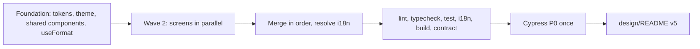

# Design review v5

Status: audit finished 2026-11-15 (15 read-only reviews of the built web app against `design/` v4 and Product Definition v2.12). This document records the findings, the decisions and the implementation plan. v5 is implemented in code; no static mock-ups are produced.

## 1. Summary

| # | Problem | Solution |
| --- | --- | --- |
| 1 | **Too much on one screen.** The field page stacks about 14 cards, the recommendation hero has 5 actions, the rotation page shows up to 8 notices. | One job per screen: field Overview keeps at most 7 blocks, each screen has one primary action, secondary actions go into a "More" menu, notices collapse into one "Notes on these numbers". |
| 2 | **Navigation does not match the roles.** 8 sidebar items, 6–7 phone tabs, and the Owner sees the agronomist's tools first. | 5 sidebar items plus Settings, 4 phone tabs plus "More", Team inside Settings, Rotations renamed Plan, and an Owner home that starts with decisions. |
| 3 | **States are inconsistent.** Action failures show a red line without a retry, offline only says "offline", long operations give no time estimate, and estimates are marked by colour alone. | One state system: skeleton variants, errors as toasts that stay with Retry, an offline banner that says what still works, one progress pattern with "typical 2 min, safe to leave", and icon plus word for every status. |
| 4 | **Raw and hard-coded text.** Raw keys, tool names and crop ids reach the screen; units, currency, sources and the language of the owner's link are hard-coded. | One formatting layer (`useFormat`) for dates, numbers, money and units; no raw id may render; source lines are built from the sources actually used; a glossary fixes the wording. |
| 5 | **Phone and accessibility gaps.** The 18-season strip has 17 px tiles, input borders have 1.5:1 contrast, tabs lack arrow keys, many targets are under 44 px, and chart text shrinks to about 7 px. | 44 px targets everywhere, a control border with 3:1 contrast, real ARIA tabs and menus, a scrollable season strip, chart text of at least 12 px, and primary actions within thumb reach. |

## 2. System decisions

| Area | Decision |
| --- | --- |
| Sidebar (Agronomist) | Today · Fields · Plan · Assistant · Decisions, then Settings. Work windows live inside Today and the field page. Work log moves under the field and Plan. |
| Sidebar (Owner) | Decisions · Today · Fields · Plan · Assistant, then Settings (with Team and Prices). |
| Phone tabs | Today · Fields · Assistant · Decisions · More. "More" holds Plan, Work windows, Settings and Sign out. Scouting is reached from Today and from the field. |
| Field page tabs | Overview · Season · Plan (rotation) · Data & history. Zones and Work log are links inside Data & history. |
| Field Overview | Header (Archive in the "⋯" menu), brief with sources, status chips, top 3 risks, "Next 7 days" (weather and work windows merged), season strip. Yield, outlook, irrigation, gather status and history move to the other tabs. |
| Actions | One primary button per screen. Recommendation: Accept and Ask the owner; the rest in "More". |
| Notices | At most one visible notice per card; the rest in a "Notes on these numbers" disclosure. |
| Statuses | Never colour alone: an icon or a word accompanies every status. Estimates carry "≈" and a legend entry. |
| Errors | Query errors: error card with what failed and Retry. Action errors: toast that stays until dismissed, with Retry. |
| Offline | Sticky banner: what you still see, what is saved on the phone, what waits for the network. |
| Long operations | One progress pattern: steps, elapsed time, typical duration, "safe to leave, we will notify you". |
| Formatting | `useFormat()` only. Units follow the field's country (US: ac, °F stays out of scope; metric elsewhere). Money uses the company currency. Plurals use `Intl.PluralRules`. |
| Contrast | New token `--ts-line-control` (3:1) for inputs and outline buttons. `text-signal` is never used as a text colour. |
| Type | Readable labels are at least 13 px (`text-caption`); the 12 px mono style is only for uppercase kickers. Chart text is at least 12 px at 390 px width. |
| Targets | 44 px minimum for every interactive element, including chips used as buttons and icon buttons. |
| Motion | Durations 100 / 160 / 240 / 420 ms; easings standard, enter, exit, emphasis. Reduced motion keeps end states with near-zero duration. |
| Components | New shared pieces: Surface, Kicker, ProgressBar, StatusDot, PageContainer, Tabs, Disclosure, Menu, Skeleton variants, persistent error Toast. Raw `<button>` is replaced by `Button` where it is an action. |

### Glossary (UI copy)

| Concept | English | Ukrainian | Do not use |
| --- | --- | --- | --- |
| An item the assistant proposes | Recommendation | Рекомендація | порада, decision for the same thing |
| The owner's answer | Decision | Рішення | звіт |
| How much to trust a number | Reliability | Надійність | впевненість |
| Reverse the last action | Undo | Скасувати дію | Відмінити |
| Close a form without saving | Cancel | Скасувати | — |
| Yield range | Low / Typical / High year | Слабкий / Звичайний / Добрий рік | P10 / P50 / P90 |
| Data tier C | Estimate | Оцінка | — |

## 3. Findings

Priority: C = critical, I = important, N = nice to have. Effort: S ≤ 1 h, M ≤ half a day, L = more. Paths are under `apps/web/src` unless stated.

| # | Area | Finding | Pri | Effort | File |
| --- | --- | --- | --- | --- | --- |
| 1 | Field | About 14 cards on Overview; no hierarchy | C | L | `app/fields/[id]/FieldClient.tsx` |
| 2 | Field | 18-season strip tiles are about 17 px wide on a phone; no touch or Esc handling | C | M | `app/fields/[id]/FieldClient.tsx:599` |
| 3 | Nav | 8 sidebar items; 6–7 phone tabs; no route to scouting | C | M | `components/AppShell.tsx:83`, `packages/ui/src/components/Nav.tsx` |
| 4 | States | Action failures have no toast and no retry | C | M | many; `ZonesClient.tsx:159`, `AssistantClient.tsx:264` |
| 5 | States | Offline banner is not sticky and says nothing about what works | C | M | `components/OfflineBanner.tsx` |
| 6 | A11y | Input and outline-button border contrast 1.5:1 | C | S | `design/tokens.css` |
| 7 | Decisions | Owner's link is always English and sits on the owner's page | C | S | `components/ReportLinks.tsx:45` |
| 8 | Fields | `canEdit` is hard-coded to true | C | S | `app/fields/page.tsx:37` |
| 9 | Recommendation | 5 actions in the hero; duplicate Ask and Compare buttons | I | M | `app/recommendations/[id]/RecommendationClient.tsx` |
| 10 | Recommendation | Edit form has 4 fields where one message is enough | I | S | same |
| 11 | Recommendation | Steps are titled by raw source; Sources and Model thresholds are separate | I | S | same |
| 12 | Scout | Distance units hard-coded; Next silently records 0; no percent summary; Send is plain text until enabled | I | M | `app/scout/[id]/ScoutClient.tsx:41`, `:270` |
| 13 | Decisions | Blanket "NASA / USDA" source claim; raw `kn_` key fallback; all agronomist cards expanded | I | M | `app/decisions/*`, `components/OwnerDecisions.tsx` |
| 14 | Rotation | Up to 8 stacked notices; agronomy-mode card competes with the banner | I | M | `app/fields/[id]/rotation/RotationClient.tsx` |
| 15 | Rotation | Raw relaxed-filter and pest ids; hard-coded price source; manual money formatting | I | M | same |
| 16 | Rotation | Chart text 11 px and shrinking on a phone; no error branch for the run | I | M | same `:258`, `:900` |
| 17 | Work windows | List per field is hard to scan; Delta T is not explained | I | M | `app/work-windows/WorkWindowsClient.tsx` |
| 18 | Zones | Map is below the controls; several primary buttons; ha and kg for US fields; retired Viewer role in copy | I | M | `app/fields/[id]/zones/ZonesClient.tsx` |
| 19 | Log | Raw crop key; no way to add an entry | I | M | `app/log/LogClient.tsx:49` |
| 20 | Auth | "Create a company" opens the account form without saying so; vague "Check the data" error | I | S | `app/login/*` |
| 21 | Onboarding | Step 2 has three equal buttons; long time-zone list | I | S | `app/onboarding/*` |
| 22 | Home | Empty home hard-codes "18 seasons" and "NASA and USDA"; same call to action for the Owner | I | S | `components/EmptyHome.tsx` |
| 23 | Home | Key numbers and the reliability line are missing from the first card; unit-less `kn_*` labels | I | M | `components/TodayCard.tsx`, `lib/brief.ts` |
| 24 | Fields | Map pins are not keyboard-focusable; US chip shows the raw state code; "Trace manually" clears points | I | M | `app/fields/FieldsOverview.tsx:316`, `app/fields/new/*` |
| 25 | Assistant | Tool-result card shows raw tool names and JSON paths; history is hidden below the chat on a phone; 36 px delete button | I | M | `components/Chat.tsx:34`, `app/assistant/AssistantClient.tsx:237` |
| 26 | Copy | `toLocaleString(undefined)`, "$12k", P10/P50/P90, pseudo-plurals "сезон(и)", raw crop id fallback | I | M | `lib/*`, many |
| 27 | A11y | `tablist` and `radiogroup` roles without arrow keys | I | S | `DecisionsClient.tsx:76`, `FieldsOverview.tsx:256`, `RotationClient.tsx:595` |
| 28 | A11y | Targets under 44 px (icon buttons, chips, links used as actions) | I | M | list in the audit; `packages/ui/src/components/Chip.tsx:28` |
| 29 | States | Long operations show no typical duration or "safe to leave" | I | M | `components/GatherFocus.tsx`, `AnalysisCard.tsx`, `ZonesClient.tsx:148` |
| 30 | States | Estimate tiles are marked by a dashed outline and opacity only | I | S | `FieldClient.tsx:620` |
| 31 | Phone | Fixed 3- and 7-column grids; hard-coded offsets above the tab bar | I | S | `OwnerDecisions.tsx:222`, `WorkWindowsClient.tsx:120`, `TodayCard.tsx:70` |
| 32 | System | `text-signal` as a text colour; no dark shadows or scrim; 34 raw buttons; 9 date formatters; mixed paddings and page widths; dead tokens | I | L | `packages/ui`, many |
| 33 | Motion | JS-driven Undo countdown; blanket reduced-motion kill; no skeleton shimmer; abrupt "Why?" expand | N | M | `packages/ui/src/components/DoneRow.tsx`, `design/tokens.css` |
| 34 | Demo leftovers | Stale demo keys in generated messages | N | S | `design/i18n/*.json` |

## 4. Implementation plan

| Step | Scope | Files owned |
| --- | --- | --- |
| 0 | Foundation | `design/tokens.css`, `packages/ui`, `lib/format.ts`, `lib/useFormat.ts`, `lib/useActionToast.ts`, `QueryState` |
| 1 | Navigation and shell, offline banner, phone tabs | `AppShell.tsx`, `Nav.tsx`, `OfflineBanner.tsx`, `SettingsNav.tsx` |
| 2 | Home and empty home | `TodayCard.tsx`, `Brief.tsx`, `EmptyHome.tsx`, `AnalysisCard.tsx`, `lib/brief.ts` |
| 3 | Field page and its tabs, season strip | `app/fields/[id]/FieldClient.tsx`, `GatherFocus.tsx` |
| 4 | Recommendation and scouting | `app/recommendations/*`, `app/scout/*` |
| 5 | Decisions (both roles) and the public link | `app/decisions/*`, `OwnerDecisions.tsx`, `ReportLinks.tsx`, `app/r/*` |
| 6 | Rotation | `app/fields/[id]/rotation/*`, `app/rotations/*` |
| 7 | Work windows, zones, work log | `app/work-windows/*`, `app/fields/[id]/zones/*`, `app/log/*` |
| 8 | Fields list and add field | `app/fields/page.tsx`, `FieldsOverview.tsx`, `app/fields/new/*` |
| 9 | Assistant | `Chat.tsx`, `app/assistant/*` |
| 10 | Auth, onboarding, settings | `app/login/*`, `app/onboarding/*`, `app/settings/*`, `app/team/*` |

Each wave-2 unit owns its files, adds copy under its own i18n namespace, and uses only the foundation components. Cypress runs once after all merges.

## 5. Out of scope for v5

- Static PNG mock-ups (the design tool is not connected); `design/screens/*.png` stay as the v4 reference.
- Fahrenheit and inches for US users (area, distance and yield units do follow the country).
- An offline queue for every action; v5 queues scouting only and says so on the banner.
