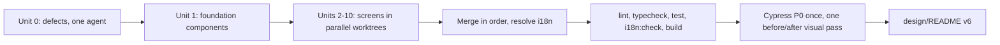

# Design review v6

Status: audit finished 2026-11-15 (seven read-only reviews of the running web app, laptop 1440x900 and phone 390x844, Owner and Agronomist, mostly EN, UK on selected screens). This is stage 1: a document for the owner to approve. No code is changed. v5 (`design-review-v5.md`) stands: its navigation (Today · Fields · Plan · Assistant; Owner adds Decisions first), field tabs (Overview · Season · Plan · Data & history) and glossary are binding unless a finding below gives a strong reason.

Problem statement from the owner: there is a lot of functionality and it is hard to read; a person opens a screen and does not understand within 5 seconds what the main thing is and what to do. Positioning: Terrasight is an AI assistant for the farmer, and the assistant is the heart of the product. No function is removed. The review decides what shows at once, what hides behind one click, and what merges.

Sources: seven part files by area (P01 Home and shell, P02 Field and trust page, P03 Rotation and Plan, P04 Recommendation and scouting, P05 Assistant, P06 Owner and public pages, P07 Rest and system patterns). "P04 #13" means finding 13 in part 04. File paths are under `apps/web/src` unless stated. Product Definition (PD) is `docs/01-product-definition.md` v2.13.

## 1. Summary

The two findings that matter most for the positioning:

1. **The assistant is buried** (P05). There is no "Ask" entry on Today; the only cues are the fourth sidebar item and a search box that reads as search. On a field page the assistant panel starts about 2,850 px down on a laptop (page 3,086 px) and about 4,000 px down on a phone (page 4,793 px). "Why?" does three different things: an evidence disclosure on the Today card, a send-a-question button on the field main card (it sends a long pre-written question at once, which costs money, and scrolls about 2,500 px), and a link that opens an empty chat on the recommendation page. In a normal answer the evidence is not shown at all (`Chat.tsx:222`); the green "2 numbers checked" chip cannot be opened.
2. **Decision screens open with statistics, not the decision** (P02, P03, P04). The field Overview and the rotation page open with the climate card (about 15 numbers, "clear trend" three times); on the rotation page the recommendation "Sow Winter wheat" is not visible at all on a laptop and the whole first phone screen is climate statistics. The trust page opens with the 2022 model failure. The recommendation page puts the title (4 lines on a phone), a gauge, three equal scales (Risk, Reliability, Data) and the action text before Accept, which is below the first phone screen.

| # | Problem that causes reading load | Answer in this plan |
| --- | --- | --- |
| 1 | The assistant has no visible entry and its answers hide their evidence. | One labelled "Ask" entry on every screen; 2-3 suggested questions in the farmer's words under each main card; "Why?" split into "Ask why" (fills the composer, does not send) and "Show the evidence"; answers link to the evidence screen; the checked-numbers chip opens the data card. |
| 2 | Evidence and statistics come before the decision (climate card, three scales, 2022 card, sensitivity block). | Decision first, evidence one click away: one "Evidence" disclosure with a one-line summary on recommendation, rotation, field and trust pages. |
| 3 | Trust is drawn in five shapes with two names for the same data level and jargon (r, p-value, tier, degree days). | One trust line "Reliability · Data level · Sources"; one set of data-level names; one meaning per status colour; plain wording with the number as evidence. |
| 4 | The same fact is stated several times or contradicts itself (counts, notices, dates, units, plurals). | At most 3 key numbers per card; one visible notice per screen; one units rule by the field's country including money; one date rule; ICU plurals. |
| 5 | Once-a-season and rare content has daily weight (stress test, climate shift, link card, region map), and phone actions are covered or below the fold. | Seasonal insights become one line with a link on daily screens and full size on Plan / Data; one shape for empty, loading and error states; sticky action bars never cover their own card. |

## 2. One sentence per screen

"Verdict": **passes** = the 5-second test is passed as built; **does too much** = it is not. Sentences are the auditors'; "none" is as written by them.

| Screen (route) | Who | This screen answers the question | Verdict |
| --- | --- | --- | --- |
| Today (`/`) | Agronomist | What is the one thing I do first today, and is anything else on fire? (P01) | does too much: 11 items before the hero buttons end; stress test, queue and 7-day block below |
| Today (`/`) | Owner | Is anything waiting for my answer? (P01) | passes in structure (decisions first); stress test and farm list dilute it |
| Empty home | Agronomist, Owner | What do I do now? (P01, from code) | passes (one action); three step cards are a mini tour |
| App shell | everyone | Where am I, and where else can I go? (P01) | passes; top bar and sidebar footer carry duplicates |
| Field Overview (`/fields/<id>`) | both | none today; after the plan: What is the one thing to do on this field now, and what is coming this week? (P02) | does too much: opens with a climate-history report |
| Field Season tab | both | What did I do or must I confirm this season? (P02) | passes |
| Field Data & history tab | both | What data and models stand behind this field? (P02) | does too much: a shelf of five unrelated things, about 40 numbers |
| Trust page (`/fields/<id>/trust`) | both | Can I believe the model's yield numbers, and by how much? (P02) | does too much: tries, but the first card is the wrong one |
| Rotation page (`/fields/<id>/rotation`) | both (same screen) | none today; after the plan: What do I sow here next season, and how sure are we? (P03) | does too much: ten blocks on one scroll, 6,137 px laptop, 12,343 px phone |
| Plan overview (`/rotation`) | both | What is planned for next season on each field, and which fields still need a decision? (P03) | passes |
| Recommendation page | both | none today ("does too much"); after: What should I do about this risk, and is it safe to rely on? (P04) | does too much |
| Scouting check (`/scout/<id>`) | Agronomist (phone) | Walk the 5 points and count affected plants out of 20. (P04) | passes; counting state is control-dense (14 controls) but task-focused |
| Assistant page (`/assistant`) | both | Ask anything about your fields and get an answer checked against the models. (P05) | passes, but only after the user is already there; about 20 controls in 3 zones |
| Assistant panel on field Overview | both | none obvious: it is the last block of a 3,000 px page (P05) | does too much (position and two composers) |
| Owner Decisions (`/decisions`) | Owner | What does my agronomist need me to say yes or no to, and what happens if I do? (P06) | close; the card does not say what happens |
| Decisions list | Agronomist | What did I ask the owner and what came back? (P06) | passes |
| No-account link (`/r/<token>`) | link holder | none stated; same card as Owner Decisions (P06, from code) | close; no brand line, no expiry date |
| Public page (`/explore`) | visitor | none as written; real purpose: How has the weather on a field changed in 45 years? (P06) | does too much |
| Sign-in (`/login`) | everyone | Sign in, or create a company. (P06) | passes |
| Fields list (`/fields`) | both | Which of my fields needs me today, and where is it? (P07) | does too much: answers two questions, the map wins, zero field rows above y=850 |
| Add a field (`/fields/new`) | both | Give Terrasight the outline of the field. (P07) | passes, but says "3 steps" and lists 5 |
| Work windows (`/work-windows`) | Agronomist | On which days can I spray / sow / drive on which field? (P07) | passes (cleanest screen) |
| Stable zones (`/fields/<id>/zones`) | Agronomist builds | Where in this field is yield always high or low? (P07) | passes when built; does too much when not built (a blurred photo with no zones) |
| Field work log | both | What happened on this field and who did it? (P07) | passes |
| Settings (Owner four tabs, Agronomist one) | both | Who am I, which company, who has access, which prices. (P07) | passes |
| Onboarding | new Owner | Create the company, then add the agronomist. (P07, from code) | passes; asks 4 questions where 1 is needed |

## 3. System decisions

Eight rules remove the most noise. Where parts disagreed the choice and the reason are given.

### 3.1 The assistant is the obvious first way in

- **Rule.** (1) One labelled "Ask" entry on every screen. Laptop: the top-bar box becomes sparkle + "Ask the assistant about your fields" (fields stay findable in the same box); phone: the magnifier becomes a pill "✦ Ask". (2) Under each screen's main card, 2-3 suggested questions in the farmer's words (table in 5.7); a chip puts the question in the composer and does not send. (3) "Why?" is split: **Ask why** fills the composer without sending; **Show the evidence** opens the Evidence disclosure. (4) Under each answer a row "Open: field · recommendation · plan" built from the tool calls the answer already carries (`m.tools`). (5) The checked-numbers chip becomes a button ("2 numbers checked: show") that opens the tool card in place, 3 rows first.
- **Where.** Every screen; suggestion chips on Today, field Overview, recommendation, Plan.
- **Components.** `AppShell.tsx` search trigger, `CommandPalette.tsx` (fields and recents first, AI prompts second under "Ask the assistant"), `Chat.tsx`, `ToolCard.tsx`, `FieldAssistant.tsx`, a new shared suggestion-chips component.
- **Replaces.** The search-looking box, three meanings of "Why?", the invisible evidence, static "this/here" chips, the "Do" block, the field panel at the page bottom.
- **Reconciled.** P04 proposed "Ask the assistant" for the recommendation link and P05 "Ask why": one behaviour gets one name, so all become **Ask why**. P05 keeps the Assistant tab unchanged; this plan does too (v5 navigation stands).

### 3.2 Decision first, evidence one click away

- **Rule.** Every screen with numbers shows conclusion in words, then at most 3 numbers, then one disclosure **Evidence / Докази** whose closed state is a one-line summary built from real data (for example "Evidence: 2 factors · NASA POWER, USDA CDL · reliability high"). Inside, in order: why (factors, one step list, chart, unknowns), data used, sources, notes on these numbers, link to the trust page. Evidence is never removed ("evidence first" in PD §10 stays).
- **Where.** Recommendation page, rotation page, field Overview (climate row), trust page, Today hero ("Show the evidence"), zones ("Seasons and source").
- **Components.** `packages/ui/src/components/Disclosure.tsx` (variant "evidence"), `CaveatNotes.tsx`, `DataBasis.tsx`.
- **Replaces.** "Why we think so", "What NASA data contributed here", "Sources and thresholds", "Seasons and source", the 10 px NASA footnote, "All metrics" as a loose block, "Notes on these numbers" stacks, the permanent right-hand column on the recommendation page.
- **Reconciled.** UK name: P04 proposed "Чим це підтверджено", P07 and P05 "Докази". Chosen "Докази" (shorter, one name in all places).

### 3.3 One trust line, one meaning per colour

- **Rule.** One component `TrustLine`, fixed order and wording: `Reliability: High · Full data · NASA POWER, USDA CDL` (UK `Надійність: висока · Повні дані · NASA POWER, USDA CDL`). Reliability and data level are neutral text with one small icon each; only "Low" reliability gets an urgent-soft background plus the word. Tapping the line opens the Evidence disclosure. Risk is the only large coloured item (word, icon, colour). The estimate mark is "≈" before the number plus the word "Estimate" in the data-level slot. Status colours: red = urgent; orange = act this week and nothing else; blue = information; green = good or done, never "Full data" alone; grey = data level, reliability, source.
- **Names (proposal, open question 18).** Data levels: **Full data / Basic data / Estimate** (UK Повні дані / Базові дані / Оцінка). Delete "Core data" and "Estimated". Reliability keeps **High / Medium / Low** (v5 glossary is binding); the clash with Risk High/Low is solved by form (Risk big and coloured, Reliability small and neutral) and flagged as open question 19.
- **Where.** Today hero, recommendation, rotation hero, field header, assistant answer, Fields list (once per region header, not per row).
- **Components.** New `components/TrustLine.tsx`; `Brief.tsx:215,520`, `TodayCard.tsx`, `FieldClient.tsx:252-255`, `RecommendationClient.tsx:560-570`, `RotationClient.tsx:798`, `FieldsOverview.tsx:479`, `AddFieldClient.tsx:471`, `Chat.tsx`; `Chip.tsx`, `StatusDot.tsx` (visible label), message keys `tier_A/B/C`, `tierA/B/C`, `tierLine_*`, `val.*` merged into one namespace.
- **Replaces.** Five data-level shapes, two names for B and two for C (P07 §3), three equal h2 scales, the "week" tone used for both "this week" and "Estimate", the dial drawn at different sizes.
- **Reconciled.** P04 proposed "Solid / Fair / Weak" for reliability; P07 kept High / Medium / Low. Chosen: keep the v5 glossary words and change the form; the vocabulary change is left to the owner.

### 3.4 At most 3 key numbers per card

- **Rule.** A card has a headline sentence and at most 3 numbers, each with unit and a label saying what it means for the decision; money first (it is the decision number). Everything else sits under "All numbers" / "All metrics". Number big, label small (no "at risk" in 40 px mono). Labels at most 6 words; a tile that does not apply to the chosen crop is hidden.
- **Where.** Climate card (3 deltas instead of about 15 numbers), Today hero, field brief, rotation hero and option cards, owner decision card, assistant tool card (3 rows then "All rows", was up to 40), stress card, `/explore` result.
- **Components.** `ClimateShiftCard.tsx`, `TodayCard.tsx`, `lib/brief.ts` (`kn_*`), `RotationClient.tsx`, `OwnerDecisions.tsx`, `ToolCard.tsx` (`MAX_ROWS`), `FarmStressCard.tsx`.
- **Replaces.** The 3x4 climate table, "0/5 seasons of corn after corn in 5 if the plan stays", unit-less `kn_*` labels, 25-row climate tool card.

### 3.5 One visible notice per screen

- **Rule.** A `NoticeStack` shows the highest-severity notice and puts the rest under one count chip "3 notes" / "Notes on these numbers". An optional source that is unavailable (for example "The GPM IMERG check is not available right now") is silent unless asked.
- **Where.** Rotation (up to 8 stacked notices before v5, 7 lines of small print in the hero now), field Overview, Fields, Add a field, zones, offline banner.
- **Components.** New `NoticeStack`, `CaveatNotes.tsx`, `OfflineBanner.tsx`, `ClimateShiftCard.tsx` (GPM line).
- **Replaces.** `CaveatNotes` as an unlimited list (the v5 rule existed, the component did not enforce it).

### 3.6 Units, dates and plurals: one rule each

- **Units.** Units follow the **field's country** everywhere, including money per area. US: ac, °F, in, bu/ac, $/ac. Elsewhere: ha, °C, mm, per ha. Currency stays the company currency. The workspace unit setting becomes the default for new fields or "Units in owner reports" (open question 21). Never mix °F and °C or ac and ha on one screen. Degree days (°F·d) appear only inside "All metrics"; headlines use plain temperature.
- **Dates.** Relative first ("today", "tomorrow", "in 3 days"), then "Nov 16" without a year in the current year; the full date with year only in documents (owner report, export) and inside Evidence. A title never repeats a date the chip beside it shows. A deadline reads "answer by Apr 25". One-year ranges read "Season 2025", never "2025-2025". Future dates are never described as done ("Sown").
- **Plurals.** `Intl.PluralRules` through `plural()` (`lib/format.ts:201`); no "1 days", "1 seasons", "season(s)", "image(s)".
- **Components.** `lib/useFormat.ts`, `lib/format.ts` (add `moneyPerArea`, a "relative" date style), `FieldsOverview.tsx:142`, `Brief.tsx:126`, `AddFieldClient.tsx:133`, `settings/workspace/WorkspaceSettingsClient.tsx`, `messages/*.json` (`kn_*`, `retro_money`, `row_c`).
- **Replaces.** Workspace units on Fields, Home and Add a field versus country units on the field page; "$/ha" next to "263.8 ac"; nine date formatters; `kn_daysUntilFrost`.

### 3.7 Once-a-season insights: one line on daily screens, full size on Plan and Data

- **Rule.** Climate shift, farm stress test, sensitivity to weather years, the trust page, the 18-season strip and "Add a field" are seasonal or rare. On daily screens each is one muted line with a link; the stress test is full strength only in autumn or when a rotation decision waits. Full size lives on: stress test card in the Plan page header (`/rotation`); climate card inside the field "Plan" tab strip and Data & history (compact card opens in place, "All metrics" holds the table); trust page one click from Data & history, at the top of that tab.
- **Where.** Today (Agronomist and Owner), field Overview, rotation page, Fields list (map).
- **Components.** `Brief.tsx:600-612`, `FarmStressCard.tsx`, `FieldClient.tsx:292,327`, `RotationClient.tsx:320`, `YearSets.tsx`, `FieldsOverview.tsx` (map card).
- **Reconciled.** P02 (its question 1) offers: collapsed row after the brief, or full size only on a new field, or its own tab. Chosen: collapsed row after "Next 7 days" with the compact card inside, because PD v2.13 lists climate shift as the challenge headline and a collapsed row still shows the headline sentence (open question 10).

### 3.8 One shape for empty, loading and error

- **Rule.** `StateBlock` with three lines of copy: what is happening, what is safe, the one next action. Loading names what loads ("Reading your fields...") and after 8 s adds "Still working. Safe to leave." Empty gives the reason and the next step ("No zones yet. Build them from past satellite images (1-2 min)."). Error gives what failed, what still works and Retry ("We could not load your fields. Your data is safe. [Try again]"). A failed seasonal card is a muted inline line, not a red card.
- **Components.** `packages/ui/src/components/States.tsx`, `components/QueryState.tsx`, and the about 10 hand-written empty lines (Zones `zz5_none`, Fields `fpNoOutline`, Prices, Log, Work windows "No verdict yet").
- **Replaces.** `EmptyState` needing three props, `Skeleton` with no words, errors naming what failed only when `what` is passed, at least 4 empty-state shapes.

### 3.9 Glossary of renames (EN and UK)

Consistent with the v5 glossary (Recommendation, Decision, Reliability, Estimate, Low / Typical / High year are unchanged).

| Old EN | New EN | Old UK | New UK |
| --- | --- | --- | --- |
| Why? (Today card disclosure) | Show the evidence | — (not given) | Показати докази |
| Why? (field main card, sends at once) / Why? (recommendation link) | Ask why (fills the composer) | Чому так? (recommendation reason) | Запитати чому |
| Search fields or ask the assistant... | Ask the assistant about your fields | — (not given) | Запитайте асистента про ваші поля |
| Do (assistant left column) | Quick actions | — (not given) | Швидкі дії |
| Ask (kicker above chips) | Try asking | — (not given) | Спробуйте запитати |
| Context: X / About: X | About X | Про: X | Про поле «X» |
| 1 thing needs your attention today | 1 thing to do today / Nothing urgent today | 1 справа потребує уваги сьогодні | 1 справа на сьогодні / Сьогодні нічого термінового |
| Today 2 (queue heading) | Also this week | Сьогодні 2 | Ще цього тижня |
| Stress test · if the weather of 2022 repeats... | If 2022 weather returns | Стрес-тест · якщо погода 2022... | Якщо повториться погода 2022 року |
| $20,904 at risk | Could lose $20,904 | $20,904 під ризиком | Можна втратити $20 904 |
| Worth a look 11 | Assistant's ideas 11 | Варто глянути | Ідеї асистента |
| All fine in 6 fields | 6 fields are fine | Усе гаразд у 6 полях | 6 полів у порядку |
| On the farm today | Your agronomist's work today | — (long text, not given) | Робота агронома сьогодні |
| Decisions need you (tab, sidebar) | Decisions (the dot or badge carries the count) | Рішення чекають на вас | Рішення |
| Needs you (h2 under the h1) | removed | Потрібне ваше рішення | removed |
| Why we think so | Evidence | Чому ми так думаємо | Докази |
| What NASA data contributed here | Data used (inside Evidence) | Що сюди дали дані NASA | Використані дані |
| Sources and thresholds | Sources ("risk starts when ...") | Джерела й пороги | Джерела |
| Options for action | removed | Варіанти дій | removed |
| Message to the owner | What the owner will see (inside the Ask sheet) | Повідомлення власнику | Що побачить власник |
| Start a check | Scout the field | Почати огляд / Огляд поля | Обхід поля |
| Core data / Estimated | Basic data / Estimate | — (not given) | Базові дані / Оцінка |
| Field shift (kicker) | How the climate here has changed | — (not given) | Як змінився клімат тут |
| clear trend / no clear trend | steady change / no clear trend | — (not given) | стійка зміна / немає чіткого тренду |
| Trend: 3.3 days later per decade | about 3 days later every 10 years (in All metrics) | — (not given) | близько 3 днів пізніше кожні 10 років |
| Growing degree days (°F·d) | Heat for crop growth | — (not given) | Тепло для росту культур |
| Baseline period / Recent period | Earlier years (1981-2000) / Recent years (2006-2025) | — (not given) | Ранні роки / Останні роки |
| Tested on 150 weather paths and 10 price scenarios | Tested on 150 possible weather sequences and 10 price levels | — (not given) | Перевірено на 150 можливих погодних послідовностях і 10 рівнях цін |
| Worst 10 % of runs: $16 | In a bad year (1 in 10): $16 | — (not given) | У поганий рік (1 з 10): $16 |
| Sensitivity to the weather years | Does the pick change with other weather? | — (not given) | Чи зміниться вибір за іншої погоди? |
| Test robustness | Try other prices and weather | — (not given) | Спробуйте інші ціни й погоду |
| If a year like 2022 happens again / Loses 405 % | If the 2022 drought comes back / Margin in the 2022 weather: -$192 per ac (normal: $63) | — (not given) / Втрачає 405 % | Якщо повториться посуха 2022 року / Дохід у погоду 2022 року: -$192 з ac |
| Mean margin / Margin | Profit per acre (hectare) a year | — (not given) | Прибуток з ac (га) за рік |
| Ask... (owner button) | Ask a question | Запитати… | Поставити запитання |
| Agronomist's note | Note from {name} | Нотатка агронома | Нотатка від {name} |
| Link without sign-in | Share with someone without an account | Посилання без входу | Поділитися без акаунта |
| Try it without an account (`/explore`) | How has the weather on a field changed since 1981? | Спробуйте без акаунта | Як змінилася погода на полі з 1981 року? |
| Real fields to try | Try a real field | Справжні поля для спроби | Оберіть справжнє поле |
| Stable zones / Latest NDVI | Zones / Latest greenness | Стабільні зони / Останній NDVI | Зони / Остання зеленість |
| Region map | Map | Карта регіонів | Карта |
| Trace on the map | Draw on the map | — (not given) | Намалювати на карті |
| Details (UK has two words) | Details | Подробиці / Докладно | Докладно everywhere |
| Not another NDVI map ... | A morning to-do list for every field, with the reason for each item. | Не ще одна карта NDVI | Щоранку список справ по кожному полю, з поясненням до кожної |
| Gemini (green dot in the field panel) | removed from the panel (kept in Settings and the disclaimer) | Gemini | removed |
| Harvest and field traffic (tab) | Harvest / traffic | — (not given) | Збирання / проїзд |

Note on the scouting word: P04 proposed "Оглянути поле", P07 "Обхід поля" because "Огляд" is also the Overview tab. Chosen: "Обхід поля".

## 4. Per-screen plan

One row per screen: what stays on the first viewport, what hides behind one click (the control named), what merges, what is renamed (full list in 3.9).

| Screen | Stays on the first viewport | Hides behind one click (control) | Merges | Renamed |
| --- | --- | --- | --- | --- |
| Today, Agronomist | Kicker, H1 (count of things to do), one status line with "Analyze fields", owner-asked row (only if open), hero card (chips, title, one action sentence, 3 numbers, trust line, Accept, Ask the owner, Evidence), 2 suggested questions | "Add a field" (to Fields; stays on empty home), Analyze hint, "Next 7 days" (one-line disclosure), stress test (one line, "Details"), "6 fields are fine" (disclosure), "Assistant's ideas 11" (disclosure) | Summary + H1 (summary only when it adds something); frost chip + frost hero; status + "Last analysis"; H1 count and queue count | H1, "Also this week", "If 2022 weather returns", "Assistant's ideas", "6 fields are fine" |
| Today, Owner | Kicker, H1 ("1 decision is waiting for you"), decisions card (max 3 rows, "Review decisions"), stress-test one-liner | "Your agronomist's work today N" (disclosure, closed when decisions wait), "6 fields are fine"; Next 7 days, Worth a look, Analyze and status are hidden for the Owner | Decisions card + stress line (one money block); h1 + block title + sidebar badge (say it once) | "Decisions", "Your agronomist's work today", sub-line "Open to approve, postpone or ask a question", "answer by Apr 25" |
| Field Overview | Header (name, area, crop, data level), tabs, the brief (headline, 3 numbers, "Compare rotations"), one exception chip line, top risks, Next 7 days, "Ask about this field" row with 3 chips | Climate row "How the climate here has changed" (opens compact card), 18-season strip (disclosure), the full assistant thread (opens in a drawer or sheet) | Plan chip + brief headline + first risk (one fact, shown in the brief only); status chips folded into the header line; "Last season" strip kept once | Climate kicker, brief numbers ("Corn would not return in the next 5 seasons", "+$60 per acre a year") |
| Field Data & history | Yield range, 3-month outlook, one-row trust card on top ("How far can you trust these numbers?") | Data sources (one line "7 of 7 sources current", disclosure), Land suitability, Zones and Work log as links | Second copy of the 18-season strip removed | Yield card title "Yield range if you sow winter wheat in 2026" |
| Climate block (card) | Headline sentence, 3 deltas with unit, "Oct 21 → Oct 30" in the line | "All metrics" (table, trend per decade, GPM, 55 km note) | Three "How far can you trust this" links into one | Kicker, "Heat for crop growth" |
| Trust page | Back link "< field", verdict sentence ("Mostly, with caution."), model vs official line with 3 numbers, chart | "Look at one year: 2022", "Worst years", "What the model leaves out", "If you had switched in 2018" (all disclosures), "How we read this" | Hero + fit card; irrigated flat cards (hero, fit, chart, missed years) hidden behind the notice | Plain fit line, raw codes replaced by sentences |
| Rotation page | Field name and tabs, hero (crop, one money line, "for: More profit", trust line, Save or Ask the owner), one "why" line, top 3 option cards | Climate strip "Details", "Show all 5 options", one "Evidence" group: chart, "How it holds up in bad and different years" (2022 + other weather), "Try other prices and weather", All numbers, Notes | "Your choice / Why this option / What to check" into the hero; two trust links + NASA block into the Evidence disclosure; 2022 check + weather-year sensitivity | Options named by crops, "In a bad year (1 in 10)" |
| Plan overview (`/rotation`) | Summary line ("3 fields wait for a decision, 2 saved, 3 not calculated"), table sorted by need, stress-test card in the header | none needed | Status column kinds shown as one chip set | Buttons "Calculate" / "Review" / "Open"; "Keep current rotation" |
| Recommendation, Agronomist | Back link, type kicker, title, action sentence (largest text), Accept, Ask the owner, risk word + deadline, trust line, Evidence summary row, 2 suggested questions | Evidence (why, steps, chart, unknowns, data used, sources), "Scout the field" in "..." and a text link, Message to the owner (inside the Ask sheet), Compare / Keep (in "...") | Options-for-action card removed; steps 1 and 2 merged; "What raises the risk" into Evidence; Reliability + Data into the trust line | "Evidence", "Scout the field", "Ask why", "Decide by Apr 25" |
| Recommendation, Owner | Title, action in plain words, deadline, Approve / Not now / Ask a question (with consequence lines) | Evidence (closed) | Start a check, Message card and Edit hidden for the Owner | as above; needs open question 24 |
| Scouting | Map, counter, Next | Summary into one line "2 of 5 points · 2%"; "Show my location" into a map control; Send only on the last point | Prev/Next + Finish; disabled-Send reason + progress | "Result", "Saved to this recommendation" |
| Assistant page | Composer, 3-4 suggestions (stacked on phone), thread, "About X" chip | "Quick actions" menu (Analyze fields; others become suggestion chips), history delete (row menu), disclaimer behind "i" | Three "Do" links with sidebar items and palette | "Quick actions", "Try asking" |
| Assistant, field panel | One input row "Ask about this field" + 3 chips under the brief | Full thread (drawer / sheet) | Two composers into one placeholder; Gemini dot removed | "About X" |
| Owner Decisions | h1 count, field + deadline, one plain question, one outcome sentence, max 3 numbers, three buttons with consequence lines (sticky on phone) | Note beyond 2 lines, "Why this?" (disclosure), asked-by, Decided list (rows), share link ("Share with someone without an account") | Title + action into one question; h2 "Needs you" removed; footer sentence into "Why this?" | "Ask a question", "Note from {name}", key numbers |
| No-account link page | One column, brand line "Terrasight · decisions from {company}", the card, "Valid until {date}" | same as Owner Decisions | none | none |
| `/explore` | h1 (the question), one sentence, 2 ready-field buttons before the map on phone, map, 3 takeaways, one call to action | "Enter coordinates", "All 8 measures", privacy paragraph (footer link) | Pivot 12 and 14 pins (same place) into one or offset; what-next into one button | h1, "Try a real field", "steady change" |
| Sign-in | Form, "Create a company", "Try it without an account" under it on phone | none | none | Story line without "NDVI" |
| Fields list | Title with summary ("8 fields · 1 urgent · 1 this week"), "Add a field", rows sorted by need across regions (name, crop, area, next thing, one chip) | Map (toggle "Map", closed on phone, open on laptop only with 3+ regions), "Region: All" menu | Legend into the chip; weather into the region header; "Nothing to do" + "No open recommendations" | "Map", "Nothing waiting" |
| Add a field | Mode switch (default map), map, name, "Add the field" (sticky on phone) | Irrigation under "More details"; "What we will find" | Location + Land check into "Place and land check"; map hidden in upload mode | "Outline the field. We build its history in about 30 seconds.", "Draw on the map" |
| Work windows | Answer line ("Best day to spray: Wed, Nov 18 on 2 of 8 fields."), tabs, grid | Attribution under "i"; reasons shown on tap (kept) | Legend + footers into one row | "Harvest / traffic" |
| Zones | Title, one primary button; empty state with thumbnail when not built; map and 3 zone cards when built | "Seasons and source" (kept), "More" for rate-map export | One primary in running/failed states | "Zones", "Latest greenness" |
| Work log | List | none | Kicker and title; date kicker into Today / Yesterday / Nov 14 | "Обхід поля" |
| Settings | Each tab's one form and Save | Password under "Security", export under "Data", prices rules under "How prices are used" | Team: three headings into one; interface-language toggle removed from Account | Tabs "Account / Company / Team / Prices" |

## 5. "Was → will be" mock-ups

Every mock-up uses the same trust line, the same Evidence disclosure and the same Ask entry. `✦` marks the assistant. "WAS" blocks are shortened; the full as-built layouts are in the part files.

### 5.1 Today, Agronomist, laptop

```
WAS (P01): top bar [Search fields or ask...  ⌘K] [UA|EN] [bell 6]
  H1 "1 thing needs your attention today" + summary that repeats the hero
  status line (1 field of 8) + Analyze (i) + "+ Add a field"
  OWNER ASKS card; hero card (Reliability: Low · Estimated (i), Why? v)
  stress test 380 px, "Today 2", Next 7 days: below the fold; no Ask cue

WILL BE
+-sidebar-+------------------------------------------------------------------+
| Today   | Today     [✦ Ask the assistant about your fields  ⌘K]  [bell] [me]|
| Fields  |                                                                  |
| Plan    |  GOOD MORNING, MARKO · NOV 15                                    |
| Assist. |  1 thing to do today                                             |
|         |  Checked today 08:17 · 8 fields · 1 new recommendation  Analyze  |
|         |  Owner asked: "What does this cost per hectare...?"   [Reply]    |
|         |  +--[Start with this][tomorrow]------------------- Mykolaiv---+   |
|         |  | Frost expected tomorrow in alfalfa                    [...] |   |
|         |  | Check sensitive crops and the growth stage.                 |   |
|         |  | Nov 16 | 32 °F | 1 day until frost                          |   |
|         |  | Reliability: Low · Estimate · NASA POWER                    |   |
|         |  | [ Accept ] [ Ask the owner ]                                |   |
|         |  | ▸ Evidence: 2 factors · NASA POWER · reliability low        |   |
|         |  +-------------------------------------------------------------+   |
|         |  Ask: [Why is this the main thing today?] [What if I wait a week?]|
|         |  ALSO THIS WEEK 1                                                |
|         |  > Wheat streak mosaic virus risk · Pivot 14        in 7 days  > |
|         |  ▸ Next 7 days: rain, 39-42 °F · spraying marginal on 1 field    |
|         |  If 2022 weather returns, plan B puts $4,643 less at risk  >     |
|         |  ▸ 6 fields are fine              ▸ Assistant's ideas 11         |
+---------+------------------------------------------------------------------+
```

### 5.2 Today, Agronomist, phone

```
WAS (P01): 5 top-bar controls; H1 2 lines; summary 3 lines; status 2 lines;
  Analyze; owner card; hero starts and the sticky Accept / Ask bar covers
  its title and numbers.

WILL BE (390x844)
+--------------------------------+
| Today                [✦ Ask] (b)|   language and theme live in More
| GOOD MORNING, MARKO · NOV 15   |
| 1 thing to do today            |
| Checked 08:17 · 8 fields       |
|   > Analyze fields             |
| +[Start with this][tomorrow]-+ |
| | Frost expected tomorrow    | |
| | in alfalfa · Mykolaiv      | |
| | Nov 16 | 32 °F | 1 day     | |
| | Reliability: Low · Estimate| |
| | Owner asked a question >   | |   one-line link row above Accept
| | ▸ Evidence: 2 factors      | |
| +----------------------------+ |
| [ Accept ]  [ Ask the owner ]  |   sticky only after the card's title and
| Ask: [Why is this first?]      |   numbers have scrolled past
| [Today][Fields][Plan][Asst][More]
+--------------------------------+
```

### 5.3 Today, Owner, laptop and phone (same order)

```
WAS (P01): H1 · summary about frost (not the owner's question) · status line
  · decisions card · stress card with two 40 px numbers that wrap

WILL BE
  GOOD MORNING, OLENA · NOV 15            [✦ Ask the assistant ...] [bell]
  1 decision is waiting for you
  +--Decisions waiting for you--------------------------------------+
  | Change next year's crops on Pivot 14?                           |
  | Answer by Apr 25                                                |
  | [ Review decisions ]                                            |
  +-----------------------------------------------------------------+
  If 2022 weather returns, the recommended plan puts $4,643 less at risk  >
  ▸ Your agronomist's work today 2
  ▸ 6 fields are fine
  Ask: [Do I need to decide today?] [What happens if I say not now?]
  Phone tabs: [Decisions •][Today][Fields][Assistant][More]
```

### 5.4 Field page (Overview), laptop

```
WAS (P02): FIELD SHIFT card first (about 15 numbers, "clear trend" x3,
  GPM notice, 55 km note); the brief starts about 600 px lower;
  assistant panel 2,850 px down

WILL BE
+------------------------------------------------------------------------------+
| North quarter                                          [✦ Ask]          [...] |
| 263.8 ac · Corn (grain) · Finney County · Full data (i)                      |
| Overview | Season | Plan | Data & history                                    |
| +--------------------------------------------------------------------------+ |
| | THE MAIN THING ON THIS FIELD                                             | |
| | Rotation for 2026: winter wheat first                                    | |
| |  +$60 per ac a year  | Corn would not return | 1 season of the same     | |
| |  more than today     | in the next 5 seasons | crop in a row            | |
| | Reliability: Medium · Full data · NASA POWER, USDA CDL                   | |
| | [Compare rotations]   ▸ Evidence: 3 factors · 4 sources · reliability med| |
| +--------------------------------------------------------------------------+ |
| 1 item needs attention · dryland                                             |
| Top risks                           Low · Moderate · Unknown            >    |
| Next 7 days  41° 47° 60° 67° 64° 64° 60° (°F)   Spraying: marginal           |
| Ask about this field: [Why is this the main thing?] [What to sow next?]      |
| [ Ask about North quarter ...........................................  > ]  |
| ▸ How the climate here has changed: first autumn frost comes 9 days later    |
| ▸ 18 seasons on this field                                                   |
+------------------------------------------------------------------------------+
```

### 5.5 Field page (Overview), phone

```
WAS (P02): header 300 px (96 px thumbnail, 2-line title, name repeated in the
  top bar), tabs clipped ("Data & his"), then the climate card cut mid-row

WILL BE (390x844)
+--------------------------+
| North quarter   [✦ Ask]  |
| 263.8 ac · Corn          |
| Full data (i)            |
| Overview Season Plan Data>   tabs scroll with a fade, last tab "Data"
| THE MAIN THING           |
| Rotation for 2026:       |
| winter wheat first       |
| +$60 per ac a year       |
| Reliability: Medium ·    |
| Full data                |
| [ Compare rotations ]    |
| ▸ Evidence               |
| 1 item needs attention   |
| Top risks  Low·Mod·Unk > |
| Ask: [Why first?] [Sow?] |
| [Today][Fields][Plan][Asst][More]
+--------------------------+
```

### 5.6 Rotation page, laptop and phone

```
WAS (P03): FIELD SHIFT card first; "RECOMMENDED FOR 2026" cut at the fold
  (80 px visible); phone: 14 screens, first screen is climate rows

WILL BE (laptop 1440x900)
+---------------------------------------------------------------------+
| North quarter   Overview Season [Plan] Data           [✦ Ask]       |
| +-----------------------------------------------------------------+ |
| | RECOMMENDED FOR 2026 · for: More profit                         | |
| | Sow Winter wheat                                                | |
| | +$32 per ac a year more than today · In a bad year (1 in 10): $16| |
| | Reliability: Medium · Full data · NASA POWER, USDA CDL          | |
| | Earns more, less erosion, holds up in dry years. Check: nothing.| |
| | [ Save to the 2026 plan ]  [ Ask the owner ]                    | |
| +-----------------------------------------------------------------+ |
| Compare 3 options (show all 5)                                      |
| [A Today $20] [B Wheat, sorghum $44] [C Winter wheat $52 · chosen]  |
|   profit · water · soil · drought                                   |
| Ask: [What if prices fall by a fifth?] [Which crop earns the most?] |
| ▸ Warmer climate: first autumn frost 9 days later    Details        |
| ▸ Evidence: chart · bad and different years · other prices · numbers|
+---------------------------------------------------------------------+
Owner view: same page without "Save to the 2026 plan"; shows the saved
choice and [Approve] [Not now] [Ask a question].

WILL BE (phone 390x844)
| North quarter  Overview Season Plan Data>
| RECOMMENDED FOR 2026       |
| Sow Winter wheat           |
| +$32 per ac a year more    |
| Reliability: Medium · Full |
| [ Save to the 2026 plan ]  |
| Compare options  ▸         |   swipe row or 3 stacked
| ▸ Evidence                 |
| Ask: [What if prices fall?]|
```

Agronomy-only field (no prices): the "No prices yet" card becomes one line inside the hero: `(!) Add your prices to see money  [Enter prices (2 min)]`.

### 5.7 Recommendation page, laptop and phone

```
WAS (P04): [Start a check] [Why?] top right; Message to the owner card
  (with stray "道の"); three equal scales Risk High · Reliability High ·
  Data Full; right column NASA data + Sources; Options for action card
  repeats the hero; phone: Accept below the first screen

WILL BE (laptop)
[<- Today]                                       PEST · Pivot 12 · Season 2027
Western corn rootworm: high risk on corn
+--------------------------------------------------------------------+
| RISK HIGH                                  Decide by Apr 25         |
| Plan for 2027: rotate away from corn, the most effective measure.   |
| Scout first: dig and wash roots at hatch, or [Scout the field]      |
| Written by AI from model results                                    |
| [ Accept ]  [ Ask the owner ]                                 [...] |
| Reliability: High · Full data · NASA POWER, USDA CDL                |
+--------------------------------------------------------------------+
| ▸ Evidence: 2 factors · NASA POWER, USDA CDL · reliability high      |
Ask: [Why do you suggest this?] [What if I wait a week?] [What do I look for?]

WILL BE (phone 390x844)
| < Today        [✦ Ask]     |
| Western corn rootworm:     |
| high risk on corn          |
| RISK HIGH · Decide by Apr 25|
| Plan for 2027: rotate away |
| from corn.                 |
| Reliability: High · Full   |
| [ Accept ] [ Ask the owner]|   sticky after the action text has scrolled past
| ▸ Evidence                 |
```

Owner view: title, action in plain words, deadline, `[Approve] [Not now] [Ask a question]` with the consequence lines of 5.9, closed Evidence. No "Scout the field", no message card, no Edit.

Suggested questions per screen (all one sentence, no jargon; filled in the composer, never sent):

| Screen | Chip 1 (EN / UK) | Chip 2 | Chip 3 |
| --- | --- | --- | --- |
| Today | What should I do first today? / Що мені зробити першим сьогодні? | Which fields are at risk this week? / Які поля цього тижня під ризиком? | Is it a good day to spray or work the soil? / Чи добрий сьогодні день для обприскування чи обробітку? |
| Field | Why is this the main thing on this field? / Чому це головне на цьому полі? | What should I sow here next season? / Що сіяти тут наступного сезону? | Has the weather here changed over the years? / Чи змінилась тут погода за роки? |
| Recommendation | Why do you suggest this? / Чому ви це радите? | What happens if I wait a week? / Що буде, якщо почекати тиждень? | What do I look for in the field? / На що дивитись у полі? |
| Plan | Which crop earns the most next season? / Яка культура принесе найбільше наступного сезону? | What if prices fall by a fifth? / А якщо ціни впадуть на п'яту частину? | Which field is hardest to plan? / Яке поле найважче планувати? |

### 5.8 Assistant answer layout

```
WAS (P05): dark question bubble; plain answer; green chip "2 numbers checked
  against the models" that cannot be opened; tool card only when the check
  failed; 2-3 line disclaimer under the composer; "Gemini" dot in the panel

WILL BE
[ What should I plant next season? ]
Corn on North quarter in 2027, sowing around April 25.
We have no emergence date yet, so the later stages are not estimated.
( ✓ 2 numbers checked: show )          [ Open: North quarter · Plan ->]
  ▾ Evidence (after one click)
  | Crop 2027        Corn (grain)
  | Sowing date      April 25, 2027
  | Source: your plan, USDA CDL                       [ All rows ▾ ]
Next: [What if I sow a week later?] [Compare with last year]
[ Ask about North quarter ...                                   > ]
Numbers come from Terrasight models. (i)
```

Rules: at most 3 evidence rows, each with unit and a plain label; the chip says what was checked; developer keys never shown; the fallback path ("part of the answer didn't match") uses the same card without the failure tone.

### 5.9 Owner's decision card, laptop and phone

```
WAS (P06): 12 items in one card: deadline chip, title "Rotation for 2026:
  corn (grain) first", action written for the agronomist, three key-number
  tiles ("0/5 seasons of corn after corn in 5 ...", "1 seasons ...", the
  money tile third), note, "Why: Scenario engine ...", asked-by, three
  buttons; phone: buttons about 2.3 screens down

WILL BE (laptop)
1 decision needs you
from Marko Shevchenko · Prairie Field Co.
+-----------------------------------------------------------------+
| PIVOT 14                                    answer by Apr 25    |
| Change next year's crops on Pivot 14?                           |
| Start with corn, then sorghum, then wheat (less water).         |
| [ +$666 a year per hectare vs the current plan ]                |
| [ 5 seasons planned: 2026-2030 ]                                |
| Note from Marko: "Please confirm before we order seed."         |
| ▸ Why this? (weather and price test, numbers)                   |
| [ Approve ]        [ Not now ]            [ Ask a question ]    |
|  Marko adds this    Nothing changes;       Marko answers here   |
|  to the plan        Marko is told                               |
+-----------------------------------------------------------------+
▸ Answered (2)  (one row each: "You approved Nov 15")
  Share with someone without an account  >

WILL BE (phone 390x844)
| 1 decision needs you       |
| PIVOT 14  answer by Apr 25 |
| Change next year's crops?  |
| Corn > sorghum > wheat:    |
| +$666 a year per hectare   |
| Marko: "Please confirm..." |
| ▸ Why this?                |
| [        Approve        ]  |   sticky above the tab bar, with safe-area padding
| [ Not now ] [ Question  ]  |
```

The consequence lines are the key addition; their wording depends on open question 26.

## 6. Findings

Priority: critical / important / nice to have. Effort: S up to 1 h, M up to half a day, L more. Sorted by priority, then effort. "Not located" means the part gave no file. Same issue found by two auditors is one row citing both. Nice-to-have items are grouped per area at the end.

| # | Area | Finding | Priority | Effort | File:line |
| --- | --- | --- | --- | --- | --- |
| 1 | Today, Recommendation | On a phone the sticky Accept / Ask bar covers the hero title and numbers on Today; on the recommendation page Accept is below the first screen. Bar sticky only after the card's title and numbers have scrolled past; shorter header (P01 F-01; P04 #1) | critical | S | `components/TodayCard.tsx:109`; `RecommendationClient.tsx:597-611` |
| 2 | Rotation, Recommendation | Owner sees agronomist write controls: `canSave` is a constant on the rotation page ("Save to the 2026 plan", "Choose this option", priority chips, price form); `canAct` is always true on the recommendation page ("Start a check", message to himself, Edit) (P03 #13; P04 #4) | critical | S | `app/fields/[id]/rotation/page.tsx:50`, `RotationClient.tsx:163,208,212`; `RecommendationPageBody.tsx:44`, `RecommendationClient.tsx:789-837` |
| 3 | Trust page | Raw model codes render under "What the model does not include" ("practice-all-used:corn", "single-year-crop:winter_wheat", ...) and a snake-case crop in a source line; add a code-to-sentence map, hide unknown codes (P02 #10) | critical | S | `app/fields/[id]/trust/TrustClient.tsx:420,445` |
| 4 | Trust page | Fit line "r = 0.71, mean error 17.7 points" is unreadable; plain sentence first, numbers as an evidence line (P02 #8) | critical | S | `design/i18n/19-Trust.json:37,145`, `TrustClient.tsx:350` |
| 5 | Rotation | 2022 check prints "Loses 405 %", "Loses 1,650 %": a percent of a tiny base. Show dollars on the same season for every option; drop the percent and the full-width red bar (P03 #4) | critical | S | `RotationClient.tsx:1146-1180`, `messages/en.json:1003` (`y22_loss`) |
| 6 | System | Data level has two names for B (Core / Basic data) and for C (Estimated / Estimate) across about 14 copies of the same keys; PD says Basic data and Estimate (P07 #2) | critical | S | `messages/en.json` (`tier_B`, `tier_C`, `Fields.tierB`, `AddField.tierLine_B`, `Assistant.val.B`) |
| 7 | AI text | Stray Japanese characters in the AI-written action and message to the owner ("Discuss resistant hybrids with道の seed supplier"); script guard at write time and regeneration. P04 rated it important, P07 critical; critical chosen because the owner receives the text (P04 #13; P07 #1) | critical | S | `apps/api/src/recommendations/*` (not located exactly) |
| 8 | Assistant | "Why?" does three different things (disclosure, silent auto-send with cost, open an empty chat); split into "Ask why" (fills the composer) and "Show the evidence" (P05 #3) | critical | S | `Overview.tsx:200`, `RecommendationClient.tsx:796`, Today card "Why?" |
| 9 | Owner Decisions | On a phone the three answer buttons are about 2.3 screens down; make them a sticky bar above the tab bar, above "Why" (P06 F3) | critical | S | `components/OwnerDecisions.tsx:228` |
| 10 | Field Overview | First viewport is the climate card (once a season); the daily brief starts about 600 px lower. Move the climate card after Next 7 days as a collapsed row (P02 #1) | critical | S | `app/fields/[id]/FieldClient.tsx:292,327`, `components/ClimateShiftCard.tsx:309-330` |
| 11 | Assistant | No visible "Ask" entry; the assistant is a fourth sidebar item and a box that reads as search (P05 #1) | critical | M | `components/AppShell.tsx` (top-bar search), `messages/*.json` `search` keys |
| 12 | Assistant | Normal answers hide the tool card (only shown on failure); the green chip is an unverifiable claim. Open the card behind the chip, 3 rows first (P05 #2) | critical | M | `components/Chat.tsx:222` |
| 13 | Rotation | Climate card first; the recommendation is below the fold on laptop and phone. Move below the hero, collapsed to a headline strip (P03 #1) | critical | M | `RotationClient.tsx:320`, `ClimateShiftCard.tsx` |
| 14 | Climate card | About 15 numbers and "clear trend" x3; show 3 deltas with unit, rest under "All metrics" (P02 #2) | critical | M | `components/ClimateShiftCard.tsx:255-293` |
| 15 | Today | Stress test is a once-a-season figure at the heaviest weight on the page; one line on Today, full card on the Plan header (P01 F-02) | critical | M | `components/Brief.tsx:600-612`, `FarmStressCard.tsx` |
| 16 | Trust page | Opens with the 2022 model failure (-11 % vs -46 %) while the next card says the model follows closely; lead with a verdict, make 2022 a disclosure (P02 #7) | critical | M | `TrustClient.tsx:157` vs `:315`, order `:82-120` |
| 17 | Rotation | Hero recommends C while the sensitivity block marks B "best in this set" in all four sets (also pivot-14); rank by the chosen priority or drop the badge (P03 #2) | critical | M | `YearSets.tsx:98-112`, `messages/en.json:1079` |
| 18 | Rotation | Agronomy-only field (Cherkasy) recommends an option with 6 points less worst-year yield than today without saying why; baseline is 5x fallow, which looks like a data default (P03 #9) | critical | M | `RotationClient.tsx` hero builder, `messages/en.json:959-960` |
| 19 | Recommendation | "Options for action": first card repeats the hero, the rest repeat Why and the pest library; remove or merge into Evidence (P04 #2) | critical | M | `RecommendationClient.tsx:743-785` |
| 20 | Recommendation | Three trust surfaces in two columns (Why disclosure, NASA data card, Sources and thresholds); fold into one Evidence disclosure with a summary line (P04 #3) | critical | M | `RecommendationClient.tsx:616-741,788-880` |
| 21 | Owner Decisions | The owner is never told what Approve / Not now / Ask do; add a consequence line under the buttons (P06 F1) | critical | M | `OwnerDecisions.tsx:231-258`, `odBtn_*` |
| 22 | Owner Decisions | Title and action are agronomist-to-agronomist ("compare the options and save your choice to the plan"); owner-facing question text (`ownerQuestion`) needed (P06 F2) | critical | M | `OwnerDecisions.tsx:206-225`, `apps/api/src/recommendations/text.ts:80-97` |
| 23 | Owner Decisions | Key numbers are not understandable ("0/5 seasons of corn after corn" also on a winter-wheat decision, "1 seasons", money tile third); order money first, hide tiles that do not apply, plural-aware labels (P06 F4) | critical | M | `lib/brief.ts`, `messages/app.*.json` `kn_*` |
| 24 | Units | Same Ukrainian field in two unit systems (Fields list 159.2 ac and 33 °F; field page ha and °C); money "per hectare" next to acres; °F next to °C on Today; "in" for inches. One rule by the field's country (P07 #3; P01 F-10; P02 #19; P03 #8) | critical | M | `FieldsOverview.tsx:142` vs `FieldClient.tsx:161`; `Brief.tsx:126`, `lib/useFormat.ts`, `lib/format.ts` |
| 25 | Today | Summary repeats the hero title and says "other fields remain stable" while a second item and 11 ideas exist (P01 F-03) | important | S | `Brief.tsx:526-533` |
| 26 | Today | Four lines of status and links under the H1 (status, Analyze + hint, Add a field); one status line + "Analyze fields"; "Add a field" to Fields (P01 F-04) | important | S | `Brief.tsx:546-557`, `AnalysisCard.tsx:97-110`, `Brief.tsx:524` |
| 27 | Today | H1 counts urgent ("1 thing"), queue heading counts urgent + this week including the hero ("Today 2"); H1 = things to do, heading = "Also this week" (P01 F-05) | important | S | `Brief.tsx:341-346,655`, `lib/brief.ts:20-24` |
| 28 | Today | Queue row reason is cut at an ellipsis with "image(s)"; show title + field + due only (P01 F-06) | important | S | `Brief.tsx:660-690` |
| 29 | Today | "Frost from Nov 15" (Kansas rail) vs hero "Frost expected Nov 16" (Mykolaiv): name the field or drop the chip when the hero is frost (P01 F-08) | important | S | `Brief.tsx:393-418` |
| 30 | Plurals | "1 days until frost" / "1 днів до заморозків"; use ICU plural (P01 F-09; P07 #24) | important | S | `Brief.tsx:624-628`, `messages/*.json` `kn_daysUntilFrost`, `lib/format.ts:201` |
| 31 | Today | Stress tile numbers wrap ("$20,904 at / risk"): "at risk" is set in the 40 px number style (P01 F-12) | important | S | `FarmStressCard.tsx:136-143` |
| 32 | Shell | Owner phone tabs put Decisions fourth, sidebar first; label "Decisions need you" wraps to 3 lines and clips. Decisions first, label "Decisions", dot carries the count (P01 F-13; P07 #18) | important | S | `AppShell.tsx:106,115,124`, `messages` `navDecisionsNeed` |
| 33 | Shell | Phone top bar has 5 controls and language and theme are also in More; laptop sidebar footer clips name and role. Keep search/Ask + bell; one avatar menu (P01 F-14, F-15) | important | S | `AppShell.tsx` header and sidebar footer, `Nav.tsx` |
| 34 | Today (Owner) | Owner home repeats the frost item three times, shows Next 7 days and Worth a look, and the block says "One tap to approve" (untrue); date "Apr 25" without "by" (P01 F-18; P06 F9) | important | S | `Brief.tsx:341-372,593-600,630-690`, `ownerWaitTitle/ownerWaitSub` |
| 35 | Today | "Worth a look 11 / ideas ... no verified model" reads as a warning; rename "Assistant's ideas", hide from the Owner, move below "All fine" (P01 F-19) | important | S | `Brief.tsx:717-760` |
| 36 | Field Overview | The rotation advice is stated three times (brief, chip, top risk) (P02 #4) | important | S | `app/fields/[id]/Overview.tsx:209,307` |
| 37 | Field Overview | Brief numbers read as scores or contain plural bugs ("0/5 seasons", "1 seasons", "$/ha" on an acre field) (P02 #5) | important | S | `app/fields/[id]/Overview.tsx:114-205`, `design/i18n/08-Field.json` |
| 38 | Field Overview | Assistant panel takes 550 px with a 230 px gap, previous answer under the input, no min-height needed (P02 #6) | important | S | `components/FieldAssistant.tsx` |
| 39 | Climate card | Statistical words ("clear trend", "Trend: 3.3 days later per decade", p-value order) and the GPM notice and 55 km line on the first screen (P02 #3; P03 #19; P07 #30) | important | S | `ClimateShiftCard.tsx:273,297,325`, `08-Field.json:203,213,435` |
| 40 | Trust page | "deviation from trend", "r of 0.7 or more" (written as an absolute value) and the long reading rule appear on every card; plain words, rule behind "How we read this" (P02 #9; P07 #31) | important | S | `19-Trust.json:95-97,140,154,203-205`, `TrustClient.tsx:163,252,332` |
| 41 | Trust page | Sub-page with "Data & history" active and no back link near the H1; "Back to the field" is 2,500 px down (P02 #14) | important | S | `TrustClient.tsx:82`, `Overview.tsx:85` |
| 42 | Field, phone | 300 px header; field tab strip clipped ("Data & his", UK "Дані та істо"); scroll with fade or shorten to "Data" (P02 #16; P03 #17; P07 §6) | important | S | `app/fields/[id]/FieldClient.tsx:270` |
| 43 | Rotation | Options D and E (AI-proposed) repeat A ($20, "-$0 vs today", Best in 0 of 10, chart lines coincide); show top 3 and "Show all 5 options" (P03 #3) | important | S | `RotationClient.tsx:854-1050` |
| 44 | Rotation | Pivot-14 2022 block: three identical "No change" rows and a "per-hectare" note on an acre field; one line (P03 #6) | important | S | `RotationClient.tsx:1120-1180`, `en.json` `y22_same` |
| 45 | Rotation | "How far can you trust this" appears 3 times in two cards plus notes and icons (5 routes); one disclosure, one link (P03 #11) | important | S | `ClimateShiftCard.tsx`, `DataBasis.tsx`, hero |
| 46 | Rotation | Hero carries 7 lines of small print (weather basis, "Library prices", "first season of the chosen plan ... recomputes next autumn"); keep reliability + one clause (P03 #12) | important | S | `RotationClient.tsx` (`RotationBody`) |
| 47 | Rotation | Cherkasy hero says the current rotation is best in other weather without a number (P03 #10) | important | S | hero sentence, `YearSets.tsx:30` |
| 48 | Plan overview | Status chips mix three kinds; "Compare options" on rows with nothing to compare; sort by need; summary line (P03 #18) | important | S | `app/rotation/RotationsOverview.tsx` |
| 49 | Recommendation | Gauge + three equal h2 scales; Risk the only large item, Reliability + Data one small trust line, no gauge on phone (P04 #5) | important | S | `RecommendationClient.tsx:551-571` |
| 50 | Recommendation | Rotation items show a pest-risk gauge ("Risk Low"); show the gain vs today (P04 #6) | important | S | `RecommendationClient.tsx:552` |
| 51 | Recommendation | AI-suggested item shows grey gauge, "Low" reliability and "Full data" (contradictory); hide scales, one sentence (P04 #7) | important | S | `RecommendationClient.tsx:552-571` |
| 52 | Recommendation | Step number circles clipped at the card edge (P04 #8) | important | S | `RecommendationClient.tsx:73-` (`Step`, `-left-[38px]`) |
| 53 | Recommendation | Wrong text: "Season 2025-2025", "1 host seasons in a row", "season(s)", "2025 -> 2025" (P04 #9; P07 #26) | important | S | i18n `thr_*`, `rcStepCropsSub`, `knS_*`, `basis_period_years` |
| 54 | Recommendation | Steps 1 and 2 repeat the same fact; scouting result step not labelled as such (P04 #10) | important | S | `RecommendationClient.tsx:629-667` vs `668-718` |
| 55 | Recommendation | Rotation factors all stamped "NASA POWER · 2026", including crop history and profit (P04 #11) | important | S | `RecommendationClient.tsx:402-423` (`sourceFor`) |
| 56 | Recommendation | "Numbers checked against the models" shown on AI-suggested items with no numbers; "No NASA dataset fed this item" reads as an error where USDA fed it (P04 #14, #15) | important | S | `RecommendationClient.tsx:806-809`, `DataBasis.tsx:61-66` |
| 57 | Recommendation | Already-accepted item still shows a black "Ask the owner" beside a status line; show status as a chip (P04 #17) | important | S | `RecommendationClient.tsx:584-613` |
| 58 | Today / Rec | Title "Frost expected on November 16, 2026 in alfalfa" beside the chip "tomorrow" and the big "Nov 16": one date three times (P07 #25) | important | S | Rec / Home title generator (not located) |
| 59 | Assistant | Field panel with a thread keeps the placeholder "Ask about any field or the whole company..." while the context is one field (P05 #5) | important | S | `Chat.tsx:268`, `Assistant.ph` |
| 60 | Assistant | "Do" block duplicates sidebar and palette and does not exist on phone; "Quick actions" menu on both (P05 #8) | important | S | `AssistantClient.tsx:199-243` |
| 61 | Assistant | History titles from the auto "Why?" question make 4 identical rows; 44 px delete icon on every row (P05 #9) | important | S | `AssistantClient.tsx:129-143` |
| 62 | Owner Decisions | "Link without sign-in" is a full card of the same weight as the decision; collapse to one link (P06 F6) | important | S | `OwnerDecisionsClient.tsx:44-47`, `ReportLinks.tsx` |
| 63 | Owner Decisions | h1 "1 decision needs you" and h2 "Needs you" repeat; UK plural "Потрібне 1 ваше" clumsy (P06 F7) | important | S | `OwnerDecisions.tsx:184-189` |
| 64 | `/explore` | On phone the result is 2 screens below the tapped button; `scrollIntoView block:"nearest"` is a no-op; use `start` (P06 F13) | important | S | `ExploreClient.tsx:138-142` |
| 65 | `/explore` | "What next" is last, below 8 rows, with two messages and a hidden link style; one button under the headline (P06 F14) | important | S | `ExploreClient.tsx:296-311`, `Explore.fieldNote/pointNote` |
| 66 | Fields list | "Full data: US records since 2008" repeated on 5 of 8 rows; show once per region header (P07 #5) | important | S | `FieldsOverview.tsx:479` |
| 67 | Fields list | Rows say "Nothing to do" and "No open recommendations" together (P07 #6) | important | S | `FieldsOverview.tsx:494-500` |
| 68 | Fields list | Urgent rows sit inside regions; sort urgent / this week first across regions (P07 #7) | important | S | `FieldsOverview.tsx` row sort |
| 69 | Add a field | "Just 3 steps" while 5 steps are listed (P07 #8) | important | S | `AddFieldClient.tsx:322` vs `:353` |
| 70 | Work windows | Open-Meteo attribution is English in the UK UI and in the lightest grey (P07 #10) | important | S | `WorkWindowsClient.tsx:265` |
| 71 | Work windows | A Cherkasy row of 7 "Limited" triangles reads as bad weather; should be "No verdict yet" (possible mapping issue) (P07 #11) | important | S | `WorkWindowsClient.tsx` rows; API mapping not located |
| 72 | Zones | Not built: first viewport is a blurred photo and the reason is below the fold; show an empty state with one action (P07 #12) | important | S | `fields/[id]/zones/ZonesClient.tsx:148-292` |
| 73 | Zones | Primary button changes label and role by state; two primaries in the failed state (P07 #13) | important | S | `ZonesClient.tsx:157-186` |
| 74 | Zones | "Stable zones" / "Latest NDVI": NDVI is not an owner's word (P07 #14) | important | S | `ZonesClient.tsx` layer tabs |
| 75 | Work log | Kicker and title repeat the word, date kicker is a third date style, no manual entry (v5 #19 still open) (P07 #15) | important | S | `fields/[id]/log/LogClient.tsx:81-109` |
| 76 | Work log | UK "Огляд поля" (scouting) collides with the "Огляд" tab; use "Обхід поля" (P07 #16) | important | S | `messages/uk.json` scouting label |
| 77 | Settings | Tab strip scrolls on a phone with the last tab cut ("Crop prices" shows as "L") (P07 #17) | important | S | `components/SettingsNav.tsx:22` |
| 78 | Settings | Prices: three paragraphs of rules before the first control; empty state first with "Add a crop" (P07 #19) | important | S | `app/settings/prices/PricesClient.tsx`, `CropPricesEditor.tsx` |
| 79 | Settings | Language toggle in Account duplicates the top-bar switch (P07 #20) | important | S | `AccountClient.tsx` |
| 80 | Settings | Team: three headings and a 4-line intro for a 2-row list (P07 #21) | important | S | `settings/team/TeamClient.tsx` |
| 81 | Status colours | The "week" tone is used for "This week" and "Estimate"; one meaning per colour; `StatusDot` label visible (P07 sys 8, #27, #28) | important | S | `packages/ui/src/components/Chip.tsx`, `StatusDot.tsx`, `FieldClient.tsx:252`, `design/README.md` §1.3 |
| 82 | Today | "Next 7 days" has 7 sub-blocks (about 430 px); one summary line, hide for the Owner (P01 F-07) | important | M | `Brief.tsx:384-427`, `TodayWindows.tsx`, `OutlookRailLine.tsx` |
| 83 | Today | "Last analysis ... 1 field" for a company of 8 reads as the farm state; show the last full run and warn only when fields are older than a day (P01 F-11) | important | M | `AnalysisCard.tsx:89-97`, `Brief.tsx:540` |
| 84 | Shell | Bell says "New urgent item: Pivot 14" (what?), shows 6 while Today shows 1, panel clipped; use the recommendation title (P01 F-16) | important | M | `NotificationsBell.tsx` |
| 85 | Shell | Empty palette lists only 3 AI prompts although the placeholder promises fields; fields and recents first (P01 F-17) | important | M | `CommandPalette.tsx` |
| 86 | Trust page | Irrigated field: after the calm "cannot be checked" notice come 8 cards with a flat 0 % hero; hide the flat cards, show the dryland check (P02 #12) | important | M | `TrustClient.tsx:98,127,315-335` |
| 87 | Trust page | Estimate field: red "does not follow" on the only check; 2022 "record drought" claim not sourced for Ukraine; hide hero with no official yield (P02 #13) | important | M | `TrustClient.tsx:315,157`, `19-Trust.json:125` |
| 88 | Trust page | Retrospective shows $/ha on an acre field and, for Ukraine, a Total of percentages (500 % vs 482 %); verdict sentence first, table in a disclosure (P02 #11) | important | M | `TrustClient.tsx:463-509` |
| 89 | Data & history | Duplicated 18-season strip, 7-row source list, trust entry at the bottom (P02 #15) | important | M | `app/fields/[id]/FieldClient.tsx:366-395` |
| 90 | Rotation | "Season 2026: -$25 instead of $86" compares each option's worst season, not one 2022 season (P03 #5) | important | M | `RotationClient.tsx:1146-1180` |
| 91 | Rotation | Pivot-14: worst 10 % equals the mean margin for every option and "+$283" is stated twice; may be a simulator issue (P03 #7) | important | M | `YearSets.tsx:117-124`, hero "why" builder |
| 92 | Rotation | Priority chips change the hero pick but the sensitivity block does not follow; show "for: More profit" in the hero (P03 #15) | important | M | `RotationClient.tsx:859` |
| 93 | Rotation, phone | Option cards about 1,500 px, year sets about 3,000 px, chart clipped with x axis "2" instead of 2028, legend far from lines (P03 #16) | important | M | `CumulativeChart.tsx:80,159`, `YearSets.tsx:170` |
| 94 | Recommendation | AI mark is a 14 px grey tooltip-only sparkle: invisible on phone; one visible chip "Written by AI from model results"; sparkle has 4 meanings (P04 #12, §7) | important | M | `AiMark.tsx`, `RecommendationClient.tsx:543` |
| 95 | Assistant | Panel is the last block, 2,850 px (laptop) / about 4,000 px (phone) down; compact "Ask about this field" row under the brief (P05 #4) | important | M | `Overview.tsx` block order, `FieldAssistant.tsx` |
| 96 | Assistant | Suggestion rails are static and use "this/here"; per-screen chips (P05 #6) | important | M | `AssistantClient.tsx:70-78`, `app.*.json` `aiSugg*`, `askRisk`, `askCrop` |
| 97 | Assistant | Tool card up to 40 rows with statistical labels; cap at 3 rows + "All rows", rename labels (P05 #7) | important | M | `ToolCard.tsx` (`MAX_ROWS = 40`), `Assistant.label` |
| 98 | Assistant | Answers do not link to the screen with the evidence; add "Open: field / recommendation / plan" from `m.tools` (P05 #10) | important | M | `Chat.tsx` after the answer |
| 99 | Owner Decisions | Mixed languages on the UK Owner page (title, action, note, Why in English): cards use the report language, chrome the UI locale (P06 F5) | important | M | `OwnerDecisionsClient.tsx:40`, `text.ts` |
| 100 | Owner Decisions | Decided list expands into full cards; one row each; bubble "Approved: Approved. Go ahead." (P06 F8) | important | M | `OwnerDecisions.tsx:174-178` |
| 101 | `/explore` | Title says how you got in, not what it is; buttons under the map (P06 F10) | important | M | `ExploreClient.tsx:186-188`, `Explore.title/tag` |
| 102 | `/explore` | Pivot 12 and 14 pins overlap (same place); offer a different second place (P06 F11) | important | M | `ExploreClient.tsx:236-246`, `ExploreMap.tsx` |
| 103 | `/explore` | Full 8-row table with statistical wording; 3 fixed takeaways + "All 8 measures" (P06 F12) | important | M | `ClimateShiftCard.tsx:304-306`, `ExploreClient.tsx:265-275` |
| 104 | Fields list | Region map takes 520 px and pushes all rows below the fold; collapse by default (P07 #4) | important | M | `FieldsOverview.tsx` (map card about L330-440) |
| 105 | Add a field | Upload mode keeps the map; on phone the primary button is below a full-bleed map and the instruction pill is hidden by the tab bar (P07 #9) | important | M | `AddFieldClient.tsx:335-345` |
| 106 | Onboarding | Step 1 asks 4 questions where 1 is needed; step 2 has Skip and Back at the same weight (P07 #22) | important | M | `onboarding/OnboardingWizard.tsx:133-170,228-250` |
| 107 | System | Empty, loading, error are not one shape (P07 #23) | important | M | `components/QueryState.tsx`, `packages/ui/src/components/States.tsx` |
| 108 | System | Notice budget: `CaveatNotes` has no limit; `NoticeStack` (P07 sys 3) | important | M | `components/CaveatNotes.tsx`, `OfflineBanner.tsx` |
| 109 | System | One date rule (relative first); nine formatters; `lib/format.ts` "relative" style (P07 sys 6) | important | M | `lib/format.ts`, `lib/brief.ts`, `LogClient.tsx:93` |
| 110 | System | TrustLine component replaces five data-level shapes (P07 sys 1) | important | L | new `components/TrustLine.tsx` and the files in 3.3 |
| 111 | System | One Evidence disclosure replaces five source/notes surfaces (P07 sys 2) | important | L | `packages/ui/src/components/Disclosure.tsx`, `DataBasis.tsx`, `CaveatNotes.tsx`, `ZonesClient.tsx:273` |
| 112 | Today, shell (nice) | Group: "All fine" chips duplicate Fields (F-20); permanent footer "No product ads ... ESA" (F-21); empty home three step cards are a tour (F-22); "never analysed" state needs a primary Analyze (F-23); owner question quote in one language (F-24) | nice to have | S | `Brief.tsx:762-805`, `EmptyHome.tsx:56-72`, `AnalysisCard.tsx` (`anNever`), `Brief.tsx:556` |
| 113 | Field (nice) | Group: "(i)" icons render as a capital "I" (P02 #17); kicker "FIELD SHIFT - NASA POWER 1981-2026" uses the challenge name (P02 #18) | nice to have | S | `packages/ui` InfoButton; `08-Field.json` `cs_kicker` |
| 114 | Rotation (nice) | Group: "Your choice" repeats the hero and "Nothing to flag" fills a column (P03 #14); GDD "°F·d" jargon (P03 #20); same sentence template as the assistant (P03 #21) | nice to have | S | `RotationClient.tsx` "Your choice" card; `ClimateShiftCard.tsx` |
| 115 | Recommendation, scouting (nice) | Group: Bug icon for every type (P04 #18); "Plan - by Apr 25" prefix (P04 #19); sent-state map full height (P04 #20); "Your result refines this field's risk model" is unsupported (P04 #21); gauge needle has no labels (P04 #22) | nice to have | S | `RecommendationClient.tsx:530,534`; `ScoutClient.tsx:327-`; i18n `scSent`/`Scout.loop` |
| 116 | Assistant (nice) | Group: "Gemini" dot (P05 #11); error state good, keep (P05 #12); disclaimer 2-3 lines (P05 #13); "Подробиці" vs "Докладно" (P05 #14) | nice to have | S | `FieldAssistant.tsx:108-111`; `AssistantClient.tsx:224-228`; `messages/uk.json` |
| 117 | Owner, public (nice) | Group: "Not another NDVI map" (F15); purple pivot circle (F16); "Try it without an account" last and grey (F17); link page brand line and "Valid until" needs `expiresAt` in `PublicDecisions` (F18, M); "asked by" own name for the Agronomist (F19) (P06) | nice to have | S | `Login.tag_s`; `login/page.tsx:61-69,108-116`; `app/r/[token]/ReportLinkClient.tsx`; `DecisionCard.tsx:134-140` |
| 118 | Rest (nice) | Group: zones phone white band while loading (P07 #29) | nice to have | S | zones phone page (not located) |

## 7. Defects found on the way

Bugs a user sees, separate from design choices. "Confirmed on screen" means an auditor saw it in a screenshot; "from code" means read in code or a text dump only. Kind: **interface**, **AI text**, or **possible model or data problem** (not an interface problem until the owner of the model or data says so).

| # | Defect | Seen in (screenshot) | Status | Kind |
| --- | --- | --- | --- | --- |
| 1 | Stray Japanese characters "道の" in an AI-written recommendation ("Discuss resistant hybrids with道の seed supplier") and in the message to the owner, seen by both roles | `rec/agronomist-en-pest-lap-fold.png`, `rec/owner-en-pest-lap-fold.png`, `rec/agronomist-en-pest-lap-open.png` | confirmed on screen | AI text |
| 2 | Phone sticky Accept / Ask bar covers the title and numbers of the Today hero card | `home/agronomist-en-ph.png`, `home/agronomist-uk-ph.png` | confirmed on screen | interface |
| 3 | Owner sees write controls on the rotation page (`canSave` hard-coded true); text diff of Owner and Agronomist shows only the header differs. Same on the recommendation page (`canAct` always true) | `rotation/owner-north-quarter-lap-en-fold.png` (+ text dumps); `rec/owner-en-pest-lap-fold.png` | on screen and code | interface (permissions) |
| 4 | Owner decision card text in English under a Ukrainian interface (title, action, note, Why) | `owner/decisions-owner-ph-uk-f.png` (also cited: `decisions-owner-lap-uk-v.png`) | confirmed on screen | interface |
| 5 | Rotation headline recommends C while the sensitivity block marks B "best in this set" in all four sets (also pivot-14) | `rotation/agronomist-north-quarter-lap-en-full.png`, `clip-ph-sets.png`; pivot-14 text dump | confirmed on screen | interface (ranking by two priorities); may touch model ranking |
| 6 | 2022 check prints "Loses 405 %", "Loses 1,650 %", "Loses 109 %"; UK "Втрачає 405 %" | `rotation/clip-ph-drought.png`, `agronomist-north-quarter-lap-en-full.png` | confirmed on screen | interface (formula divides by a tiny base) |
| 7 | Raw model codes on the trust page ("practice-all-used:corn", "single-year-crop:winter_wheat", "state-level-yields:sorghum", "second-crop-ignored", snake-case "winter_wheat") | `field/a-en-l-north-quarter-trust-full.png`, `a-en-l-pivot-12-trust-full.png`, `a-en-l-cherkasy-trust-full.png` | confirmed on screen | interface |
| 8 | Season 2027 marked "Sown ... Sown on Apr 25 (Your value)" while today is 2026-11-15; the assistant repeats "sowing date of April 25, 2027" | `field/a-en-l-north-quarter-season-full.png`, `a-en-l-north-quarter-overview-full.png` | confirmed on screen | possible data problem (probably seed data); UI should still not say "Sown" before the date |
| 9 | Contradicting counts on Today: "1 thing needs attention" vs "Today 2"; "other fields remain stable" with a 7-day item and 11 ideas; "Last analysis ... 1 field" in an 8-field company; bell shows 6 / 5 unread | `home/agronomist-en-lap-full.png`, `agronomist-en-lap.png`, `owner-en-lap.png`, `agronomist-bell-lap.png` | confirmed on screen | interface |
| 10 | Mixed units: 32 °F in the hero next to 0 °C in the row text; Cherkasy "159.2 ac" and "33 °F" on the list but ha and °C on its page; "Margin, per hectare" next to "263.8 ac"; "3.05 in" for inches; "Today: 33 F / 45 F" for Ukrainian fields; UK "39 F" spacing | `home/agronomist-en-lap.png`, `owner-en-lap-full.png`, `rest/agronomist-fields-en-lap-full.png` vs `rotation/agronomist-cherkasy-lap-en-fold.png`, `field/a-en-l-north-quarter-trust-full.png`, `rest/agronomist-fields-uk-lap.png` | confirmed on screen | interface |
| 11 | Plural errors: "1 days until frost" / "1 днів", "1 seasons of the last crop in a row", "season(s)", "host seasons", "image(s)", "Season 2025-2025", "2025 -> 2025" | `home/agronomist-en-lap.png`, `home/agronomist-uk-lap.png`, `field/a-en-l-north-quarter-overview-full.png`, `rec/agronomist-en-pest-lap-open.png` | confirmed on screen | interface |
| 12 | Clipped phone tabs: field tab "Data & his" (UK "Дані та істо"); Settings "Crop prices" shown as "L"; Owner tab "Рішення чекають на вас" on 3 lines | `field/a-en-p-north-quarter-overview-vp.png`, `rest/owner-prices-uk-ph.png`, `rest/owner-team-uk-ph.png`, `home/owner-uk-ph.png` | confirmed on screen | interface |
| 13 | Pivot-14 bad-year margin ("Worst 10 % of runs") equals the mean margin for every option, and "+$283" is stated twice | `rotation/agronomist-pivot-14-lap-en.txt` | text dump only | possible model or data problem (simulator on the irrigated pivot) |
| 14 | Rotation options D and E identical to A ($20, "-$0 vs today", Best in 0 of 10); chart lines A/D/E end at $99; "-$0" has a minus sign | `rotation/agronomist-north-quarter-lap-en-full.png` | confirmed on screen | possible model problem (options generated equal to current) plus interface (formatting) |
| 15 | Cherkasy: recommended option has 6 points lower worst-year yield than today; baseline "Fallow x5" looks like a default; unit-less "Irrigation: 0 in a year", "Erosion index: 256" | `rotation/agronomist-cherkasy-ph-en-fold.png`, `agronomist-cherkasy-lap-en.txt` | on screen and text | possible model or data problem |
| 16 | Trust page: irrigated field shows a flat 0 % hero and "Cannot be compared" twice; Cherkasy retrospective Total "500 %" vs "482 %"; 2022 "record drought" claimed for Ukraine without a source | `field/a-en-l-pivot-12-trust-full.png`, `a-en-l-cherkasy-trust-full.png` | confirmed on screen | model limitation shown badly; the Ukraine claim is a possible data problem |
| 17 | Trust page chart: end labels collide ("Model 0 / Field NDVI 4.8 / Official yield -2.9"), text says the chart scrolls sideways on a laptop, chart uses 60 % of the card width | `field/a-en-l-north-quarter-trust-full.png`, `a-en-l-pivot-12-trust-full.png` | confirmed on screen | interface |
| 18 | Recommendation titled "Rotation for 2026" on 2026-11-15 although the headline is the next season (check whether 2027); factor line "seasons of corn after corn in 5 if the plan stays 2/5" broken; "51 $/ha" currency misplaced | `rec/agronomist-en-rot-lap-open.png` | confirmed on screen | possible logic problem for the title year |
| 19 | Rotation recommendation factors all stamped "NASA POWER · 2026", including crop-history and profit factors | `rec/agronomist-en-rot-lap-open.png` | confirmed on screen | interface (wrong attribution) |
| 20 | Step number circles half cut at the left edge of the card | `rec/agronomist-en-pest-lap-open.png`, `agronomist-en-rot-lap-open.png` | confirmed on screen | interface |
| 21 | AI-suggested item shows Risk Unknown + Reliability Low + Full data; "Numbers checked against the models" on items with no numbers | `rec/agronomist-en-ai-lap-fold.png` | confirmed on screen | interface |
| 22 | Owner decision bubble "Approved: Approved. Go ahead."; "0/5 seasons of corn after corn" on a winter-wheat decision | `owner/decisions-owner-lap-en-decided.png` | confirmed on screen | interface |
| 23 | Stress tile "$20,904 at / risk" wraps; "5 of 8 fields counted" is the only hint that 3 fields are missing from the total | `home/owner-en-lap.png`, `owner-en-lap-full.png` | confirmed on screen | interface |
| 24 | Sidebar user name and role cut off ("Marko...", "Agronomis") | `home/agronomist-en-lap.png` | confirmed on screen | interface |
| 25 | Frost chip "Frost from Nov 15" (Kansas) next to hero "Frost expected on November 16" (Mykolaiv), no field named | `home/agronomist-en-lap-full.png` | confirmed on screen | interface |
| 26 | Assistant answer in English with a Ukrainian date ("25 квітня 2027") under the Ukrainian UI; field name truncated in the chip | `assistant/assistant-agronomist-uk-ph-vp.png` | confirmed on screen | interface (answer language fixed at question time) |
| 27 | Field assistant panel: placeholder differs from its context; 230 px gap under the answer | `assistant/field-agronomist-en-lap-full.png`, `field/a-en-l-north-quarter-overview-full.png` | confirmed on screen | interface |
| 28 | `/explore`: Pivot 12 and Pivot 14 pins overlap and hide labels; phone header wraps to 2 rows; result 2 screens below the tapped button; bold "8 days later" beside grey "+8.3 d hot days no clear trend" | `owner/explore-lap-en-idle-v.png`, `explore-ph-en-idle-v.png`, `explore-ph-en-field-v.png`, `explore-lap-en-field-f.png` | confirmed on screen | interface |
| 29 | Add a field: "Just 3 steps" with 5 listed; phone instruction pill clipped by the tab bar | `rest/agronomist-fieldsnew-en-lap.png`, `agronomist-fieldsnew-en-ph.png` | confirmed on screen | interface |
| 30 | Work windows: attribution in English in the UK UI; Cherkasy row of 7 "Limited" triangles | `rest/agronomist-ww-uk-lap.png`, `agronomist-ww-en-lap.png` | confirmed on screen | interface; the Cherkasy row is a possible data problem |
| 31 | Zones: blurred photo with no zones; 100 px white band above the map on phone | `rest/agronomist-zones-p12-en-lap.png`, `agronomist-zones-nq-en-ph.png` | confirmed on screen | interface |
| 32 | Work log: UK "Огляд поля" vs "Огляд" tab; EN "Field check: Field check: done" kicker repeats | `rest/agronomist-log-p12-uk-lap.png`, `agronomist-log-p12-en-lap.png` | confirmed on screen | interface |
| 33 | Owner Team page: Owner row has a "You" tag and a text role, the other row a full-width select | `rest/owner-team-en-lap.png` | confirmed on screen | interface |
| 34 | Owner tab and sidebar label "Decisions need you" even with 1 pending (badge already says 1); Decisions fourth on phone, first in the sidebar | `home/owner-uk-ph.png`, `home/owner-more-ph.png` | confirmed on screen | interface |

## 8. Screens that stay heavy after this plan, and why

| Screen | Why it stays heavy |
| --- | --- |
| Today hero card | Chips, field, title, action sentence, 3 numbers, trust line, 2 buttons, Evidence: the one place where density is justified. If a further cut is needed, drop the "..." menu on phone (P01). |
| Owner home with 2+ decisions including a rotation | The decisions card lists 3 rows; the stress line and the card say similar things (P01). |
| Field Overview | Still 7 blocks (brief, chips, risks, next 7 days, climate row, strip, assistant); only order and weight change; 8 with limited land (P02). |
| Field Data & history | A reference shelf (yield range with 5 note lines, 3-month outlook, strip, land suitability); not split further in this pass (P02). |
| Trust page | 8-10 cards; scannable with verdict first and disclosures; chart and year table remain (P02). |
| Rotation page | The most data per page; the notice budget helps but does not simplify the comparison; option cards keep about 8 items each; the Evidence group holds 5 sections; weather-year block is long when opened (P03, P07). |
| Rotation (agronomy-only) | Prices form and recommendation on one screen (P03). |
| Recommendation (rotation items) | Still summarises another screen (crop strip, economics, link to Plan); better fix is one card "Keep current vs best other" with a link (P04). Evidence is long when opened (acceptable, opt-in). |
| Scouting (counting state) | 14 controls, but task-focused and phone-fit (P04). |
| `/assistant` (laptop) | Three zones (history, thread, quick actions); history is the weight (P05). |
| Assistant tool cards (climate, year sets) | Statistical by nature; the answer text must carry the conclusion, the card is evidence only (P05). |
| Owner decision card | About 8 elements; note and "Why this?" are the first things to cut if testing shows scrolling (P06). |
| `/explore` on phone | Map and form take 1.5 screens before the result; "result first, map second" would help but removes the click-the-map affordance (P06). |
| Top bar on laptop | Search/Ask + bell + avatar is the minimum (P01). |

## 9. What was not looked at

- **Onboarding** was reviewed from code only (cannot be opened for an existing company). **Empty home** from code only (P01, P07).
- **`/r/<token>`** was reviewed from code only; no link was created because that writes data (P06).
- **Real assistant tool cards, the fallback state, the "Not checked against the models" chip and the typing state** could not be opened (one scripted attempt was blocked); findings are from `ToolCard.tsx`, `Chat.tsx`, tests and message files (P05). No assistant message was sent, so wording of live answers is unchecked.
- **Scouting open (counting) state** was reviewed from `ScoutClient.tsx`; only a sent task was opened (P04). **Recommendation Owner and UK views** were opened on selected shots only.
- **Ukrainian layouts**: UK trust-page text was checked in `design/i18n/19-Trust.json`, not on screen; UK rotation layout length was checked in text only; UK shots of Owner Today and Fields list partly not opened (P02, P03, P01).
- **Kearny dryland** was read from a text dump only (P03); **pivot-12 and Cherkasy** overview, season, data and phone trust pages were captured but not opened (P02).
- **Settings, Agronomist view**: one shot (`agronomist-settings-account-en-lap.png`) captured, not opened (P07). Owner Work windows and Owner Fields shots not opened.
- **Full-page phone captures** draw the fixed tab bar over the page; this is a capture artefact, not a bug (P04, P05, P06).
- **Sticky phone bars** were not tested with a real device; safe-area padding is a recommendation (P06).
- **Model and data questions** (pivot-14 spread, options D/E, Cherkasy baseline) were seen in output only; nobody opened the simulator.
- No screen was opened in a state that required writing data (Accept, Save, Send, Add the field, Build zones, create link).

## 10. Open questions for the owner

Each question has the options, the auditors' recommendation (rec) and the decision it touches. PD means `docs/01-product-definition.md` v2.13; "PD §10" are the product principles.

**Positioning and navigation**

| # | Question | Options and recommendation | Touches |
| --- | --- | --- | --- |
| 1 | May the top-bar search be renamed so that asking the assistant is its main meaning and field search the secondary one? (P05 Q3) | A: "Ask the assistant about your fields", fields in the same box (rec). B: keep search, add a separate Ask button. | PD §6 (AI assistant); PD §10 "One focus per screen" |
| 2 | Should "Ask why" fill the composer and wait, or send at once as today? (P05 Q2) | A: fill, user presses Send (rec: it costs money and the user should see the question). B: send. | S-05.05 (cited by P05) |
| 3 | May the "N numbers checked" chip open the tool card in every answer (today only when the check failed)? (P05 Q1) | A: yes, 3 rows first (rec; supports "evidence first"). B: keep as is. | PD §10 "Evidence first", "Numbers from models" |
| 4 | When the UI language changes, should an answer stay in its language or be re-asked? (P05 Q5) | A: stay, add "answered in English" (rec: no extra cost). B: re-ask. | none |
| 5 | May the "Gemini" label leave the field panel (kept in Settings and the disclaimer)? (P05 Q4) | A: yes (rec). B: keep. | PD §6 |
| 6 | One language switch (top bar) and none in My account? Theme and language also leave the phone top bar? (P07 Q4; P01 F-14) | A: yes (rec). B: keep both. | none |
| 7 | Should the Owner's Today show agronomist items at all? (P01 Q3) | A: collapsed "Your agronomist's work today N" (rec). B: hide. C: show open. | PD §3 roles |
| 8 | Is "Assistant's ideas" (unverified) agronomist-only? (P01 Q5) | A: hide from the Owner, keep for the Agronomist (rec). B: show to all. | PD §10 "Numbers from models, words from AI" |

**What moves below the fold**

| # | Question | Options and recommendation | Touches |
| --- | --- | --- | --- |
| 9 | May the stress test leave the home page for the Plan header, keeping one line on Today? (P01 Q1) | A: one line on Today, full card on Plan (rec). B: keep the card. | FR-ST-1; EP-10 S-10.13 |
| 10 | May the climate shift move below the brief and be collapsed? (P02 Q1) | A: collapsed row after Next 7 days, compact card inside (rec). B: first only on a new field. C: its own tab "Climate". | PD v2.13 (challenge headline block), FR-CS-1 |
| 11 | May the trust page open with a verdict and put the 2022 card under a disclosure? (P02 Q2) | A: yes; the demo opens the disclosure (rec). B: keep 2022 first. | FR-TR-1; demo script (Garden City 2022) |
| 12 | For irrigated fields, hide the flat-model cards and keep the notice and the dryland check? (P02 Q4) | A: yes (rec). B: show all. | PD §10 "Show the error" |
| 13 | Is the region map on the Fields page a feature to show the judges at once? (P07 Q3) | A: collapse on phone, open on laptop only with 3+ regions (rec). B: always open on laptop. C: collapsed everywhere. | PD Fields page note |
| 14 | May the rotation page show 3 options by default and keep D/E behind "Show all 5", although AI-proposed rotations are a headline feature? (P03 Q2) | A: top 3 (current, best for the chosen priority, runner-up); an AI option shows first if it is better (rec). B: all 5. | PD v2.12 (AI-proposed rotations) |
| 15 | Is dollars-only acceptable in the 2022 check (the percent was probably added to compare across fields)? (P03 Q5) | A: dollars on one 2022 season per option (rec). B: percent of the field's own mean. | FR-ST-1 |
| 16 | Should the weather-year sensitivity rank by the chosen priority so the recommendation is first in every column? (P03 Q3) | A: yes (rec). B: keep equal priorities and drop the "best" badge. | FR-CS-2 (sensitivity, not a forecast) |
| 17 | Retrospective in estimate mode: relative % or only a verdict? (P02 Q5) | A: verdict sentence, no total of percentages (rec). B: table. | FR-TR-2 (P1) |

**Naming**

| # | Question | Options and recommendation | Touches |
| --- | --- | --- | --- |
| 18 | Confirm the data-level names Full data / Basic data / Estimate (UK Повні дані / Базові дані / Оцінка), delete "Core data" and "Estimated", and show the level always (not only when it is not Full). (P07 Q2; P04 Q5) | A: all three always visible in the trust line (rec: "Honest about data"). B: hide "Full data". | PD §10 "Honest about data"; v5 glossary (tier C = Estimate) |
| 19 | Keep Reliability High / Medium / Low, or change to Solid / Fair / Weak to stop clashing with Risk High / Low? (P04 Q1) | A: keep the v5 words, differ by form (rec). B: change the glossary. | v5 glossary |
| 20 | PD v2.13 requires "no clear trend" in the climate block; P06 proposes "varies year to year". Keep the PD wording? (raised in this synthesis) | A: "steady change" / "no clear trend" (rec). B: P06 wording. | PD v2.13 risk row "climate trend not significant" |

**Units**

| # | Question | Options and recommendation | Touches |
| --- | --- | --- | --- |
| 21 | Do units follow the field's country, and is the company unit setting only a default for new fields or "Units in owner reports"? (P01 Q4; P07 Q1) | A: country everywhere; setting becomes "Units in owner reports" (rec). B: remove the setting. C: company wins. | v5 §2 (Formatting) |
| 22 | Commit to ac, bu/ac, °F, in, $/ac for US fields everywhere? v5 put °F out of scope but it is already shown. (P02 Q3) | A: yes (rec). B: metric for all. | v5 §5 (out of scope) |

**Owner's permissions and view**

| # | Question | Options and recommendation | Touches |
| --- | --- | --- | --- |
| 23 | Should the Owner's rotation page be read-only plus the decision (Approve / Not now / Question)? (P03 Q1) | A: yes (rec). B: keep Save for Owners who also work. | PD §3 roles (Owner answers decisions; Agronomist does the field work) |
| 24 | Should the Owner be able to Approve / Not now on the recommendation page, and is "Start a check" meaningful for an Owner? (P04 Q2, Q3) | A: Approve / Not now / Ask there, hide "Start a check" (rec). B: only on `/decisions`. | PD §3 roles |
| 25 | May the owner see a separate plain-language question text (`ownerQuestion`), written by the assistant under the number-check rules? (P06 Q1) | A: yes (rec). B: template in `OwnerCard`. | PD §10 "Numbers from models, words from AI"; PD v2.12 (AI-written recommendations) |
| 26 | Should "Approve" on a rotation decision also change the plan in the app, or stay a record the agronomist acts on? (P06 Q2) | A: stay a record, line says "Marko adds this to the plan" (rec). B: change the plan. | PD §3 roles |
| 27 | May an Owner add a field (empty home points only to Team)? (P01 Q2) | A: yes if the Owner has no agronomist yet. B: Agronomist only. | PD §3 roles, v2.12 |
| 28 | Should "Link without sign-in" move to Settings > Team (Owner only)? (P06 Q3) | A: collapsed link on Decisions that opens the form (rec). B: Settings. | PD §3 (only the Owner manages links) |
| 29 | May the Agronomist edit the "Message to the owner" before sending? (P04 Q4) | A: yes, in the Ask sheet (rec). B: no. | PD §10 "The agronomist decides" |

**Public and sign-in pages**

| # | Question | Options and recommendation | Touches |
| --- | --- | --- | --- |
| 30 | Is `/explore` a product entry (talk to a farmer) or a demo for judges? It decides the default (3 takeaways or full table) and whether a Ukrainian ready field is added. (P06 Q4) | A: both: 3 takeaways + "All 8 measures", add a real Ukrainian field outline (rec). B: judges only. | FR-PB-1; PD v2.6 and v2.13 (ready outlines of real fields only); v2.13 open question 4 |
| 31 | May onboarding step 1 ask only the company name (time zone detected, units from the first field)? (P07 Q5) | A: yes (rec). B: keep four questions. | PD "create company" wording, v2.12 |

**AI text safety and model checks**

| # | Question | Options and recommendation | Touches |
| --- | --- | --- | --- |
| 32 | When AI text fails a script check (for example CJK in EN or UK), regenerate or show with a warning? (P07 Q6) | A: regenerate, then fall back to the template (rec). B: show with a warning. | PD §10 "Numbers from models, words from AI"; PD §11 (AI states a wrong fact) |
| 33 | Pivot-14: "worst 10 % = mean" and "+$283" twice: real model output (no weather spread on irrigated fields) or a bug? (P03 Q6) | Needs the simulator owner. Until then hide the bad-year line when there is no spread (rec). | PD §10 "Show the error" |
| 34 | Cherkasy: may we recommend an option with a lower worst-year yield when the reason is soil? If yes the hero must say so. (P03 Q4) | A: yes with the reason in the hero (rec). B: do not recommend. | PD v2.12 (AI-proposed rotations) |
| 35 | May Work windows show a computed answer line ("Best day to spray: ...")? (P07 Q7) | A: yes, derived from the models (rec). B: no. | PD §10 "Numbers from models" |
| 36 | Which season is "next" on 2026-11-15: the recommendation title says "Rotation for 2026"; the headline should be the next season (P04 §10, not an owner question in the part). | A: title uses the next season (2027) (rec). B: keep. | PD "Rotation horizon" (headline is next season) |

## 11. Implementation plan for stage 2

Starts only after the owner approves this document. The NASA Space Apps submission was due on 2026-11-15 and the recorded demo video and slide deck show the current interface, so stage 2 should start after the submission.



Order: (1) defects that need a fix regardless of the redesign; (2) the system components, so screens use them; (3) screens, starting with the critical findings. Each unit owns its files, adds copy under its own i18n namespace, and uses only the foundation components. Shared files have one owner; others consume them only through props.

| Unit | Scope | Files owned | Findings / defects |
| --- | --- | --- | --- |
| 0 | Defects, merged before the rest | `apps/api/src/recommendations/*` (script guard only), `app/fields/[id]/rotation/page.tsx` (`canSave`), `RecommendationPageBody.tsx` (`canAct`), `messages/*.json` keys `tier_*`, `kn_daysUntilFrost`, plural keys, `lib/format.ts` (`moneyPerArea`, plurals) | 2, 6, 7, 30, 53; defects 1, 3, 11 |
| 1 | Foundation | `packages/ui/src/components/{Disclosure,Chip,StatusDot,States}.tsx`, new `components/{TrustLine,NoticeStack,SuggestionChips}.tsx`, `components/{QueryState,CaveatNotes}.tsx`, `lib/useFormat.ts`, `design/tokens.css`, `design/README.md` | 24 (rule), 81, 107-111 |
| 2 | Shell and Ask entry | `components/{AppShell,CommandPalette,NotificationsBell,OfflineBanner}.tsx`, `packages/ui/src/components/Nav.tsx` | 11, 32, 33, 84, 85 |
| 3 | Today and empty home | `components/{Brief,TodayCard,AnalysisCard,FarmStressCard,EmptyHome,TodayWindows,OutlookRailLine}.tsx`, `lib/brief.ts` | 1, 15, 25-31, 34, 35, 82, 83, 112 |
| 4 | Field page and tabs | `app/fields/[id]/{FieldClient,Overview}.tsx`, `components/ClimateShiftCard.tsx` (also consumed by units 6 and 9 via props) | 10, 14, 36-39, 42, 89, 113 |
| 5 | Trust page | `app/fields/[id]/trust/*`, `design/i18n/19-Trust.json` | 3, 4, 16, 40, 41, 86-88 |
| 6 | Rotation and Plan overview | `app/fields/[id]/rotation/*`, `app/rotation/*`, `components/DataBasis.tsx`, `YearSets.tsx`, `CumulativeChart.tsx` | 5, 13, 17, 18, 43-48, 90-93, 114 |
| 7 | Recommendation and scouting | `app/recommendations/*`, `app/scout/*`, `components/AiMark.tsx` | 1, 19, 20, 49-58, 94, 115 |
| 8 | Assistant | `components/{Chat,ToolCard,FieldAssistant}.tsx`, `app/assistant/*` | 8, 12, 59-61, 95-98, 116 |
| 9 | Owner Decisions, link page, `/explore`, sign-in | `app/decisions/*`, `apps/api/src/recommendations/text.ts` (ownerQuestion, after unit 0), `components/{OwnerDecisions,ReportLinks}.tsx`, `app/r/*`, `app/explore/*`, `app/login/*`, `DecisionCard.tsx` | 9, 21-23, 62-65, 99-103, 117 |
| 10a | Fields list, add field | `app/fields/page.tsx`, `FieldsOverview.tsx`, `app/fields/new/*` | 24, 66-69, 104, 105 |
| 10b | Work windows, zones, log, settings, onboarding | `app/work-windows/*`, `app/fields/[id]/zones/*`, `app/log/*`, `app/fields/[id]/log/*`, `app/settings/*`, `components/SettingsNav.tsx`, `app/onboarding/*` | 70-80, 106, 118 |

Overlap rules: `FieldAssistant.tsx` belongs to unit 8; unit 4 changes only the block order in `FieldClient.tsx` and `Overview.tsx`. `ClimateShiftCard.tsx` belongs to unit 4; units 6 and 9 pass props (compact, fixed pick) and do not edit it, so unit 4 merges before 6 and 9. `messages/*.json` and `design/i18n/*.json` are edited only through each unit's own namespace, merged in unit order.

After each unit: `pnpm lint`, `pnpm typecheck`, `pnpm test`, `pnpm i18n:check`. After the last merge: `pnpm build`, `pnpm library:check` and `pnpm test:integration` where the API changed (unit 0, unit 9). Cypress P0 and one before/after screenshot pass run once at the end, not per unit. Subagents run on Sonnet in worktrees; the main session merges and verifies.
