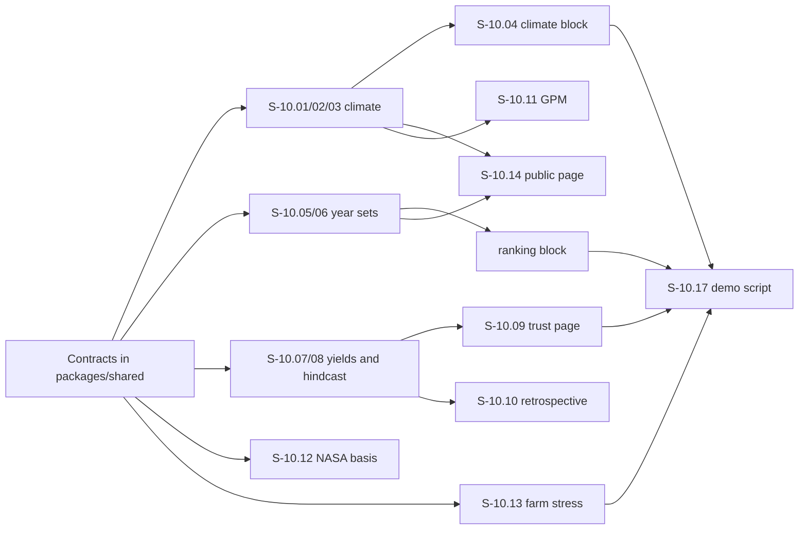

# EP-10 Field Shift: climate evidence

**Goal:** answer the challenge "Field Shift: Adapting Farms with NASA Data" on the screen in the first minute: show how the climate of this field has shifted (NASA POWER 1981–2025), show whether the recommended rotation still wins under the recent climate, prove the model on past seasons with its real error, and give one farm-level number for a repeat of 2022.
**RFC:** §7.3 (weather runs), §7.7 (horizon), §10.6 (backtesting, promoted from P2). **Tech Design:** §6.2, §9, §14. **Design:** 08 Field, 10 Rotation, 09 Rec, 04 Main, new 19 Trust, new 20 Explore.
**Status:** approved by the owner on 2026-11-15.

## Decisions taken with the owner (2026-11-15)

| # | Question | Decision |
| --- | --- | --- |
| D1 | Public page vs "no demo data" (PD v2.6) | Public page without sign-up: climate shift for any clicked point; rotation only for a few ready outlines of real fields, computed live from real data and cached. No hidden company, nothing invented. |
| D2 | Actual yields for the hindcast | USDA NASS Quick Stats API with the owner's key (`NASS_API_KEY`), county level, cached. |
| D3 | SMAP and GPM (named in docs, absent in code) | Connect GPM IMERG as an independent check of POWER precipitation. Remove SMAP from docs and copy. |
| D4 | How to show the hindcast | Year-to-year deviations as they are: chart, correlation, mean error, missed years with the reason. No parameter fitting. Retrospective labelled "at today's prices, a comparison of two simulations". |

## Defaults chosen by the team (the owner may change any of them)

| # | Topic | Default |
| --- | --- | --- |
| T1 | Two periods | 1981–2000 and 2006–2025 (20 years each). Trend tests use the whole annual series 1981–2025. |
| T2 | Growing season | Northern hemisphere 1 April – 30 September; southern 1 October – 31 March. |
| T3 | Metrics | Mean growing-season temperature; hot days in the flowering window of the field's main crop; growing-season precipitation; longest dry spell (days in a row under 1 mm); growing degree days (base 10 °C, cap 30 °C); last spring frost and first autumn frost (Tmin ≤ 0 °C); frost-free days. |
| T4 | Significance | Theil–Sen slope per decade; Mann–Kendall, two-sided, α = 0.05, with trend-free pre-whitening when lag-1 autocorrelation is significant. Not significant → the block says "no clear trend" and shows the slope greyed with that word next to it. |
| T5 | Flowering windows | New file `data/crop-flowering.json`: window and heat threshold per crop, each with a cited source, `verified: false` until the owner reviews. Crop unknown → fallback "days above 35 °C in June–August", labelled as a fallback. |
| T6 | Resolution note | Every climate block states that NASA POWER is a grid of about 55 km: neighbouring fields share the same numbers. |
| T7 | Year sets | "All years" (default, unchanged), "Climate 1981–2000", "Last 15 years", "Trend continued to 2030". Calibration of typical yield stays on all years in every set. |
| T8 | "Trend continued to 2030" | The "last 15 years" set plus a temperature shift and a rainfall factor from the Theil–Sen slopes, extended to 2028 (the middle of 2026–2030) from the middle of the last-15 set. A slope that is not significant is not applied. Weather only: margins are still simulated, never extrapolated. |
| T9 | Wording | "Sensitivity analysis: how the ranking changes with the weather years used. Not a climate forecast." CMIP6 is out of scope. The 5-season rule (2026–2030) applies to the plan; climate shift and hindcast look back. |
| T10 | Headline rule | The recommendation stays computed on all years. When the top option differs between sets, the rotation headline gains one sentence saying so; when it does not, it says the ranking is the same in all sets. |
| T11 | Hindcast measure | Model: relative yield of the crop grown that year (US: from CDL), as a deviation from its own mean. Actual: county yield (NASS) as a deviation from its linear trend; field MODIS NDVI peak as a deviation from the field's mean. Reported: Pearson r, mean absolute error in percentage points, years with an error above 20 points. |
| T12 | Reasons for misses | Only from data: the year's hot days, frost dates, or rain during harvest, each mapped to "the model does not include heat / frost / harvest losses". Otherwise "reason unknown". |
| T13 | Ukraine in the hindcast | NDVI only, plus oblast yields from `data/ua-yields.json` shown as unverified context. No county yields exist. |
| T14 | Farm stress number | 2022 weather placed in season 2026 on every field (one common season); loss = typical margin − margin in that season, times field area, summed. Shown for the current plan and for the recommended option (equal priorities). Fields without 2022 weather or without prices are listed as not counted. |
| T15 | Public rotation | No Gemini on public runs; results kept 7 days; per-IP limits; ready outlines: the Garden City pivot plus the outlines the team exports from its recorded fields. |
| T16 | Demo script | The 3-minute script replaces the 8-step one; the long version stays as an appendix. |

## Open questions for the owner

1. Flowering windows and heat thresholds (T5): review the cited values before they are marked verified.
2. `NASS_API_KEY`: add it to `.env` (free key from quickstats.nass.usda.gov/api).
3. GPM IMERG needs a working NASA Earthdata token (`EARTHDATA_TOKEN`). Is the one in `.env` still valid?
4. Ready outlines (T15): export the three recorded fields (second Kansas pivot, Chase County NE, Logan County CO) or use the Garden City pivot only?
5. Is α = 0.05 acceptable, or should the block also mark "weak evidence" at 0.10?

## Stories

### S-10.01 Climate shift computation

| Priority | Points | RFC | Tech Design | Design | Depends on |
| --- | --- | --- | --- | --- | --- |
| P0 | 5 | §7.3 | §6.2 | — | S-02.03 |

As an agronomist, I want the climate of my field compared between two periods, so that I see what has changed before I plan.

**Acceptance criteria**
- A pure function in a new package `packages/climate` takes the daily NASA POWER series, latitude, the main crop and the flowering table, and returns the metrics of T3 for both periods (T1), their difference, the Theil–Sen slope per decade and the Mann–Kendall result (T4).
- Mann–Kendall and Theil–Sen are tested against published worked examples; ties and missing years are handled; a year with fewer than 90 % of its season days is skipped and counted.
- Frost dates are day-of-year values; a year without frost is reported as such, not as zero.
- Identical inputs give identical output. No network, no clock.

### S-10.02 Flowering windows and heat thresholds

| Priority | Points | RFC | Tech Design | Design | Depends on |
| --- | --- | --- | --- | --- | --- |
| P0 | 3 | §11.3 | §7 | — | — |

As the team, we want flowering windows with sources, so that "hot days at flowering" is not an invented number.

**Acceptance criteria**
- `data/crop-flowering.json`: per crop a window (days after sowing, or calendar dates per region) and a heat threshold in °C, each with title, publisher, URL and access date; `verified: false` until reviewed.
- `pnpm library:check` validates the file. Crops without an entry use the labelled fallback (T5).
- The climate block shows the threshold, the window and "not yet reviewed" while unverified.

### S-10.03 Climate shift API

| Priority | Points | RFC | Tech Design | Design | Depends on |
| --- | --- | --- | --- | --- | --- |
| P0 | 3 | §10.2 | §9, §14.1 | — | S-10.01 |

As an agronomist, I want the climate shift within seconds of adding a field, so that I do not wait for the satellite history.

**Acceptance criteria**
- `GET /api/w/:ws/fields/:id/climate-shift` reads the cached POWER series (not the field history) and returns `pending` until the POWER task is done, then `ready`, or `unavailable` with the reason.
- The response carries the dataset name, the period and the last data date. Contract in `packages/shared`.
- Workspace isolation is tested; the contract collection covers the route.

### S-10.04 Climate shift block on the field and rotation pages

| Priority | Points | RFC | Tech Design | Design | Depends on |
| --- | --- | --- | --- | --- | --- |
| P0 | 5 | §9 | §6.2 | 08 Field, 10 Rotation | S-10.03 |

As an agronomist, I want the shift as the first block, so that the answer to "what changed here" comes first.

**Acceptance criteria**
- The block is the first on the field Overview and the first on the rotation page; it renders while the history gather is still running.
- Each metric: both period values, the signed difference with units of the field's country, an arrow, and the words "clear trend" or "no clear trend" (never colour alone).
- The 55 km note (T6) and the source line are always visible. UA and EN copy. Works at 390 px.

### S-10.05 Weather year sets in the engine

| Priority | Points | RFC | Tech Design | Design | Depends on |
| --- | --- | --- | --- | --- | --- |
| P0 | 5 | §7.3, §7.7 | §6.2 | — | S-06.02, S-10.01 |

As the system, I want rotation runs on a chosen set of weather years, so that the ranking can be compared between climates.

**Acceptance criteria**
- `EngineInput.yearSet`: `all` (default), `climate-1981-2000`, `last-15`, `trend-2030` (T7, T8). `all` gives exactly today's results (same seed, same numbers).
- Calibration and the stress run are unchanged by the set. The engine version is bumped.
- `trend-2030` applies only significant slopes and returns which shifts it applied.
- Tests: determinism per set; `all` regression; a set with fewer than 10 seasons is refused with a clear error.

### S-10.06 Ranking by year set

| Priority | Points | RFC | Tech Design | Design | Depends on |
| --- | --- | --- | --- | --- | --- |
| P0 | 5 | §8.2 | §9 | 10 Rotation | S-10.05 |

As an agronomist, I want to see whether the recommended rotation still wins in the recent climate, so that I do not plan for the 1990s.

**Acceptance criteria**
- An endpoint returns, per year set, the order of the shown options and their margins and drought scores; results are cached like other runs.
- The rotation page shows a block "Sensitivity to the weather years" with the three sets side by side, the label of T9, and the sentence of T10 in the headline.
- When the order is the same in all sets, the block says so in one line.
- The assistant never calls this a forecast (golden question added in S-10.16).

### S-10.07 USDA NASS county yields

| Priority | Points | RFC | Tech Design | Design | Depends on |
| --- | --- | --- | --- | --- | --- |
| P0 | 5 | §5 | §7 | — | — |

As the team, we want real county yields, so that the model is compared with what happened.

**Acceptance criteria**
- A source adapter for NASS Quick Stats: county, crop, year, yield, irrigated or non-irrigated practice where published; key from `NASS_API_KEY`; cached; a recorded fixture for the demo counties.
- Without the key the hindcast says "county yields not connected" and uses NDVI only; nothing is invented.
- Units are converted to t/ha with the conversion stated; the licence line is added to `THIRD-PARTY-NOTICES.md`.

### S-10.08 Hindcast computation

| Priority | Points | RFC | Tech Design | Design | Depends on |
| --- | --- | --- | --- | --- | --- |
| P0 | 8 | §10.6 | §6.2 | — | S-10.07 |

As an agronomist, I want the model run on past seasons, so that I know how far to trust it.

**Acceptance criteria**
- The engine exports a function that simulates one past season with the real weather for the crop grown that year and returns the relative yield.
- The service returns, per year, the model deviation, the county yield deviation and the NDVI deviation (T11), plus Pearson r, mean absolute error and the missed years with reasons (T12).
- No parameter is tuned to improve the result; the caveat for unverified crop parameters is carried.
- 2022 for the Garden City field is returned as a named case.
- A poor result is returned as it is, with its numbers.

### S-10.09 Page "How far can you trust this"

| Priority | Points | RFC | Tech Design | Design | Depends on |
| --- | --- | --- | --- | --- | --- |
| P0 | 5 | §9 | §6.2 | 19 Trust | S-10.08 |

As an agronomist, I want one page with model against actual, so that the error is in plain sight.

**Acceptance criteria**
- `/fields/:id/trust`, linked from Data & history, from the reliability line on the rotation page and from the NASA block.
- Chart model vs county yield vs NDVI by year (marks differ by shape and label, not only colour), table view, r, mean error, list of missed years with the reason, and a plain list "what the model does not include".
- The 2022 case is shown first for a field that has it. Ukraine follows T13.

### S-10.10 Rotation retrospective 2018–2022

| Priority | Points | RFC | Tech Design | Design | Depends on |
| --- | --- | --- | --- | --- | --- |
| P1 | 5 | §7.7 | §6.2 | 19 Trust | S-10.08 |

As an agronomist, I want to see what the recommended rotation would have done in 2018–2022, so that the advice is tested on real weather.

**Acceptance criteria**
- The current rotation and the recommended one are simulated over the real weather of 2018–2022; margins per season and the sum are shown.
- The block is labelled "at today's prices; a comparison of two simulations, not what the field earned".
- Agronomy-only mode shows relative yield instead of money.

### S-10.11 GPM IMERG precipitation check

| Priority | Points | RFC | Tech Design | Design | Depends on |
| --- | --- | --- | --- | --- | --- |
| P1 | 5 | §5 | §7 | 08 Field | S-10.01 |

As the team, we want a second NASA rainfall record, so that the precipitation shift does not rest on one dataset.

**Acceptance criteria**
- An adapter reads GPM IMERG monthly precipitation for the field's cell (2001 onwards) with the Earthdata token; cached; fixture recorded.
- The climate block shows whether IMERG agrees with POWER on the direction of the growing-season rainfall change since 2001, and the two numbers.
- When IMERG is not available the line says so; no other result depends on it.
- SMAP is removed from the docs, `CLAUDE.md`, the README, `THIRD-PARTY-NOTICES.md` and unused copy.

### S-10.12 "What NASA data contributed here"

| Priority | Points | RFC | Tech Design | Design | Depends on |
| --- | --- | --- | --- | --- | --- |
| P0 | 5 | §9 | §9 | 09 Rec, 10 Rotation | S-10.03 |

As a judge, I want to see which NASA dataset each conclusion rests on, so that the use of NASA data is not a claim in a footer.

**Acceptance criteria**
- The recommendation and rotation responses carry a list: dataset, period used, last data date, and the conclusion it supports. Built from the data actually used, never a fixed string.
- A block on the recommendation page and on the rotation page shows this list; other sources (USDA, ESA, Open-Meteo) follow in a second, quieter list.
- Hard-coded "NASA POWER 1981–2025" and "USDA NASS" strings are replaced by data; "USDA NASS" appears for prices only with "typed in from the NASS 2025 report".

### S-10.13 Farm stress test

| Priority | Points | RFC | Tech Design | Design | Depends on |
| --- | --- | --- | --- | --- | --- |
| P0 | 5 | §7.3 | §9 | 04 Main | S-06.03 |

As an owner, I want one number for a repeat of 2022 across all fields, so that I see what the plan protects.

**Acceptance criteria**
- The engine stores the 2022 result for each of the 5 seasons; existing output is unchanged.
- `GET /api/w/:ws/farm-stress` returns the margin at risk (T14) for the current plan and the recommended plan, the fields counted and the fields not counted with the reason. No new model.
- The home page shows the two numbers and the difference for both roles, with a link to the fields behind it.

### S-10.14 Public page for judges

| Priority | Points | RFC | Tech Design | Design | Depends on |
| --- | --- | --- | --- | --- | --- |
| P0 (climate) / P1 (rotation) | 8 | §14 | §14.1 | 20 Explore | S-10.01, S-10.05 |

As a judge, I want to try it without an account, so that I can check it on a place I know.

**Acceptance criteria**
- `/explore`, no sign-in: click the map or pick a ready outline → the climate shift within seconds. UA and EN.
- Public API with per-IP limits and a daily cap; POWER cached per grid cell; nothing is written to any workspace.
- Ready outlines of real fields (T15) also show the rotation and the year-set comparison, computed live without a field record, without Gemini, kept 7 days. A clicked point shows climate only and says why.
- Every number is from real data; a failed source is shown as failed.

### S-10.15 Deploy readiness

| Priority | Points | RFC | Tech Design | Design | Depends on |
| --- | --- | --- | --- | --- | --- |
| P0 | 3 | §18 | §17 | — | — |

As the team, we want the deploy files ready for a public host, so that the deploy day has no surprises.

**Acceptance criteria**
- The runbook and `.env.example` document `NASS_API_KEY`, `EARTHDATA_TOKEN` (now used), `GEMINI_DAILY_TOKEN_BUDGET`, `GEMINI_DAILY_CALL_BUDGET` (with a non-zero recommended value), `S3_BUCKET` for photos, the instance metadata hop limit, and the boundaries load check.
- The reverse proxy has a request body limit and a rate limit for `/api/public/*`.
- The post-deploy check list covers `/explore`. The team deploys; no cloud call is made from this repository's tooling by the assistant.

### S-10.16 Assistant and golden questions

| Priority | Points | RFC | Tech Design | Design | Depends on |
| --- | --- | --- | --- | --- | --- |
| P1 | 3 | §12.3, §12.7 | §12 | 14 Assistant | S-10.03, S-10.06 |

As an agronomist, I want to ask the assistant about the climate shift, so that it is explained in words.

**Acceptance criteria**
- Tools `get_climate_shift` and `get_year_set_ranking` return the same numbers as the screens; the number check covers them.
- Golden questions (UA and EN): the assistant never calls the sensitivity analysis a forecast, says "no clear trend" when it is not significant, and keeps "5 seasons, 2026–2030" for the plan.

### S-10.17 Three-minute demo script

| Priority | Points | RFC | Tech Design | Design | Depends on |
| --- | --- | --- | --- | --- | --- |
| P0 | 2 | — | — | — | all above |

As the team, we want a 3-minute script, so that the judges see the answer to the challenge first.

**Acceptance criteria**
- `docs/demo-script.md` (UA and EN): climate shift of the Garden City field → the rotation that accounts for it → proof on 2022 → farm stress test → 20 seconds on the morning brief and the assistant. Each step has a time box, the real numbers from the app and a fallback.
- The 8-step script stays as an appendix.

## Order and parallel work

Total: 17 stories, 80 points (P0: 67, P1: 13; S-10.14 is counted as P0).
